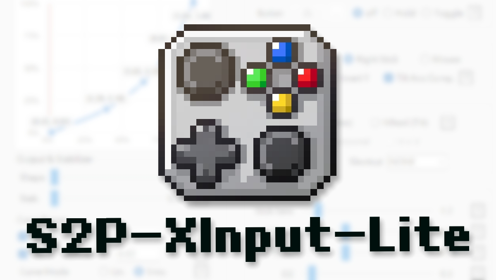
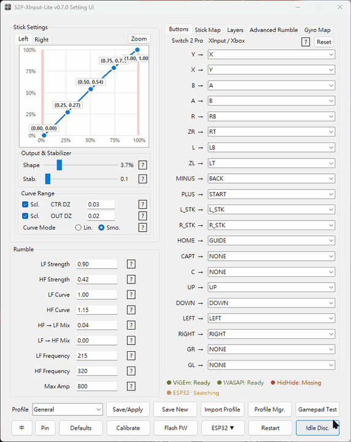
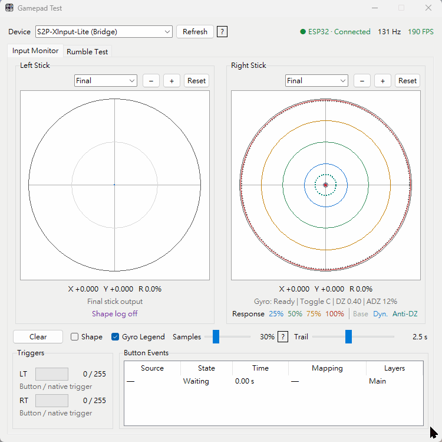
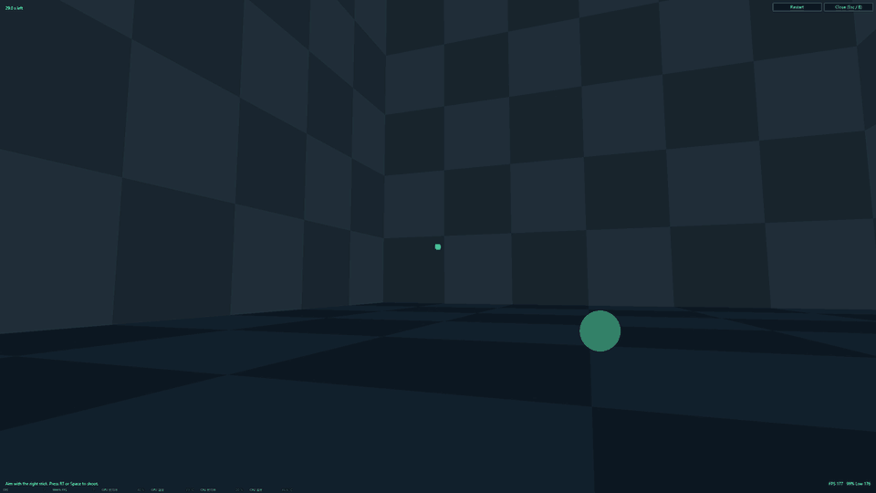
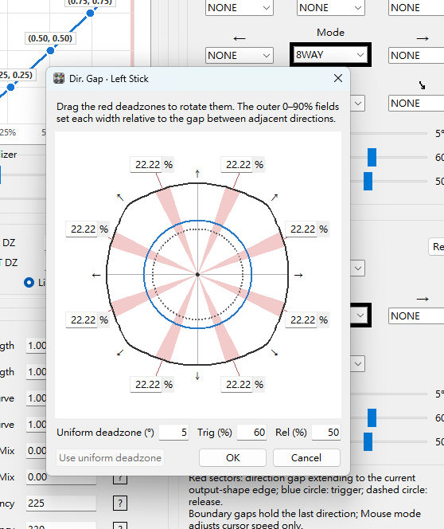
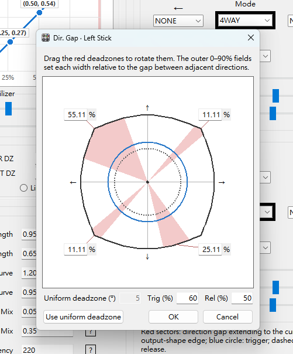

# S2P-XInput-Lite

[繁體中文](README_zh-TW.md) · [User Guide](manual/USER_GUIDE.md) · [繁體中文使用手冊](manual/USER_GUIDE_zh-TW.md) · [v0.8.2 release notes](RELEASE_NOTES_v0.8.2.md)

**[Download the latest Windows release](https://github.com/duoduo-88/S2P-XInput-Lite/releases/latest)** · **[Support the project on Ko-fi](https://ko-fi.com/duoduo88)**

S2P-XInput-Lite lets Windows games use a Switch 2 Pro Controller as an
XInput-compatible (Xbox) controller. It connects over wired USB, an ESP32-S3
USB bridge, or native Windows BLE, and adds stick tuning, button and direction
mapping, mapping layers, gyro aiming, rumble, and audio-driven rumble. The
bundled Gamepad Tester checks input, rumble, and report rate, and includes a
2D/3D Aim Test.

> [!IMPORTANT]
> **v0.8.2 bundles ESP32-S3 firmware S2P-FW 1.0.9.** It brings the radial
> gyro deadzone, button spike suppression, per-axis gyro compensation, and
> gamepad combos to Android USB HID standalone mode. If you use the ESP32-S3 bridge, open
> **Flash FW** in the main window to check and update your firmware.
> [Flashing instructions](manual/USER_GUIDE.md#flash-esp32-s3)

  
  

> This is an independent, unofficial community project. It is not affiliated with, endorsed by, sponsored by, or certified by Nintendo, Microsoft, Espressif Systems, Apple, or Google.

## Quick start

1. Download the release ZIP and extract **all** of it to a new folder.
2. If ViGEmBus is not installed, run `app\driver\Install-ViGEmBus.bat`.
3. For wired USB, optionally install [HidHide](https://github.com/nefarius/HidHide/releases/latest)
   so games see only the virtual controller.
4. Connect the controller before opening Steam or another controller tool.
   For native BLE, turn Bluetooth on and hold the controller's **SYNC** button
   after starting the program. **Do not pair it in Windows Bluetooth settings.**
5. Run **S2P-XInput-Lite.exe**, choose a profile, and select **Save/Apply**.

The [User Guide](manual/USER_GUIDE.md) covers every setting step by step with
screenshots, and the `?` buttons in the application explain each field.

| In the release folder | Purpose |
|---|---|
| **S2P-XInput-Lite.exe** | Settings and controller connection |
| **GamepadTester.exe** | Standalone Gamepad Tester |
| **START_HERE.txt** | Quick-start notes |
| **app/** | Runtime, firmware, drivers, notices, and manuals. Keep it beside both EXEs. |

The release includes a portable Python runtime, so no separate Python
installation is needed. To upgrade, extract the new version to a new folder and
use **Import Settings** to bring over your profiles, layers, and calibration.

## Requirements

- Windows 10 or 11
- Switch 2 Pro Controller
- ViGEmBus 1.22.0
- A USB-C data cable, Bluetooth, or a compatible ESP32-S3 N16R8 bridge
- Optional for wired USB: HidHide

## Features

**Connection**
- Wired USB is used first, then ESP32-S3, then native BLE, with live 6-axis /
  9-axis sensor status.
- XInput-compatible virtual controller output through ViGEmBus.
- Low-latency input handling keeps every button press while always using the
  newest stick and motion report.
- Live connection, battery, ESP32, ViGEmBus, WASAPI, and HidHide status.
  Battery level comes from a measured discharge curve and also shows on the
  controller's player lights.
- Optional idle disconnect for wireless connections. Press any button to wake.

**Sticks and mapping**
- Per-controller stick calibration, curves, deadzones, smoothing,
  stabilization, and output-shape adjustment.
- Button, keyboard, mouse, stick-direction, linear-trigger, and linear-scroll mapping.
- `4WAY` and `8WAY` stick mapping with a radar editor for per-direction deadzones.
- Mapping layers that switch a different set of mappings on while a button
  chord is held or toggled.

**Gyro**
- Gyro to an XInput stick or the mouse, in Aim (Center) or Wheel (Tilt) mode.
- Radial deadzone, adaptive deadzone, speed-adaptive smoothing, sensitivity
  curve, and tilt-axis compensation.
- Button guard that freezes output or suppresses spikes when a button press shakes the controller.
- Per-axis compensation multipliers for keeping fine aim steady after raising
  the in-game look speed.

**Rumble**
- The same XInput-to-HD Rumble 2 conversion over USB, ESP32, and BLE, always
  sending only the latest frame and prioritizing stop frames.
- Audio-reactive rumble that analyzes six frequency bands, with Game, Audio,
  and Mix sources.

**Profiles**
- Game profiles switch stick, gyro, rumble, audio, and mapping settings
  together, and apply to a running connection without reconnecting.
- **Import Settings** migrates profiles, mapping layers, and calibration from
  an older installation with a preview, conflict choices, and rollback.
- Traditional Chinese and English interface.

**ESP32-S3**
- Write a profile to the ESP32 and run it as an Android USB HID controller
  without the Windows program. Controller button chords and the CDC console
  remain available for recovery.
- Built-in firmware flashing that checks the installed version first.

**Gamepad Tester**
- Input Monitor with stick trails, output-shape measurement, button events,
  and trigger values.
- 2D and 3D Aim Test with Tracking, Targets, and Timed Targets, plus a gyro
  compensation preview and calculator. [Aim Test guide](manual/USER_GUIDE.md#aim-test-guide)
- Rumble Test, Raw HID Report Rate Test with P50/P95/P99 intervals, and ESP32
  Diagnostics with exportable reports.
- Update notifications that open the official GitHub release page. The
  application never downloads, runs, or replaces files on its own.

The tester is built for a Switch 2 Pro Controller connected through
S2P-XInput-Lite. Other XInput, WinMM, and Raw HID controllers can be tested
too, but S2P-specific information such as mappings, sensors, and ESP32
diagnostics will be missing.

### Aim Test

Aim Test reads the S2P bridge output or a physical controller as Windows sees
it, and adds no response curve, deadzone, or aim assist of its own. Direct2D
draws at the monitor's current refresh rate, with FPS and 99% Low shown in the
corner.

### Directional deadzones

Drag each red sector in the radar editor to rotate it, and set its width as a
percentage of the angle between adjacent directions.

  
  

## ESP32-S3 modes

| Mode | Windows program | Output |
|---|---|---|
| **Bridge** | Must stay open | XInput through ViGEmBus, with rumble and audio rumble |
| **Android USB HID standalone** | Not needed | A standard USB HID controller (`S2P Mobile Gamepad`), input only |

Standalone mode currently works with Android devices that support USB OTG and
recognize this HID controller. Compatibility varies by device, Android version,
and game, so plug-and-play operation cannot be guaranteed. macOS, iOS, and
iPadOS are not supported. Standalone mode does not provide game rumble,
Windows keyboard or mouse output, audio rumble, per-application profile
switching, gyro mouse, or BLE HID.
[USB modes, recovery, and validation](docs/usb-hid-standardization.md)

## Limitations

- Windows only, one controller at a time.
- No Joy-Con pairing or PS5 controller emulation.
- XInput has no raw motion sensors, so gyro is mapped to a stick or the mouse.
- HidHide is not bundled. Without it wired input still works, but games may
  see both the physical controller and the virtual one.
- If wired status shows Basic mode, fully exit Steam or other controller tools,
  reconnect the controller, and start this application first.

## Technical notes

Settings files, HidHide, rumble, and firmware details

- Settings and per-controller stick calibration are stored in
  `app/src/config.ini`. A missing file is created from
  `app/src/profiles/System Default.ini`, and keys missing from an older file
  are added without overwriting existing values. Keep `System Default.ini` in
  every release package.
- The first launch provides General, Audio, FPS-COMP, FPS-IMM, Racing, Action,
  and Rhythm profiles. **System Default** is a read-only baseline, and
  **Defaults** resets the current controls without deleting saved profiles or calibration.
- Mapping layer files are global and stored in `app/src/layers`. Each profile
  stores which layers are enabled and their order. Only the highest-priority
  matching layer is active: held layers win over toggled ones, then the list order decides.
- Gyro zero-bias is measured again after every connection. Keep the controller
  still for about 0.5 seconds. Gyro output starts after 16 stable samples, and
  sampling continues up to 64.
- When a wired controller is found and HidHide is installed but not set up,
  the application asks before adding `app\runtime\python.exe`,
  `app\src\raw_hid_probe.exe`, and the selected Nintendo HID to HidHide. Other
  applications' entries are kept. **Defaults** removes only the entries this
  program added. If setup fails, close HidHide Configuration Client and retry.
- Each HD Rumble 2 frame packs a 9-bit LF frequency, 10-bit LF amplitude,
  9-bit HF frequency, and 10-bit HF amplitude. Frequencies range from `0` to
  `511` and roughly correspond to Hz.
- The amplitude range `0–1023` is the protocol field range, not a certified
  safe limit for continuous output. The default maximum is `500`, about 49% of
  the field, because higher amplitudes make a faint tapping sound more likely
  when rumble changes quickly. Lower it if you hear tapping or other noise.
- Connection and **Pin** feedback use two short pulses (LF `225`, HF `481`,
  amplitude `800`) on every transport. HF `481` is only for this cue.
- Before flashing, the application compares the ESP32 firmware with the bundled
  `S2P-FW 1.0.9` and checks for a real 16 MB flash chip. Smaller or unknown
  sizes are rejected.
- In Bridge mode, the ESP32 releases BLE after 3 seconds without CDC or 8
  seconds without a host heartbeat. See the
  [shutdown investigation](docs/bridge-host-shutdown.md).
- The status line shows 9-axis when magnetometer data keeps arriving, or 6-axis
  when only gyro and accelerometer data are active. Wired USB always requests
  the full sensor report.

Historical latency measurements

These measurements predate v0.7.14 / S2P-FW 1.0.7 and do not validate the
current USB descriptors or modes.

- Wired USB input: 250 Hz, 4 ms report interval, with no queuing or drops
  during concurrent rumble stress tests.
- ESP32 input: about 132 Hz. The low-latency firmware reduced host arrival
  p50 / p95 from 7.986 / 8.059 ms to 7.500 / 7.595 ms.
- Native Windows BLE: 66.7 Hz / 15 ms, the minimum WinRT `throughput_optimized` interval.
- Game rumble changes and stop frames use 7.5 ms priority pacing over ESP32 and
  wired USB (about 8 ms measured) and 15 ms over BLE. Wired audio / Mix updates
  use 16.6 ms (about 60 Hz).

## Upstream and license

Parts of this project are based on or derived from
[Switch2Connect](https://github.com/TommyWabg/Switch2Connect) by TommyWabg and
have been modified and reorganized for this project.

S2P-XInput-Lite is licensed under the [GNU General Public License v3.0](LICENSE).
See [THIRD_PARTY_NOTICES.md](THIRD_PARTY_NOTICES.md) for attribution and
[third_party/README.md](third_party/README.md) for the license texts and source
materials shipped with releases. The GitHub repository includes the complete
ESP32 firmware source. Release packages include the flashing tool and firmware
images under `app/esp32s3`.

[Release history](https://github.com/duoduo-88/S2P-XInput-Lite/releases) ·
[Source](https://github.com/duoduo-88/S2P-XInput-Lite/tree/main)

## Compatibility and trademarks

Product names and trademarks are used only to identify compatible hardware,
software, and interfaces. “XInput-compatible” describes interoperability with
software that accepts XInput controller input; it does not mean that this
project or its ESP32 firmware is licensed, certified, approved, or manufactured
by Microsoft.

The firmware uses Espressif/TinyUSB shared default USB identifiers: Bridge
`303A:4001` (CDC) and `303A:4005` (CDC + HID, `S2P Mobile Gamepad`). These are
shared class defaults, not a dedicated PID allocation or USB certification.
VID/PID and product names only locate candidates; S2P operations require a
matching firmware identity and compatible capabilities. Legacy `CAFE:4020`,
`CAFE:4021`, and `CAFE:4022` are upgrade candidates only.
See [mode switching, migration, recovery, and official references](docs/usb-hid-standardization.md).

Nintendo Switch is a trademark of Nintendo. Windows and Xbox are trademarks of
Microsoft. ESP32 is a trademark of Espressif Systems. Apple, macOS, iOS, and
iPadOS are trademarks of Apple Inc. Android is a trademark of Google LLC. All
other trademarks are the property of their respective owners.
