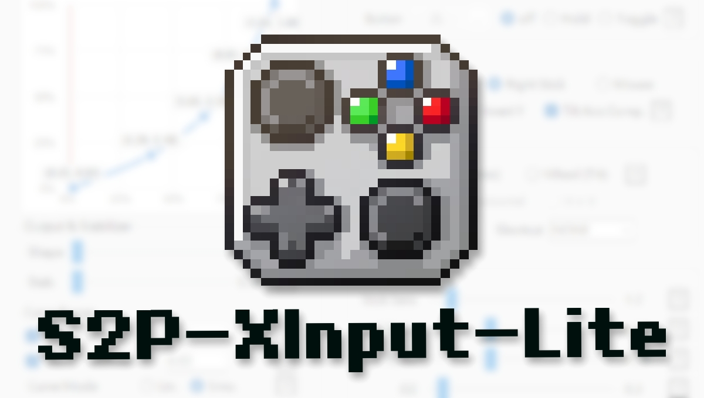
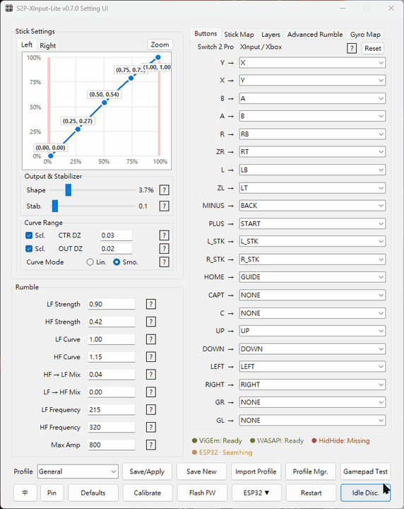
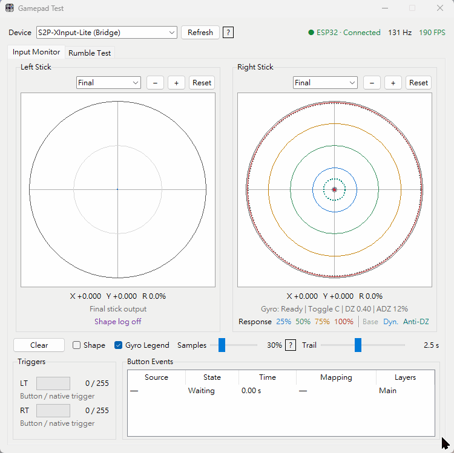
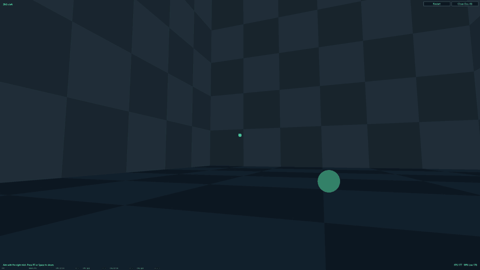
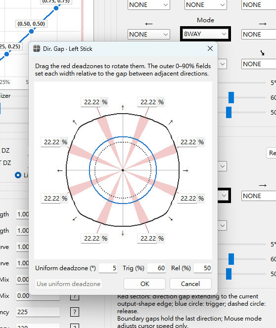
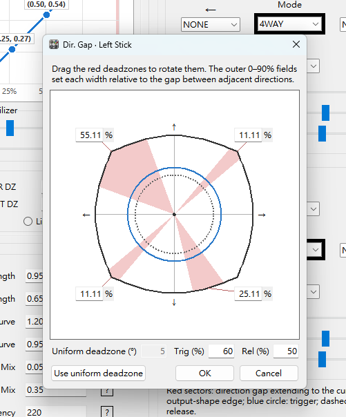

# S2P-XInput-Lite

[English](README.md) · [使用手冊](manual/USER_GUIDE_zh-TW.md) · [English Guide](manual/USER_GUIDE.md) · [v0.8.2 更新說明](RELEASE_NOTES_v0.8.2.md)

**[下載最新 Windows 版本](https://github.com/duoduo-88/S2P-XInput-Lite/releases/latest)** · **[在 Ko-fi 贊助本專案](https://ko-fi.com/duoduo88)**

S2P-XInput-Lite 讓 Windows 遊戲把 Switch 2 Pro Controller 當成 XInput 相容（Xbox）手把使用。
可透過 USB 有線、ESP32-S3 USB 橋接器或 Windows 原生 BLE 連線，並提供搖桿調整、按鍵與方向映射、
映射層、陀螺儀瞄準、震動與音訊震動。隨附的手把測試程式可檢查輸入、震動與回報率，也內建 2D／3D
瞄準測試。

> [!IMPORTANT]
> **v0.8.2 隨附 ESP32-S3 韌體 S2P-FW 1.0.9。** Android USB HID 獨立模式新增圓形陀螺儀死區、
> 按鍵突波抑制、分軸陀螺儀補償與手把組合鍵。使用 ESP32-S3 橋接器時，請在主視窗按 **刷入韌體 ▼ → 刷入內建韌體**
> 確認並更新韌體。[刷寫步驟](manual/USER_GUIDE_zh-TW.md#flash-esp32-s3)

  
  

> 本專案是獨立、非官方的社群作品，未獲 Nintendo、Microsoft、Espressif Systems、Apple 或 Google 授權、認證、贊助或背書，亦與這些公司無關。

## 快速開始

1. 下載發佈 ZIP，**完整**解壓縮到新的資料夾。
2. 若尚未安裝 ViGEmBus，執行 `app\driver\Install-ViGEmBus.bat`。
3. USB 有線模式可另外安裝 [HidHide](https://github.com/nefarius/HidHide/releases/latest)，讓遊戲只看到虛擬手把。
4. 先連接手把，再開啟 Steam 或其他手把工具。原生 BLE 請開啟藍牙，啟動程式後按住手把的 **SYNC** 鍵；
   **不要在 Windows 藍牙設定中手動配對。**
5. 執行 **S2P-XInput-Lite.exe**，選擇方案後按 **儲存/套用**。

[使用手冊](manual/USER_GUIDE_zh-TW.md) 附截圖逐步說明每項設定；程式內各欄位旁的 `?` 也有詳細說明。

| 發佈資料夾內容 | 用途 |
|---|---|
| **S2P-XInput-Lite.exe** | 設定與手把連線 |
| **GamepadTester.exe** | 獨立的手把測試程式 |
| **START_HERE.txt** | 快速使用說明 |
| **app/** | 執行環境、韌體、驅動、授權聲明與手冊，請和兩個 EXE 放在一起 |

發佈包已包含可攜式 Python 執行環境，不必另外安裝 Python。更新時請將新版解壓縮到新資料夾，
再用 **匯入設定** 帶入舊版的方案、映射層與校正資料。

## 系統需求

- Windows 10 或 11
- Switch 2 Pro Controller
- ViGEmBus 1.22.0
- USB-C 資料線、藍牙，或相容的 ESP32-S3 N16R8 橋接器
- USB 有線模式可選用：HidHide

## 主要功能

**連線**
- 依序使用 USB 有線、ESP32-S3、原生 BLE，並即時顯示 6 軸／9 軸感測狀態。
- 透過 ViGEmBus 輸出 XInput 相容虛擬手把。
- 低延遲輸入處理：不漏掉任何按鍵，同時使用最新的搖桿與動作感測報告。
- 即時顯示連線、電量、ESP32、ViGEmBus、WASAPI 與 HidHide 狀態。電量依實測放電曲線估算，
  手把的玩家燈也會顯示。
- 無線連線可設定閒置自動斷線，按任一鍵即可喚醒。

**搖桿與映射**
- 每支手把獨立的搖桿校正、曲線、死區、平滑、防抖與輸出形狀調整。
- 按鍵、鍵盤、滑鼠、搖桿方向、線性扳機與線性滾輪映射。
- `4WAY`、`8WAY` 搖桿方向映射，可用雷達圖逐一調整方向死區。
- 映射層：按住或切換按鍵組合時，改用另一組映射。

**陀螺儀**
- 陀螺儀可輸出到 XInput 搖桿或滑鼠，支援回中（瞄準）與傾斜（方向盤）模式。
- 圓形死區、自適死區、速度自適應平滑、感度曲線與傾斜軸補償。
- 按鍵防晃：按鍵造成手把晃動時，可暫停輸出或抑制突波。
- 分軸補償倍率：調高遊戲內視角速度後，維持原本的微瞄手感。

**震動**
- USB、ESP32 與 BLE 共用同一套 XInput 至 HD Rumble 2 轉換，只送出最新的震動並優先送出停止訊框。
- 音訊震動以六頻段分析聲音，可選遊戲、音訊或混合來源。

**方案**
- 遊戲方案可一起切換搖桿、陀螺儀、震動、音訊與映射設定，執行中的連線不必重連即可套用。
- **匯入設定** 可從舊版安裝遷移方案、映射層與校正資料，提供預覽、衝突選擇與失敗還原。
- 繁體中文與英文介面。

**ESP32-S3**
- 將方案寫入 ESP32，不需 Windows 程式即可當成 Android USB HID 手把使用；手把組合鍵與 CDC 主控台
  可用於救援。
- 內建韌體刷寫，刷寫前會先檢查已安裝的版本。

**擴充工具**
- [S2P-Joystick-Macro](https://github.com/duoduo-88/S2P-Extensions) 等獨立工具可透過 S2P 送出輸入或讀取控制器輸出，
  只能使用你允許的權限。S2P 仍是唯一的虛擬手把，實體搖桿永遠優先。
- 啟用的工具會隨 S2P 啟動與關閉。衝突檢查會列出搖桿衝突、缺少的權限與不明程式，「檢查更新」可查看哪些工具有新版本。
  [擴充工具手冊](manual/USER_GUIDE_zh-TW.md#27-extensions擴充工具)

**手把測試**
- 輸入監看：搖桿軌跡、輸出形狀量測、按鍵事件與扳機數值。
- 2D／3D 瞄準測試：跟槍、點靶、限時點靶，以及陀螺儀補償預覽與補償計算。[瞄準測試手冊](manual/USER_GUIDE_zh-TW.md#aim-test-guide)
- 震動測試、Raw HID 回報率量測（含 P50／P95／P99 間隔），以及可匯出報告的 ESP32 診斷。
- 更新通知只會開啟官方 GitHub Release 頁面，程式不會自行下載、執行或覆蓋任何檔案。

手把測試主要針對透過 S2P-XInput-Lite 連線的 Switch 2 Pro Controller。其他 XInput、WinMM 與 Raw HID
手把也能測試，但會缺少映射、感測器與 ESP32 診斷等 S2P 專屬資訊。

### 瞄準測試

瞄準測試讀取的是 Windows 收到的 S2P 橋接輸出或實體手把輸入，本身不額外套用反應曲線、死區或輔助瞄準。
Direct2D 以螢幕目前的更新率繪圖，角落顯示 FPS 與 99% Low。

### 方向死區

在雷達編輯器拖曳紅色區域可旋轉缺口，並以相鄰方向夾角的百分比設定每區寬度。

  
  

## ESP32-S3 模式

| 模式 | Windows 程式 | 輸出 |
|---|---|---|
| **Bridge**（橋接） | 需要保持開啟 | 透過 ViGEmBus 輸出 XInput，支援震動與音訊震動 |
| **Android USB HID 獨立模式** | 不需要 | 標準 USB HID 手把（`S2P Mobile Gamepad`），僅輸入 |

獨立模式目前支援具備 USB OTG、且能正確辨識此 HID 手把的 Android 裝置。相容性依裝置、Android 版本與
遊戲而異，無法保證所有裝置都能隨插即用；macOS、iOS 與 iPadOS 不在支援範圍內。獨立模式不提供遊戲震動、
Windows 鍵盤／滑鼠輸出、音訊震動、依程式自動切換方案、陀螺儀滑鼠或 BLE HID。
[USB 模式、救援與驗證清單](docs/usb-hid-standardization.md)

## 限制

- 僅支援 Windows，一次只支援一支手把。
- 不支援 Joy-Con 配對或 PS5 手把模擬。
- XInput 無法輸出原始動作感測資料，因此陀螺儀只能映射到搖桿或滑鼠。
- 不隨附 HidHide。未安裝時 USB 有線仍可使用，但遊戲可能同時看到實體手把與虛擬手把。
- 若 USB 狀態顯示 Basic 模式，請完整關閉 Steam 或其他手把工具，重新連接手把，再先啟動本程式。

## 技術細節

設定檔、HidHide、震動與韌體細節

- 設定與每支手把的搖桿校正儲存在 `app/src/config.ini`。檔案不存在時會以
  `app/src/profiles/System Default.ini` 建立；舊設定缺少的欄位會自動補齊，不會覆寫既有值。
  每個發佈包都必須保留 `System Default.ini`。
- 首次啟動提供 General、Audio、Movie、FPS-COMP、FPS-IMM、Racing、Action 與 Rhythm 方案。
  **System Default** 是唯讀基準；**還原預設** 只重設目前畫面，不會刪除已儲存的方案或校正資料。
- 映射層檔案是全域資源，存放在 `app/src/layers`；各方案會保存啟用哪些映射層與其順序。
  同一時間只套用優先權最高的符合映射層：按住優先於切換，其餘依清單順序決定。
- 每次連線後都會重新量測陀螺儀零偏。請保持手把靜止約 0.5 秒；收集 16 個穩定樣本後才開始輸出陀螺儀，
  取樣會持續累積到 64 個。
- 偵測到 USB 手把、HidHide 已安裝但尚未設定時，程式會先詢問，再將 `app\runtime\python.exe`、
  `app\src\raw_hid_probe.exe` 與選定的 Nintendo HID 加入 HidHide。其他程式的 HidHide 項目會保留；
  **還原預設** 只移除本程式加入的項目。設定失敗時，請先關閉 HidHide Configuration Client 再重試。
- 每個 HD Rumble 2 震動訊框封裝 9-bit LF 頻率、10-bit LF 振幅、9-bit HF 頻率與 10-bit HF 振幅。
  頻率範圍 `0`～`511`，約可視為 Hz。
- 振幅 `0`～`1023` 是協議欄位範圍，不是經認證的連續輸出安全上限。預設最大振幅為 `500`
  （約欄位上限的 49%），因為振幅越高，震動快速變化時越容易出現輕微撞擊聲；出現撞擊聲或異音時請調低。
- 連線與 **Pin** 提示在所有連線方式都使用兩次短震動（LF `225`、HF `481`、振幅 `800`）；HF `481` 只用於這個提示。
- 刷寫前會比對 ESP32 韌體與隨附的 `S2P-FW 1.0.9`，並確認實際 Flash 容量為 16 MB；容量不足或無法確認時不會刷寫。
- Bridge 模式下，CDC 連續消失 3 秒或主機心跳逾時 8 秒，ESP32 會解除 BLE。詳見[關閉流程調查](docs/bridge-host-shutdown.md)。
- 持續收到磁力計資料時狀態列顯示 9 軸，只有陀螺儀與加速度計時顯示 6 軸。USB 有線一律要求完整的感測報告。

歷史延遲量測

以下量測早於 v0.7.14／S2P-FW 1.0.7，不代表目前的 USB 描述符與模式已通過驗證。

- USB 有線輸入：250 Hz、4 ms 報告間隔；同時進行震動壓力測試時沒有排隊或丟棄。
- ESP32 輸入：約 132 Hz；低延遲韌體將主機到達時間 p50／p95 從 7.986／8.059 ms 降至 7.500／7.595 ms。
- Windows 原生 BLE：66.7 Hz／15 ms，即 WinRT `throughput_optimized` 的最低間隔。
- 遊戲震動變化與停止訊框在 ESP32 與 USB 有線採用 7.5 ms 優先節流（實測約 8 ms），BLE 為 15 ms；
  USB 音訊／Mix 更新為 16.6 ms（約 60 Hz）。

## 上游專案與授權

本專案部分內容以 TommyWabg 的 [Switch2Connect](https://github.com/TommyWabg/Switch2Connect) 為基礎或由其衍生，
並已為本專案修改與重整。

S2P-XInput-Lite 採用 [GNU General Public License v3.0](LICENSE)。第三方來源與著作權聲明請參閱
[THIRD_PARTY_NOTICES.md](THIRD_PARTY_NOTICES.md)；發佈包所附的完整授權文字與對應源碼位置記錄在
[third_party/README.md](third_party/README.md)。GitHub 原始碼庫包含完整的 ESP32 韌體原始碼；
發佈包則在 `app/esp32s3` 內提供燒錄工具與韌體映像。

[歷史版本](https://github.com/duoduo-88/S2P-XInput-Lite/releases) ·
[原始碼](https://github.com/duoduo-88/S2P-XInput-Lite/tree/main)

## 相容性與商標

文件中的產品名稱與商標僅用於辨識相容的硬體、軟體及介面。「XInput 相容」只表示可與接受 XInput
手把輸入的軟體互通，不表示本專案或其 ESP32 韌體已獲 Microsoft 授權、認證、核准或製造。

韌體採用 Espressif/TinyUSB 的共享預設識別碼：Bridge `303A:4001`（CDC），HID `303A:4005`
（CDC＋HID，`S2P Mobile Gamepad`）。這不是專屬 PID 配發，也不代表 USB 認證或 Espressif 背書。
VID/PID 與產品名稱僅用於尋找候選裝置，S2P 操作仍須驗證韌體身分及相容能力。
舊 `CAFE:4020/4021/4022` 僅供辨識升級候選。[模式切換、遷移、救援與官方參考](docs/usb-hid-standardization.md)。

Nintendo Switch 為 Nintendo 的商標；Windows 與 Xbox 為 Microsoft 的商標；ESP32 為 Espressif Systems 的商標；
Apple、macOS、iOS 與 iPadOS 為 Apple Inc. 的商標；Android 為 Google LLC 的商標。其他商標均屬其各自權利人所有。
