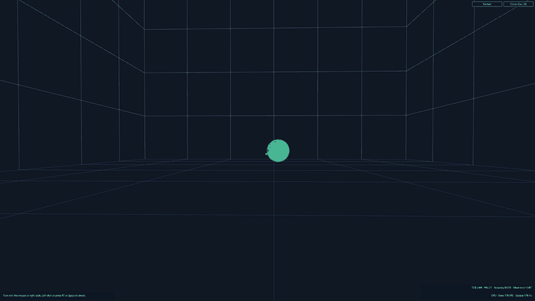
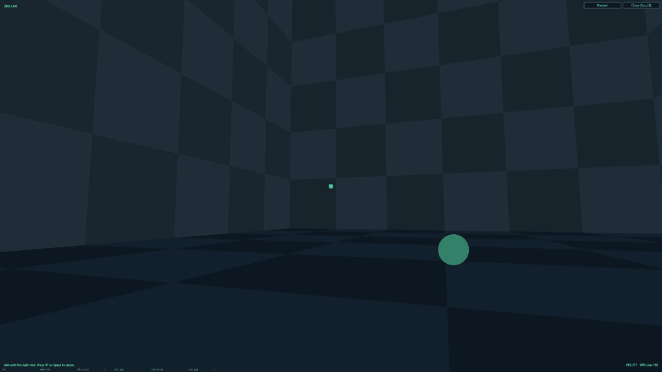

# v0.8.1 — Aim Test fixes and standalone direction deadzones

> [!IMPORTANT]
> **ESP32-S3 firmware update.** v0.8.1 bundles S2P-FW 1.0.8. Use **Flash FW**
> in the main window to check your installed version and update your bridge.
> [Flashing instructions](manual/USER_GUIDE.md#flash-esp32-s3)

## 3D Aim Test comparison / 3D 瞄準測試對比

| v0.8.0 · Wireframe / 線框網格 | v0.8.1 · Filled checkerboard / 填色棋盤 |
| --- | --- |
|  |  |

Select either preview to open the full GIF. 點擊動圖可開啟原尺寸 GIF。

## What's new

- The 3D room uses fixed, low-contrast checkerboard colors to reduce shimmer
  as the camera turns. The side walls are slightly lighter than the end walls,
  and the floor has its own palette.
- The timer is at the upper left, FPS and 99% Low are at the lower right, and
  the end screen centers the results and comparison with the best matching round.
- Controller input takes priority by default. Enable automatic switching in
  Test Settings to use the controller and mouse in the same round.
- 3D mouse aim uses the cursor's actual position after recentering. If Windows
  places the cursor away from the requested center, the offset no longer turns
  the camera while the mouse is still.
- Bundled S2P-FW 1.0.8 applies per-direction 4WAY and 8WAY deadzones to both
  sticks and enabled mapping layers in Android USB HID standalone mode.
- The desktop checks the active profile after writing and verifies the expected
  device, USB mode, and profile after the ESP32 restarts.
- Controller recovery still works when Bridge CDC output stalls. Only a chord
  that requests a different mode can reserve recovery, and legacy input reports
  are excluded from raw chord detection.

Android hardware verification for the new deadzones and recovery behavior is
pending. See the [USB validation checklist](docs/usb-hid-standardization.md).

On a Radeon RX 7900 GRE, the fixed 3D replay averaged 177.0 Direct2D
submissions per second in a 1080p window on a 180 Hz display for both room styles.
At 4K offscreen with a 600 Hz scheduler target, the wireframe and filled room
averaged 593.4 and 593.9 submissions per second, respectively. The P99 interval
went from 2.98 ms to 3.08 ms.

## Installation

Extract the full Windows ZIP into a new folder. Keep **app** beside
**S2P-XInput-Lite.exe** and **GamepadTester.exe**. To upgrade, use **Import Settings**
and select the old folder that contains its EXEs.

## 繁體中文

> [!IMPORTANT]
> **ESP32-S3 韌體有更新。** v0.8.1 隨附 S2P-FW 1.0.8。使用 ESP32-S3 橋接器時，可在主視窗按
> **刷入相容韌體（Flash FW）**，確認目前版本後更新。[刷寫步驟](manual/USER_GUIDE_zh-TW.md#flash-esp32-s3)

- 3D 場景使用固定配色的低對比棋盤方格，減輕轉動視角時的閃爍。左右牆稍亮，地板使用獨立配色。
- 左上顯示計時，右下顯示 FPS 和 99% Low。結束時，成績和同條件最佳成績的差異會顯示在中央。
- 偵測到手把時預設優先使用手把。可在測試設定開啟自動銜接，在同一回合交替使用手把和滑鼠。
- 3D 滑鼠瞄準改用游標回中後的實際落點。Windows 調整落點時，這個偏移不會在滑鼠靜止時轉動視角。
- 隨附的 S2P-FW 1.0.8 可在 Android USB HID 獨立模式套用左右搖桿與啟用映射層的 4WAY／8WAY 逐區方向死區。
- 桌面程式在寫入後確認生效的設定，並在 ESP32 重新啟動後核對裝置、USB 模式與設定。
- Bridge 的 CDC 傳送卡住時仍能用手把救援。只有要求切換到其他模式的組合鍵才會取得救援控制權，舊式輸入報告會略過原始組合鍵判定。

新死區與救援行為仍待 Android 實機驗證。詳見 [USB 驗證清單](docs/usb-hid-standardization.md)。

在 Radeon RX 7900 GRE 上以同一段 3D 回放測試，1080p 視窗於 180 Hz 螢幕上，線框版和填色版
平均都是每秒 177.0 次 Direct2D 繪圖提交。4K 離屏測試將排程目標設為 600 Hz，兩版平均分別為
每秒 593.4 和 593.9 次提交，P99 幀間隔從 2.98 ms 增至 3.08 ms。

### 使用方式

將完整 Windows ZIP 解壓縮到新資料夾。請將 **app** 與 **S2P-XInput-Lite.exe**、
**GamepadTester.exe** 放在一起。升級時可用 **匯入設定** 選取舊版含 EXE 的程式根目錄。
