# S2P-XInput-Lite v0.7.14 User Guide

[繁體中文](USER_GUIDE_zh-TW.md)

This guide covers installation, connections, profiles, stick tuning, mapping,
gyro controls, rumble, HidHide, ESP32-S3 bridge and standalone operation, and
the Gamepad Test, report-rate, diagnostics, and About pages in
S2P-XInput-Lite v0.7.14.

This guide matches the published desktop v0.7.14 release and bundled S2P-FW
1.0.7. The firmware build and descriptor checks passed; physical Windows and
Android hardware validation remains pending.

The screenshots use the English interface. Select **中 / En** in the lower-left corner of the main window to switch languages without changing the layout.

> [!IMPORTANT]
> After changing a value, select **Save/Apply** to write it to the current profile and apply it to the active connection. Switching profiles or closing the window does not save pending changes.

> [!TIP]
> Create a personal profile before experimenting. **System Default** is a read-only reference profile and cannot be overwritten.

## Contents

- [1. Getting started](#1-getting-started)
- [2. Main window and profiles](#2-main-window-and-profiles)
- [3. Stick settings](#3-stick-settings)
- [4. Button and direction mapping](#4-button-and-direction-mapping)
- [5. Mapping Layers](#5-mapping-layers)
- [6. Gyro mapping](#6-gyro-mapping)
- [7. Rumble settings](#7-rumble-settings)
- [8. HidHide and ESP32-S3](#8-hidhide-and-esp32-s3)
- [9. Gamepad Test](#9-gamepad-test)
- [10. Quick controls](#10-quick-controls)
- [11. Troubleshooting](#11-troubleshooting)
- [Appendix: recommended tuning order](#appendix-recommended-tuning-order)

---

## 1. Getting started

### 1.1 Requirements

- Windows 10 or Windows 11.
- A Switch 2 Pro Controller and a data-capable USB-C cable.
- ViGEmBus 1.22.0 for creating the virtual XInput controller.
- HidHide is recommended for wired USB to prevent games from receiving both the physical HID device and the virtual XInput controller.
- A compatible ESP32-S3 board is required for ESP32 bridge mode.

### 1.2 First launch

The ZIP's main folder contains **S2P-XInput-Lite.exe**, **GamepadTester.exe**,
**START_HERE.txt**, and **app/**. Open the first EXE for Settings or the second
for the standalone tester. Keep the app folder beside the EXEs; it contains
the runtime, firmware, drivers, licenses and full manuals.

1. Extract the complete release archive into a new folder. Do not run the application from inside the archive.
2. If ViGEmBus is missing, run `app\driver\Install-ViGEmBus.bat`.
3. Connect the controller or ESP32-S3.
4. Run `S2P-XInput-Lite.exe`.
5. Confirm that **ViGEm: Ready** appears in green at the bottom of the window.
6. Select a profile, adjust the settings, and select **Save/Apply**.

The connector opens a separate black command window with live pairing, connection, input, and transport status. Keep that command window open while playing; closing it stops the active connection. Minimizing the settings UI moves only its main window into the Windows notification area. The black command window stays visible and the connection continues. Click the notification icon to restore Settings, or right-click it for **Show Settings** and **Exit**.

The settings UI and Gamepad Tester each allow only one running instance. Launching either one again restores and foregrounds its existing window instead of creating another process that could compete for the controller.

> [!NOTE]
> When updating, extract into a new folder and use **Import Settings** to select the old folder containing its EXEs. Both older `src/` and newer `app/src/` installations are supported. To transfer only config.ini manually, copy it into the new `app/src/config.ini` while the application is closed.

### 1.3 Connection methods

#### Wired USB

Connect the controller directly to the PC with USB-C. This normally provides low latency and a stable update rate. HidHide is recommended.

#### ESP32-S3 bridge

The controller connects to the ESP32-S3 over BLE. The bridge then sends controller data to the PC over USB.

v0.7.14 / S2P-FW 1.0.7 retains Bridge and Android USB HID standalone only.
Android HID does not require the Windows application to remain open. Use Bridge
for desktop XInput through ViGEmBus, game rumble and audio haptics.
The previous physical PC XInput and Auto modes have been removed.

The controller's four player LEDs show the measured battery level
cumulatively: one LED for low, two for medium-low, three for medium-high, and
four for high. This display also works in standalone mode with bundled
S2P-FW 1.0.7, without keeping the Windows application open.

#### Windows BLE

Pair the controller directly with Windows. This is convenient, but update rate and stability can depend on the Bluetooth adapter and wireless environment.

---

## 2. Main window and profiles

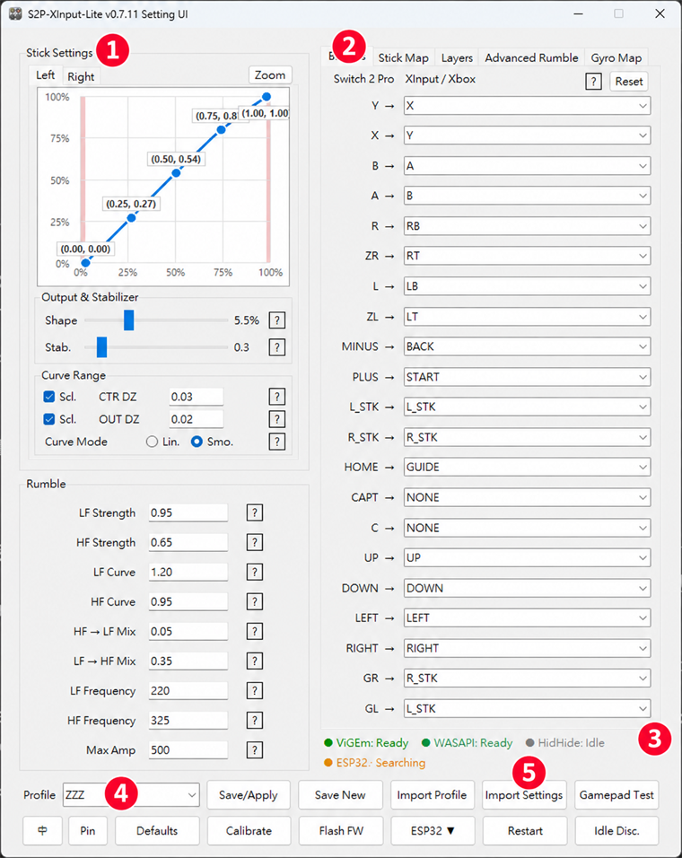

1. **Stick settings** — Drag curve control points and adjust output, stabilizer, and basic rumble options.
2. **Feature tabs** — Switch between Buttons, Stick Map, Layers, Advanced Rumble, and Gyro Map. The screenshot shows Xbox button mapping.
3. **Status row** — Check ViGEm, WASAPI, HidHide, controller, and ESP32 status.
4. **Profile selector** — Choose the profile to edit or apply.
5. **Import Settings** — Migrate compatible settings from another S2P-XInput-Lite installation.

The remaining footer controls save or create profiles, import one profile, change
language, restore defaults, calibrate, flash firmware, restart, and Pin.

### 2.1 Status indicators

- **ViGEm: Ready** — The virtual XInput controller is available.
- **WASAPI: Ready** — System-output audio capture is available.
- **HidHide: Ready** — HidHide is installed and configured.
- **HidHide: Missing** — HidHide is not installed.
- **Pad: Searching** — No controller has been detected yet.
- **ESP32** — The ESP32-S3 bridge is active or being detected.

### 2.2 Profile controls

- **Profile** — Select a saved profile.
- **Save/Apply** — Save the current profile and apply it immediately.
- **Save New** — Create a new profile from the values currently shown.
- **Import Profile** — Import an external `.ini` profile.
- **Import Settings** — Migrate settings from an older or same-version S2P-XInput-Lite installation.

### 2.3 Import Settings

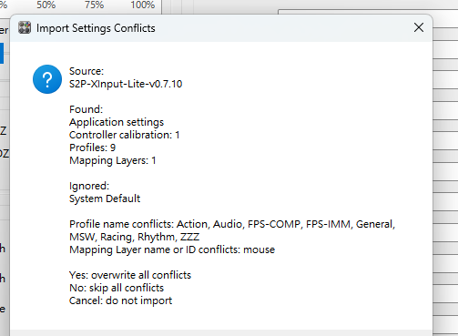

The numbered preview identifies: **1** source installation, **2** compatible data
found, **3** items deliberately ignored, **4** profile or Mapping Layer conflicts,
and **5** the choice applied to all conflicts.

1. Select **Import Settings**.
2. Choose the previous or same-version S2P-XInput-Lite **application root**; do not choose its `src` folder.
3. Review the preview of application settings, persistent controller calibration, user profiles, and managed Mapping Layers.
4. If names or Layer IDs conflict, explicitly choose **Overwrite all** or **Skip all**.
5. Confirm the import. The GUI, profile list, and Layer list refresh when it completes.

The current version supplies the schema and defaults, so this is not a downgrade
or a raw folder copy. Missing newer keys keep current defaults. **System
Default** is never overwritten; runtime caches, logs, firmware, executables,
and build output are not imported. A failed validated write rolls back
`config.ini`, user profiles, and managed Layers together.

> [!WARNING]
> **System Default** is read-only. Use **Save New** to create an editable profile from it.

---

## 3. Stick settings

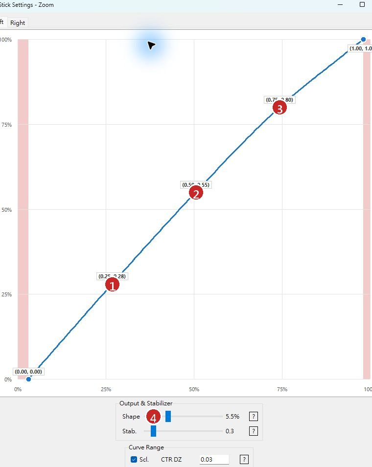

1. **25% point** — Controls response for small stick movement.
2. **50% point** — Controls the middle of the response.
3. **75% point** — Controls response near the outer range.
4. **Shape and Stab.** — Adjust response shape and slope-based stabilization.

### 3.1 Curve controls

- Drag a point to change the curve.
- The left stick is blue and the right stick is red.
- Double-click a point to restore its default.
- Right-click a point to enter exact X and Y coordinates.
- Select **Zoom** for the large curve editor.
- **Lin.** connects points linearly.
- **Smo.** uses a smooth curve.

### 3.2 Deadzones

- **CTR DZ** — Center deadzone used to remove drift near the neutral position.
- **OUT DZ** — Outer deadzone used to reach 100% before the stick reaches its physical limit.

Large deadzones shorten the usable stick range. Increase them only enough to solve center drift or insufficient outer travel.

### 3.3 Shape and Stab.

**Shape** adjusts the overall response character.

**Stab.** adds stabilization only where the curve slope is greater than 1:1:

- `0.0` — Off.
- `1.0` — Standard compensation.
- `2.0` — Stronger compensation.
- `3.0` — Maximum compensation.

Higher values are steadier but can feel smoother or less immediate.

### 3.4 Stick calibration

1. Select **Calibrate** at the bottom of the main window.
2. Follow the command-window instructions and leave the sticks centered when requested.
3. Slowly rotate each stick around its complete outer range.
4. Return to the settings window and test the result.

> [!TIP]
> Recommended order: calibration → center deadzone → outer deadzone → response curve → stabilizer.

---

## 4. Button and direction mapping

### 4.1 Buttons

The **Buttons** tab maps physical controller buttons to Xbox 360 outputs.

- The physical input is shown on the left.
- Select the Xbox output from the list on the right.
- `NONE` disables the output.
- **Reset** restores the mappings on this tab.
- Select **Save/Apply** to keep the changes.

The common layout swaps A/B and X/Y to match Xbox button positions. CAPT, C, GR, GL, and other extra buttons can also be assigned or disabled.

### 4.2 Stick Map

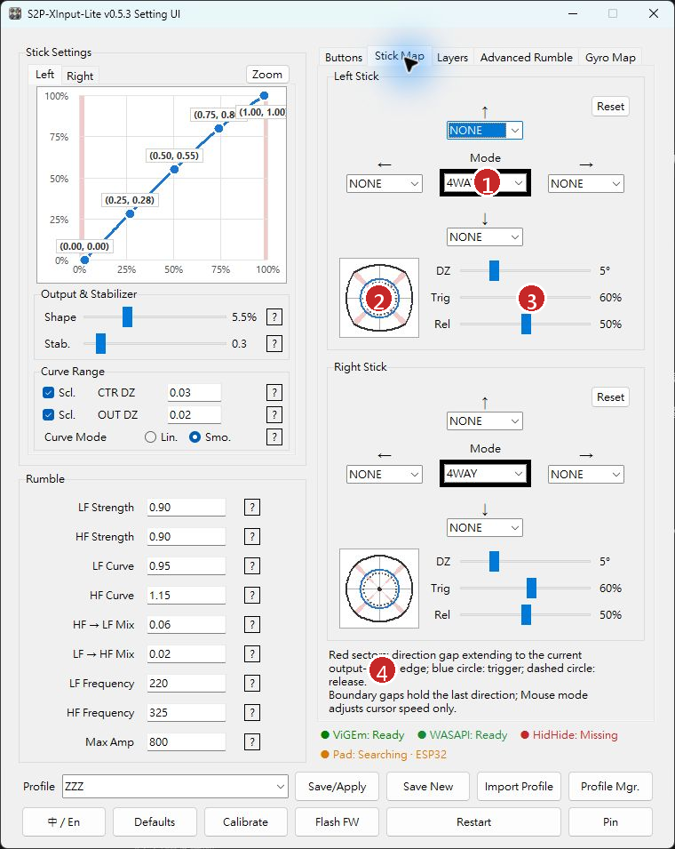

1. **Mode** — Select the direction mode, such as `4WAY`.
2. **Direction diagram** — Shows the active direction regions and boundary gaps.
3. **DZ / Trig / Rel** — Direction deadzone, trigger threshold, and release threshold.
4. **Independent sticks** — The left and right sticks can be configured and reset separately.

> [!TIP]
> Keep **Trig** above **Rel**. The resulting hysteresis prevents repeated activation when the stick rests on a direction boundary.

---

## 5. Mapping Layers

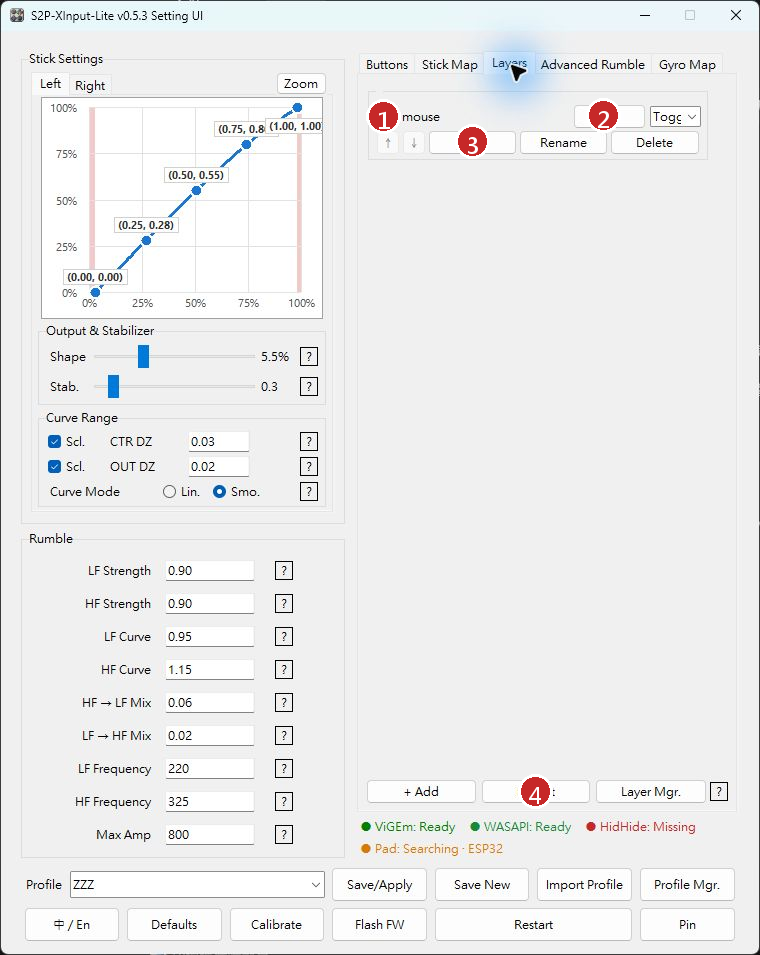

1. **Enable check box** — Enables or disables the layer.
2. **Activation** — Assigns the activation button and Toggle/Hold behavior.
3. **Layer actions** — Edit, Rename, and Delete.
4. **Layer tools** — Add, Import, and Layer Manager.

### 5.1 Creating a layer

1. Select **+ Add** and enter a recognizable name.
2. Select **Edit** and configure button, keyboard, or mouse mappings.
3. Assign the activation button.
4. Select **Hold** or **Toggle**.
5. Enable the check box beside the layer.
6. Select **Save/Apply**.

- **Hold** — Active only while the assigned button is held.
- **Toggle** — Each press alternates between enabled and disabled.

> [!WARNING]
> Layer edits remain in memory until **Save/Apply** succeeds. The layer files and profile state are not permanently saved before that point.

---

## 6. Gyro mapping

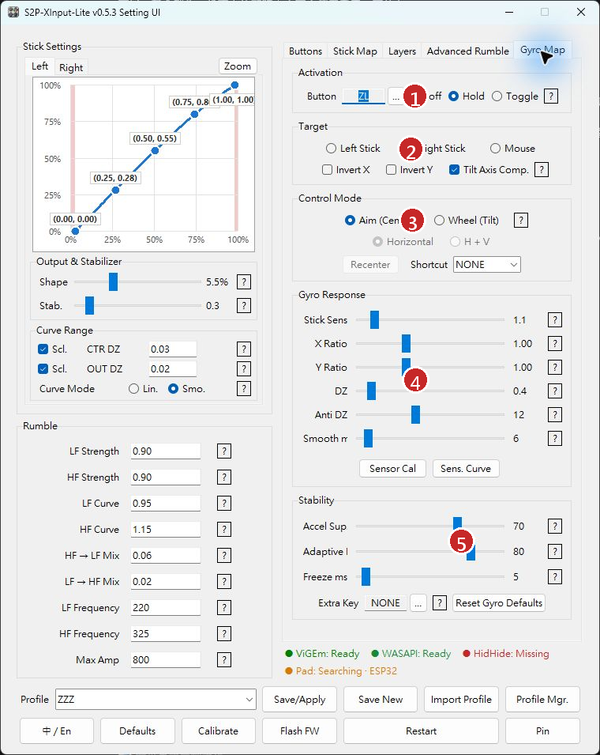

1. **Activation** — Assign an activation button and select Off, Hold, or Toggle.
2. **Target** — Left Stick, Right Stick, or Mouse.
3. **Control Mode** — Aim (Center) or Wheel (Tilt).
4. **Gyro Response** — Sensitivity, X/Y ratios, deadzone, anti-deadzone, and smoothing.
5. **Stability and calibration** — Stability controls, Sensor Cal, and sensitivity curve.

### 6.1 Activation and target

- **Off** — Gyro mapping is disabled.
- **Hold** — Gyro mapping is active while the assigned button is held.
- **Toggle** — Press once to enable and again to disable.
- **Left Stick / Right Stick** — Converts gyro motion into stick output.
- **Mouse** — Converts gyro motion into mouse movement.
- **Invert X / Y** — Reverses either axis.

### 6.2 Control modes

- **Aim (Center)** — Center-referenced aiming, normally used for shooters.
- **Wheel (Tilt)** — Output based on controller tilt, suitable for steering-style control.

### 6.3 Response settings

- **Stick Sens** — Gyro-to-stick sensitivity.
- **X Ratio / Y Ratio** — Horizontal and vertical scaling.
- **DZ** — Removes small center drift.
- **Anti DZ** — Raises the minimum output for small intentional movement.
- **Smooth ms** — Smoothing time. Higher values are steadier but feel less immediate.

### 6.4 Recommended setup

1. Place the controller on a stable surface and run **Sensor Cal**.
2. Select the target and activation behavior.
3. Start with low sensitivity.
4. Use X/Y Ratio to balance horizontal and vertical speed.
5. Add DZ only when the center drifts.
6. Add a small Anti DZ only when small motion does not register.
7. Adjust Smooth ms last.

> [!WARNING]
> During magnetometer calibration, move away from speakers, magnets, large metal objects, and powered equipment. Follow the prompt and rotate the controller through a complete three-dimensional figure-eight.

---

## 7. Rumble settings

### 7.1 Basic rumble

- **LF Strength / HF Strength** — Low- and high-frequency path strength.
- **LF Curve / HF Curve** — Response from small to large rumble commands.
- **HF → LF Mix / LF → HF Mix** — Cross-feed between the two paths.
- **LF Frequency / HF Frequency** — The two active frequency commands.
- **Max Amp** — Final amplitude limit.

### 7.2 Max Amp and mechanical noise

The amplitude field has a protocol range of `0–1023`. The default is `500`, approximately 49% of the field maximum.

Testing across multiple bridge implementations and controllers indicates that stronger output makes a linear actuator more likely to produce a light mechanical impact during rapid changes. The effect is usually minor during normal use.

The default of `500` retains clear feedback while reducing excessive-output noise. It is not a certified continuous hardware safety limit.

> [!CAUTION]
> The `0–1023` field range does not mean every controller should run continuously at the maximum. Reduce Max Amp, LF/HF Strength, or the affected audio bands if you hear impacts, sharp buzzing, or unnatural vibration.

### 7.3 Game, Audio, and Mix

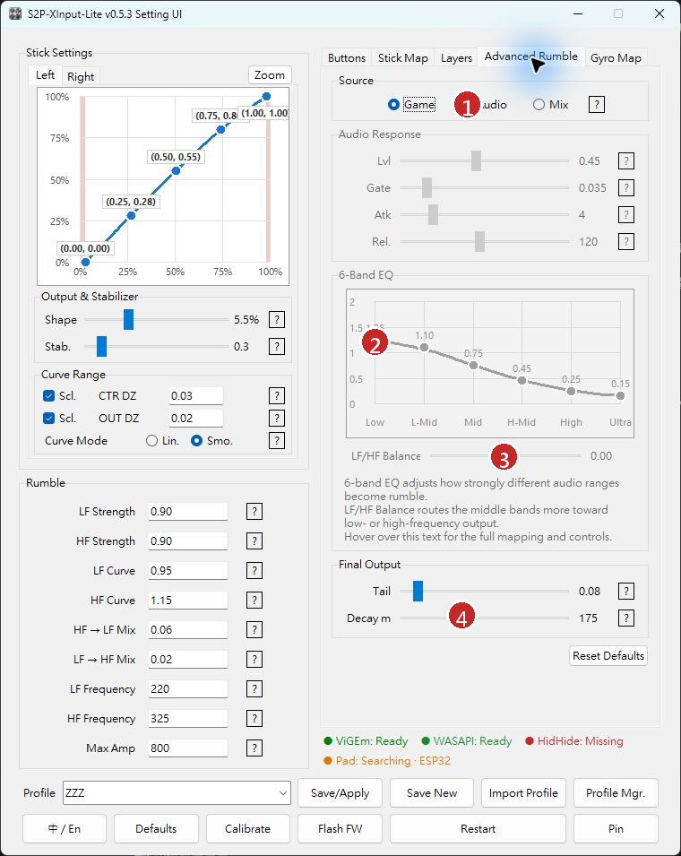

1. **Source** — Game, Audio, or Mix.
2. **Six-band curve** — Gain for each audio range.
3. **LF/HF Balance** — Routes the middle bands toward LF or HF.
4. **Final Output** — Tail and decay behavior.

- **Game** — Uses native game rumble only.
- **Audio** — Converts the Windows default output into rumble.
- **Mix** — Softly combines game and audio rumble without simple hard clipping.

### 7.4 Audio Response

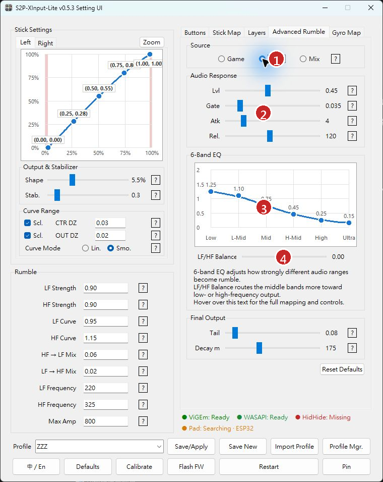

1. **Audio source**
2. **Lvl / Gate / Atk / Rel**
3. **Low, L-Mid, Mid, H-Mid, High, and Ultra bands**
4. **LF/HF Balance**

- **Lvl** — Overall audio-to-rumble sensitivity.
- **Gate** — Rejects quiet background audio.
- **Atk** — Attack speed; lower values respond faster.
- **Rel** — Release time after the sound ends.

### 7.5 Six-band EQ

| Band | Range | Typical content |
|---|---:|---|
| Low | 20–120 Hz | Deep impacts and sub-bass |
| L-Mid | 120–300 Hz | Low-frequency body |
| Mid | 300–700 Hz | Low-mid detail |
| H-Mid | 700–2000 Hz | High-mid detail |
| High | 2000–4000 Hz | Friction and vocal edges |
| Ultra | 4000–8000 Hz | Sharp alerts and ultra-high detail |

- Drag a point to adjust its gain.
- Double-click a point to restore that band.
- `1.00` is neutral gain.
- These controls affect Audio and Mix, not Game-only rumble.

### 7.6 LF/HF Balance

- `-1.00` favors LF.
- `0.00` is balanced.
- `+1.00` favors HF.
- Start within `-0.15` to `+0.15`.

This control changes the routing of the middle bands; it does not change the six gain values.

### 7.7 High-frequency noise

If Audio or Mix produces continuous high-frequency noise:

1. Lower the High and Ultra bands.
2. Move LF/HF Balance slightly toward LF.
3. Raise Gate to reject quiet background audio.
4. Lower Lvl if every sound begins too strongly.
5. If needed, reduce HF Strength or Max Amp.

---

## 8. HidHide and ESP32-S3

### 8.1 HidHide

In wired mode, a game may see both the physical controller HID and the virtual XInput controller, producing duplicate input. HidHide hides the physical HID while allowing S2P-XInput-Lite to keep reading it.

- **HidHide: Ready** — Installed and configured.
- **HidHide: Missing** — Not installed. Select the status text to open the download page.
- **HidHide: Off / Setup** — Installed but not configured.
- **HidHide: Error** — The configuration could not be read or changed.

If you dismiss an automatic reminder, it will not appear on every launch. Select the HidHide status at the bottom of the window to open the action again.

> [!WARNING]
> Close HidHide Configuration Client before retrying a failed setup. Enabling global cloaking can also affect other devices already present in the HidHide list.

### 8.2 Flashing ESP32-S3 firmware

1. Select **Flash FW**.
2. The application reads the connected firmware version and compares it with
   the bundled `S2P-FW 1.0.7`.
3. Review the installed and bundled versions, then choose whether to flash or
   cancel. Cancelling resumes the connector if it was paused for detection.
4. After confirming, connect the ESP32-S3 OTG port and hold **BOOT**.
5. Press **RESET / EN** once, release **RESET / EN**, then release **BOOT**.
6. The application identifies the ESP32-S3 ROM port by its USB identity even
   when that COM port was already present, then flashes the firmware.
7. After a successful flash, the ESP32 returns to bridge mode and the desktop
   connector starts automatically after USB re-enumeration.
8. If the bridge does not reappear after several seconds, press **RESET / EN**
   or reconnect the board.

> [!CAUTION]
> Do not disconnect the ESP32-S3 or close the application while firmware is being written.

### 8.2.1 Bridge shutdown protection

Bridge shutdown protection in v0.7.14 requires both the updated desktop
application and S2P-FW 1.0.7.
In bridge mode, use **Exit** to request release and wait for confirmation that
all BLE links are released. After session establishment, continuous CDC loss
for 3 seconds or no host heartbeat for 8 seconds starts automatic BLE release.
Android USB HID keeps working without the desktop application
or CDC/DTR, with its existing idle disconnect and button-wake behavior.
Hardware sleep-current and shutdown validation for this fix is still pending;
see the [hardware checklist](../docs/bridge-host-shutdown.md).

### 8.3 Pairing the controller

1. Connect the ESP32-S3 and start S2P-XInput-Lite.
2. Put the controller into pairing mode.
3. Hold **SYNC** when a new pairing is required.
4. The application detects the SYNC connection and writes the ESP32 pairing data.
5. Confirm that the Pad/ESP32 status changes to connected.

### 8.4 Two ESP32 operating modes

| Mode | Windows application required | USB output | Identifier |
|---|---|---|---|
| ESP32 Bridge | Yes | CDC; desktop XInput through ViGEmBus | `303A:4001` |
| Android USB HID standalone | No | CDC + standard HID, `S2P Mobile Gamepad` | `303A:4005` |

Both modes retain CDC configuration, diagnostics and recovery. These are shared
Espressif/TinyUSB defaults; USB metadata alone does not establish S2P identity.
The desktop validates firmware identity and compatible capabilities. Legacy
`CAFE:4020/4021/4022` identifiers are upgrade candidates only.

Existing NVS values `0=Bridge` and `2=HID` retain their meanings. Old `1=XInput`
and `3=Auto` migrate to HID with a desktop notice: PC XInput/Auto standalone was
removed; Android USB HID is selected, and desktop XInput requires Bridge.
Unknown values or read errors start in Bridge. Migration itself does not reboot.

### 8.5 Writing a profile and enabling Android USB HID

1. Select a profile and select **Save/Apply** after adjusting its settings.
2. Confirm that the connected ESP32 runs bundled `S2P-FW 1.0.7`.
3. Open **ESP32 ▼ → Write and enable Android USB HID standalone**
   (**寫入並啟用 Android USB HID 獨立模式** in Traditional Chinese).
4. Review compatibility warnings. Cancel and correct Windows-only outputs, or
   confirm omission of unsupported items.
5. Wait for transfer, length/CRC validation, runtime apply and controlled restart.
   Keep USB power connected throughout.
6. Connect the ESP32 to an Android USB host with a data cable and OTG adapter
   when required. The system and game must support USB HID controllers;
   compatibility remains subject to hardware testing.

Save pending edits first; use **Save New** after changing **System Default**.
A/B storage retains the previous valid profile until the new slot passes
validation. Do not assume a failed write or mode save changed the device.
The obsolete Auto menu screenshot has been removed from this section.

### 8.6 Returning to Bridge and recovery

- **Desktop menu:** Connect the ESP32 to Windows and choose **ESP32 ▼ → Return
  to ESP32 bridge mode**. Wait for USB re-enumeration and automatic desktop
  search. Reconnect USB or use **Restart Connection** if recovery is still needed.
- **Connected controller:** Hold **HOME+X for 3 seconds, then release** to save
  Bridge; hold **HOME+A for 3 seconds, then release** to save Android USB HID.
  HOME+Y is removed. Chords read raw input before mappings and layers. Selecting
  the current mode does not reboot; failed persistence does not reboot.
- **No controller:** CDC remains available in both modes. Send `mode bridge`,
  then `restart` after the mode is saved. Close the desktop connector before
  opening the same COM port in a serial terminal.
- **No working CDC:** Enter the chip's ROM Download Mode. Check the board's
  native USB port and BOOT/RESET (EN) controls. Typically hold **BOOT**, press
  and release **RESET/EN**, then release **BOOT**. Boards without RESET may
  require holding BOOT while reconnecting USB. Follow the board manufacturer's
  wiring and timing instructions. Use the existing flashing workflow after ROM
  enumeration; chip identification and the 16 MB flash check still apply. After
  flashing, release BOOT and press RESET/EN or power cycle to start the application.
  ROM does not implement the S2P application protocol.

Returning to Bridge retains the last stored standalone profile. **Restart
Connection** only restarts the desktop connection.

### 8.7 Standalone support and validation limits

HID reuses stick calibration, curves, center/outer deadzones, output shape,
stabilization/smoothing, button and direction mapping, compatible Mapping
Layers, linear triggers, gyro-to-stick, idle disconnect and BLE reconnect.
Its input report retains buttons, four stick axes, a hat, separate analog
triggers and digital L2/R2 compatibility output.

Standalone does not execute Windows keyboard/mouse output, Audio/Mix haptics,
process-based profile switching or gyro mouse output. HID has no rumble output
report: Android game rumble is not promised, and BLE HID is not provided.
Windows game rumble and audio haptics continue through the Bridge desktop path.

No physical hardware was exercised for this revision. Windows/Android descriptor
enumeration and input, ViGEmBus, rumble/audio haptics, USB unplug/replug,
sleep/remote wake, idle disconnect, BLE reconnect, actual NVS upgrades, controller
chords and ROM recovery are all pending. Historical measurements do not validate
the new firmware. Apple devices are outside current support; Android support
varies by device, OS and game. See [validation and official references](../docs/usb-hid-standardization.md).

---

## 9. Gamepad Test

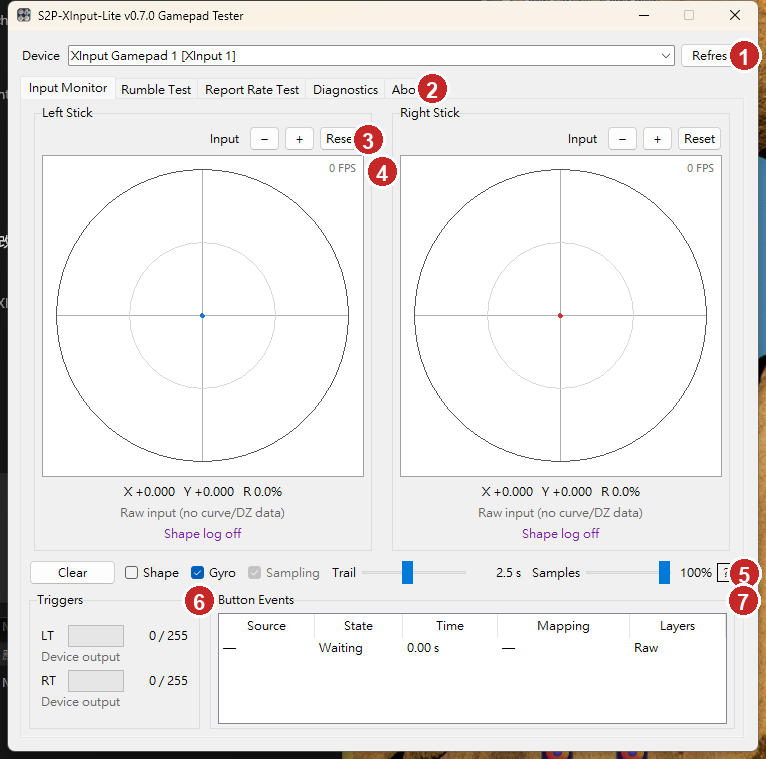

1. **Device and refresh**: Select the controller to inspect or rescan devices.
2. **Function tabs**: Open Input Monitor, Rumble Test, Report Rate Test,
   Diagnostics, or About.
3. **Stick source and zoom**: Select each stick's source and adjust its view.
4. **Left and right stick plots**: Show live position, trails, output shape,
   and guides.
5. **Sampling and trail controls**: Adjust sampling, trail duration, and
   overlays.
6. **Trigger input**: Shows current LT and RT values and their input type.
7. **Button events**: Lists button state, held time, effective mapping, and
   active layer.

Select **Gamepad Test** at the bottom of the main window to open the standalone
tester. It runs separately from the settings window so high-rate drawing does
not delay settings input. Selecting the button again raises the existing tester
instead of opening a duplicate. The standalone Gamepad Tester application can
also be launched directly without opening the settings window first.

> [!IMPORTANT]
> Gamepad Tester is designed primarily for a Switch 2 Pro Controller connected
> and processed by S2P-XInput-Lite. Other XInput, WinMM, or Raw HID controllers
> can still run basic input, vibration, and report-rate tests, but they do not
> publish S2P shared telemetry. Physical/processed sources, effective mappings,
> Mapping Layers, battery, sensors, transport status, and ESP32 diagnostics may
> therefore be unavailable. This is expected.

### 9.1 Selecting a source

- **S2P-XInput-Lite** tests the current virtual XInput output and exposes
  physical, processed, and combined sources.
- Other entries are XInput or generic game controllers detected by Windows;
  only information exposed by that interface is shown, without S2P-only data.
- Duplicate names include the interface type and device number.
- **Refresh** rescans devices. Changing the device or plotted source clears the
  old measurement so unrelated samples are not combined.

### 9.2 Stick plots

Each stick has its own source selector. The centre crosshair is zero, the dark
outer circle is the 100% reference, and the live dot is the current value.

- **Trail samples** controls the percentage of real reports drawn.
- **Trail length** controls how many seconds remain visible.
- `-`, `+`, and **Reset** control plot zoom.
- S2P output sources can also show the applied deadzone, outer limit, response
  curve, and gyro guides.

### 9.3 Output-shape capture

Enable **Show Output Shape**, then rotate the stick slowly around its outer
edge. The purple line records the maximum output reached in every direction and
reports coverage, roundness error, and maximum radius.

- Coverage reaches 100% after every 5-degree sector has a real sample.
- After the displayed line catches the latest maxima and no sector expands for
  one second, the capture locks and stops redrawing to avoid idle rendering
  overhead.
- Toggle **Show Output Shape**, change the source/settings, or select
  **Clear Trail & Statistics** to begin a new capture.

### 9.4 Buttons and triggers

The event table shows the source button, pressed/released state, held duration,
effective mapping, and active mapping layer. LT and RT show both raw trigger
input and final output. S2P Mobile USB HID uses its button, axis, trigger and
POV map only when associated with the exact verified CDC device; otherwise
the tester retains generic HID behavior.

### 9.5 Vibration Test

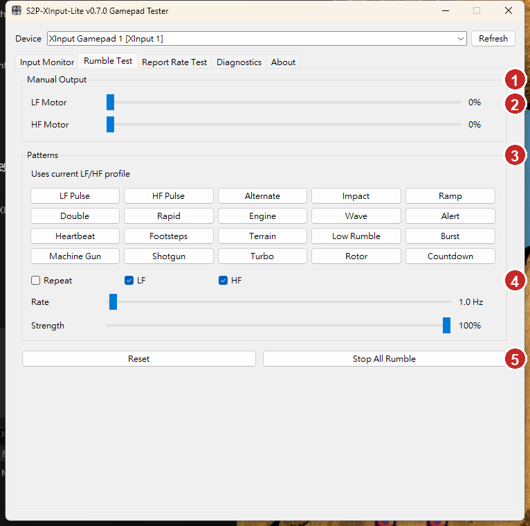

1. **Manual output**: Adjust LF and HF motor strength directly.
2. **Motor levels**: Show the current output percentage for both bands.
3. **Test patterns**: Select pulse, alternate, impact, engine, wave, and other
   preset effects.
4. **Playback controls**: Set repeat, LF/HF routing, rate, and strength.
5. **Stop controls**: Reset the settings or immediately stop all vibration.

The **Vibration Test** tab sends test patterns to Windows devices that expose
XInput rumble. Stopping or closing the tester sends zero vibration. Mobile USB
HID currently provides input only and does not relay web or game rumble to the
controller.

### 9.6 Report Rate

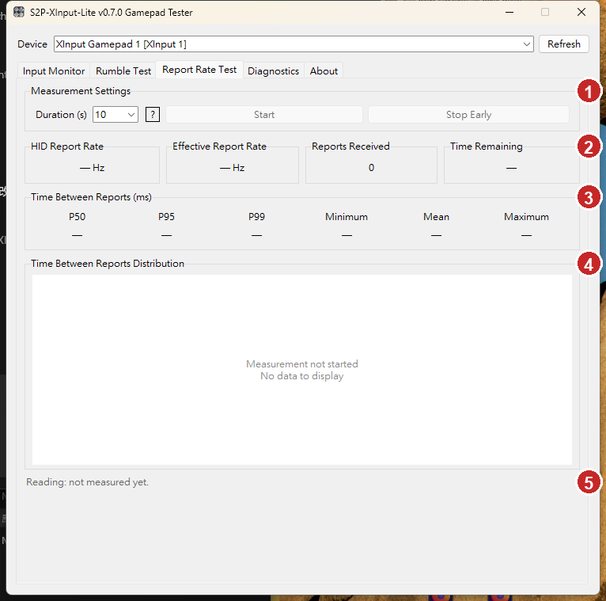

1. **Measurement settings**: Select the duration, start, or stop early.
2. **Live summary**: Shows HID rate, effective rate, report count, and time
   remaining.
3. **Interval statistics**: Lists P50, P95, P99, minimum, mean, and maximum.
4. **Interval distribution**: Plots report-interval distribution and timeline.
5. **Reading status**: Shows whether measurement is active and its result state.

Open **Report Rate** to measure a Raw HID collection without display-frame
sampling. Select the collection and test duration, start the measurement, then
move one stick continuously through wide circles. The result shows total HID
reports, reports containing usable stick data, effective rate, P50/P95/P99
intervals, distribution statistics, and a timeline. Select the collection that
actually changes when the controller moves; interfaces from the same physical
device may expose different reports.

### 9.7 Diagnostics

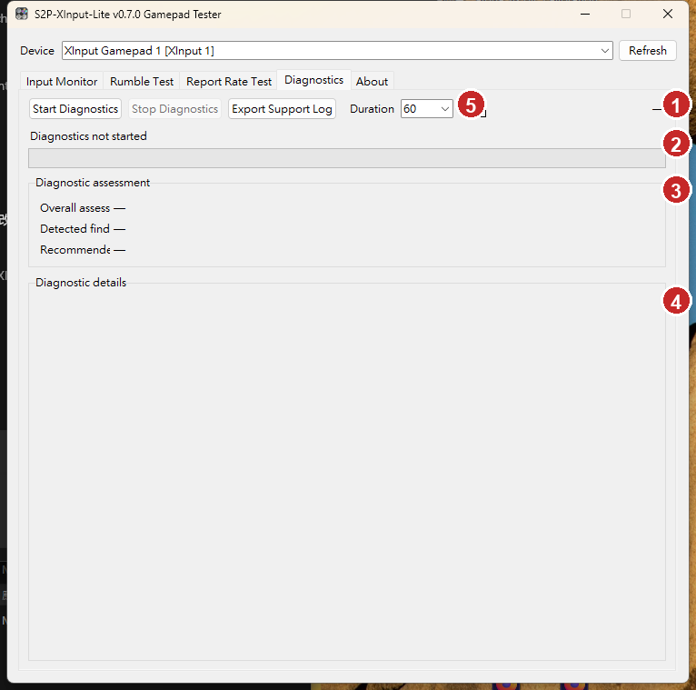

1. **Diagnostic controls**: Start or stop diagnostics and select the duration.
2. **Diagnostic status**: Shows the current phase and progress.
3. **Diagnostic assessment**: Summarizes the verdict, findings, and advice.
4. **Diagnostic details**: Lists connection, input, sensor, and rumble checks.
5. **Export Support Log**: Saves diagnostic data for a support report.

The **Diagnostics** tab runs a 30, 60, or 120 second ESP32 health check. Keep
the controller awake and exercise the sticks, sensors, and rumble during the
run. The summary covers firmware mode, connection and input continuity,
latency, calibration, motion sensors, gyro processing, rumble, and an overall
pass/warn/fail verdict. **Export Report** saves the displayed report as UTF-8
text.

Bridge mode temporarily uses the application's active serial connection.
Standalone modes open the ESP32 diagnostic channel directly. The complete
diagnostic command set requires the bundled `S2P-FW 1.0.7`.

### 9.8 About

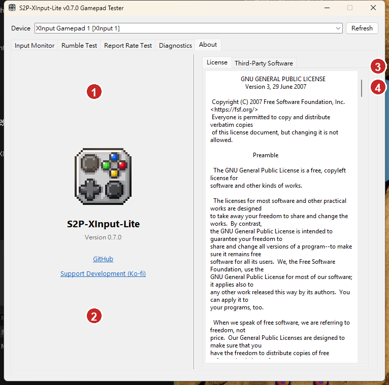

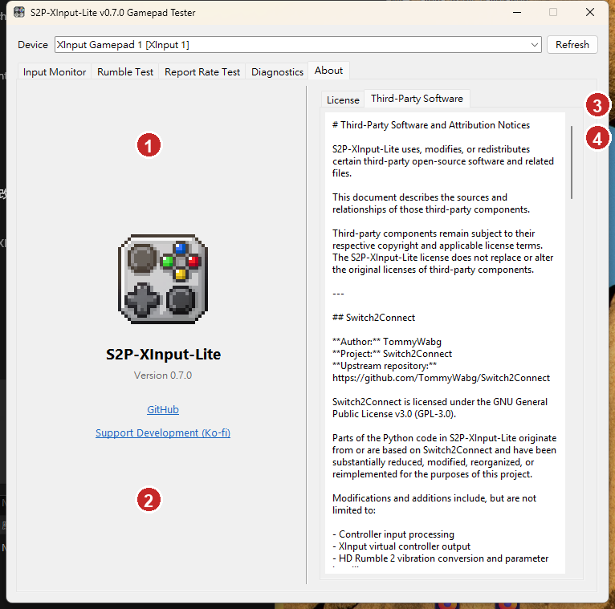

1. **Product identity**: Shows the icon, product name, and version.
2. **Project links**: Opens GitHub, sponsorship, and development-support links.
3. **Document tabs**: Switches between the license and third-party notices.
4. **Document content**: Scrolls through the complete bundled notices.

The **About** tab keeps the logo, version, GitHub, and Ko-fi links visible on
the left. The right side contains scrollable **License Agreement** and
**Third-Party Software** tabs loaded from the files included with the release.

---

## 10. Quick controls

### 10.1 Sliders and values

- Select the displayed slider value to open the parameter-entry window.
- The window shows the valid range, step size, and help text.
- Hold a parameter label and drag right to increase or left to decrease.
- Each parameter follows its own discrete step sequence.

### 10.2 Right-click restore menu

- **Restore Last Saved Value** — Discards the unsaved change.
- **Restore System Default** — Uses the value from System Default.

### 10.3 Curve points

- Double-click to restore a point.
- Right-click to enter exact X and Y coordinates.
- Drag to adjust visually.

### 10.4 Six-band help

Hover over the six-band description to display a question-mark cursor and the complete guide for:

- Frequency ranges.
- Band-name mappings.
- LF/HF Balance.
- Drag and double-click controls.

### 10.5 Restart and Pin

- **Restart Connection** — Restarts the desktop connector and reloads saved settings; it does not write to the ESP32.
- **ESP32 ▼** — Writes the current profile and selects standalone output, or returns to bridge mode.
- **Pin** — Makes the currently detected controller the preferred device. A successful action produces a notification rumble.

> [!WARNING]
> Select **Save/Apply** before Restart or pending changes may not be applied.

---

## 11. Troubleshooting

| Symptom | What to check |
|---|---|
| ViGEm is not Ready | Reinstall ViGEmBus, restart Windows, and launch the application again. |
| Duplicate game input | Configure HidHide and check whether Steam Input is also remapping the device. |
| Controller not found | Use a data-capable cable, reconnect the controller, or remove and repeat Windows BLE pairing. |
| ESP32 remains Searching | Check the OTG port, firmware, USB connection, and controller pairing state. |
| ESP32 received old settings | Select Save/Apply first. Modified System Default settings must be saved with Save New. |
| Device is missing after a mode change | Wait for automatic USB re-enumeration and reconnection. If the bridge still does not appear, reconnect the ESP32; use Restart Connection only as a manual fallback. |
| Phone detects the controller but a game ignores triggers | Use Mobile USB HID firmware from v0.6.0; it exposes both analog trigger axes and digital L2/R2 buttons. |
| Audio rumble does not react | Confirm WASAPI is Ready, select Audio or Mix, and check the Windows default output device. |
| Quiet audio still vibrates | Raise Gate, lower Lvl, and reduce High/Ultra. |
| Mechanical impact noise | Lower Max Amp, LF/HF Strength, or the band that triggers the noise. |
| High-frequency noise in Audio/Mix | Lower High/Ultra, move Balance toward LF, raise Gate, and reduce HF Strength. |
| Gyro drift | Run Sensor Cal on a stable surface and avoid magnetic or powered objects. |
| Profile cannot be overwritten | System Default is read-only; use Save New. |
| Settings disappear after restart | Select Save/Apply and ensure the application folder is writable. |

### Restoring a stable configuration

1. Restore the suspicious parameter to its last saved value.
2. Compare the result with **System Default**.
3. Use **Defaults** only when a complete adjustable-settings reset is intended.
4. Select **Save/Apply**.
5. Select **Restart** and retest input and rumble.

> [!NOTE]
> A full reset retains stick calibration and saved profiles, but disables Mapping Layers and removes this application's HidHide entries.

---

## Appendix: recommended tuning order

### Sticks

Calibration → center deadzone → outer deadzone → curve → stabilizer.

### Gyro

Calibration → target → activation → sensitivity → X/Y ratios → deadzone → smoothing.

### Game rumble

Start with Game mode and Max Amp `800`. Reduce Max Amp or LF/HF Strength if the controller produces mechanical noise.

### Audio rumble

Gate → Lvl → six bands → LF/HF Balance → Tail/Decay.

### Profiles

Keep one verified stable profile and use **Save New** for experimental settings.

> [!NOTE]
> This guide applies to S2P-XInput-Lite v0.7.14. For later releases, follow the in-app question-mark help and the latest release notes.
