# S2P-XInput-Lite v0.8 User Guide

[繁體中文](USER_GUIDE_zh-TW.md)

S2P-XInput-Lite turns a Switch 2 Pro Controller into an XInput-compatible (Xbox)
controller that Windows games accept directly. It provides stick curves,
button and direction mapping, mapping layers, gyro, rumble, and audio-driven
rumble. The bundled Gamepad Tester checks input, rumble, and report rate, and
includes an Aim Test.

This guide covers desktop **v0.8** and the bundled ESP32-S3 firmware
**S2P-FW 1.0.9**. Screenshots show the English interface. Select **中／En** at
the lower left of the main window to switch languages. Profiles and values in
the screenshots are examples.

> [!IMPORTANT]
> After changing a value, select **Save/Apply** to write it to the current
> profile and apply it to the connection. Switching profiles or closing the
> window does not save your changes.

> [!TIP]
> Create your own profile with **Save New** before tuning. `System Default` is
> a read-only baseline and cannot be overwritten.

## Contents

- [1. Getting started](#1-getting-started)
- [2. Main window and profiles](#2-main-window-and-profiles)
- [3. Stick settings](#3-stick-settings)
- [4. Button mapping and Stick Map](#4-button-mapping-and-stick-map)
- [5. Layers](#5-layers)
- [6. Gyro Map](#6-gyro-map)
- [7. Rumble](#7-rumble)
- [8. Gamepad Tester](#8-gamepad-tester)
  - [8.5 Aim Test](#aim-test-guide)
- [9. ESP32-S3](#9-esp32-s3)
  - [9.2 Flash firmware](#flash-esp32-s3)
  - [9.8 Build your own firmware](#build-firmware)
- [10. Quick controls](#10-quick-controls)
- [11. Troubleshooting](#11-troubleshooting)
- [Appendix: Recommended tuning order](#appendix-recommended-tuning-order)

---

## 1. Getting started

### 1.1 Requirements

- Windows 10 or Windows 11.
- A Switch 2 Pro Controller and a USB-C cable that carries data.
- ViGEmBus 1.22.0, which creates the XInput-compatible virtual controller.
- HidHide is recommended for wired USB, so games do not read both the
  physical controller and the virtual one.
- A compatible ESP32-S3 board for ESP32 mode.

### 1.2 Install and first launch

The release ZIP contains **S2P-XInput-Lite.exe**, **GamepadTester.exe**,
**START_HERE.txt**, and the **app** folder. The first EXE opens the main
program and the second opens the standalone Gamepad Tester. The runtime,
firmware, drivers, license notices, and manuals are inside **app**, so keep it
beside both EXEs.

1. Extract the full ZIP to a new folder. Do not run it from inside the archive.
2. If ViGEmBus is not installed, run `app\driver\Install-ViGEmBus.bat`.
3. Connect the controller or the ESP32-S3 (see [1.3 Connection modes](#13-connection-modes)).
4. Run `S2P-XInput-Lite.exe`.
5. Check that `ViGEm: Ready` at the bottom of the window is green.
6. Choose a profile, adjust it, then select **Save/Apply**.

> [!NOTE]
> Right after the controller connects (or reconnects), a stick may rest
> slightly outside the center deadzone and produce a small leftover output.
> As with many controllers after power-on, flick both sticks once after
> connecting so they settle back to center.

### 1.3 Connection modes

| Mode | Description |
|---|---|
| **Wired USB** | Connect the controller to the PC with USB-C. Low latency and a steady report rate. HidHide is recommended. |
| **ESP32-S3** | The controller connects to the ESP32-S3 over BLE, and the ESP32-S3 forwards data to the PC over USB. See [9. ESP32-S3](#9-esp32-s3). |
| **Windows BLE** | Turn on Windows Bluetooth, start the program, and hold `SYNC` on the controller. The program pairs and connects it, so you do not add the device in Windows Settings. Report rate and stability depend on the Bluetooth hardware and the wireless environment. |

The ESP32-S3 runs in one of two ways. **Bridge** keeps the Windows program
running, outputs XInput through ViGEmBus, and handles rumble and audio rumble.
**Android USB HID standalone mode** needs no Windows program, because the
ESP32-S3 itself acts as a USB HID controller. Physical USB XInput has
licensing issues and must not be added.

<a name="connector-window"></a>

### 1.4 Connector window and notification area

Connecting opens a separate black connector (CMD) window that shows pairing,
connection, input, and transport status. Keep it open while you play, because
closing it ends the connection. If the ESP32 disconnects, the window stays
open and shows the reason.

Closing the settings window with **X** hides only that window in the Windows
notification area; S2P keeps running, and the connector window and the
connection are unaffected. Minimizing (**–**) keeps it on the taskbar as
usual. Click the notification icon to restore the settings window, or
right-click it to choose **Show Settings** or **Exit**. Only **Exit** really
closes S2P.

Only one settings window and one Gamepad Tester can run at a time. Starting
either again brings the existing window forward instead of starting another
process or taking over the controller.

### 1.5 Upgrading

1. Extract the new ZIP to a **new folder**.
2. Open the new main program, select **Import Settings**, and choose the old
   program folder that contains its EXEs. See [2.4 Import Settings](#24-import-settings).
3. If you use an ESP32-S3, check its firmware with **Flash FW**. See [9.2 Flash firmware](#flash-esp32-s3).

To copy `config.ini` by hand instead, close the program and copy it to the
new version's `app\src\config.ini`.

---

## 2. Main window and profiles

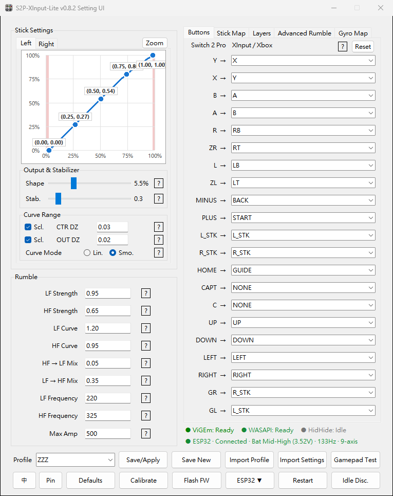

The main window has four areas:

- **Stick Settings** (upper left): stick curves, output shape, stabilizer,
  and deadzones. See [3. Stick settings](#3-stick-settings).
- **Rumble** (lower left): basic rumble strength, curves, frequencies, and
  maximum amplitude. See [7.1 Basic rumble](#71-basic-rumble).
- **Tabs** (right): **Buttons**, **Stick Map**, **Layers**, **Advanced Rumble**,
  and **Gyro Map**. The screenshot shows the Buttons tab.
- **Bottom**: the status bar, the profile selector, and action buttons.

### 2.1 Status bar

| Status | Meaning |
|---|---|
| `ViGEm: Ready` | The virtual XInput controller is available. |
| `WASAPI: Ready` | System audio capture is available, so audio rumble can work. |
| `HidHide: Ready` | HidHide is installed and hides the physical controller. |
| `HidHide: Idle` | HidHide is installed, but no USB controller needs hiding, for example over ESP32 or Bluetooth. |
| `HidHide: Off / Setup` | HidHide is installed but hiding is not set up. Click the status to set it up. |
| `HidHide: Missing` | HidHide is not installed. Click the status to open the download page. |
| `HidHide: Error` | HidHide settings could not be read or changed. See [11. Troubleshooting](#11-troubleshooting). |
| `ESP32 · Connected · Bat … · 129Hz · 9-axis` | Connected through the ESP32, showing battery level, input report rate, and sensor mode. |
| `ESP32 · Idle; press any button to wake` | The controller disconnected after being idle. Press any button to wake it. See [2.6](#26-idle-disc). |
| `Pad: Searching` | No controller has been detected yet. |

### 2.2 Bottom buttons

| Button | Purpose |
|---|---|
| **Profile** | Choose the profile to edit or apply. Right-click the selector to rename or delete a profile. |
| **Save/Apply** | Save the current profile and apply it to the connection immediately. |
| **Save New** | Create a new profile from the values on screen. |
| **Import Profile** | Import an external `.ini` profile. |
| **Import Settings** | Migrate settings from another S2P-XInput-Lite installation. See [2.4](#24-import-settings). |
| **Extensions** | Open the built-in Gamepad Test or manage independent extension tools (several at once, with conflict checks). See [2.7](#27-extensions). |
| **中／En** | Switch the interface language. |
| **Pin** | Make the detected controller the preferred device. The controller vibrates when this succeeds. |
| **Defaults** | Reset everything on screen to defaults. See [Restore a stable setup](#restore-a-stable-setup). |
| **Calibrate ▼** | Menu: **Stick Calibration** (see [3.4](#34-stick-calibration)) and **Sensor Calibration**, which calibrates the gyro, accelerometer, and magnetometer (see [6.4](#64-gyro-response)). |
| **Flash FW ▼** | Check and flash the bundled or a custom ESP32-S3 firmware. See [9.2](#flash-esp32-s3). |
| **ESP32 ▼** | Write the profile and switch to Android USB HID standalone mode, or switch back to Bridge. See [9.5](#95-write-settings-and-enable-android-usb-hid). |
| **Restart** | Restart the desktop connection with the saved settings. Nothing is written to the ESP32. |
| **Idle Disc.** | Choose how long a wireless connection may stay idle before it disconnects. See [2.6](#26-idle-disc). |

### 2.3 Profiles

- **Switch profiles**: choose a saved profile from **Profile**.
- **Save and apply**: select **Save/Apply**. A running connection applies the
  new settings without reconnecting. If the live update fails, the saved
  settings take effect on the next connection, or select **Restart**.
- **Create a profile**: select **Save New** and enter a name. This is the only
  way to keep changes made to `System Default`.

### 2.4 Import Settings

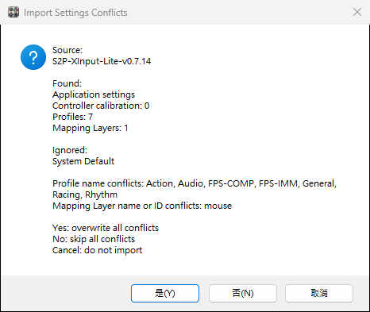

1. Select **Import Settings**. If the screen has unsaved changes, you are asked
   whether to save them first.
2. Choose the **program root** (the folder with the EXEs) of an older or the
   same S2P-XInput-Lite version, not `src`. Both the older `src\` layout and
   the current `app\src\` layout can be imported.
3. Check the preview: application settings, controller calibration, and the
   number of profiles and mapping layers, plus anything skipped.
4. If profile names or layer IDs conflict, as in the screenshot, choose
   **Yes** (overwrite all), **No** (skip all), or **Cancel** (do not import).
5. Confirm the import. The profile and layer lists refresh afterward.

The import uses the current version's settings structure and defaults, so
settings added in newer versions use their defaults. `System Default` is never
overwritten. Runtime caches, logs, firmware, EXEs, and build output are not
imported. If any write fails, `config.ini`, user profiles, and mapping layers
are all rolled back. Invalid values, unfinished shortcut recordings, and
unsupported mappings are rejected so they cannot replace a working profile.

### 2.5 Unsaved changes and external edits

- When switching profiles with unsaved changes, you can save, discard, or
  cancel. **Cancel** keeps the current profile and your edits. Closing the
  window does not save automatically.
- If another program changes the current profile, **Yes** reloads the external
  version, **No** overwrites it with what is on screen, and **Cancel** keeps
  your edits without writing the file.
- Fix invalid input before saving. A validation error means the change has not
  been saved or applied.
- If you see "Your settings were saved, but the profile list could not be
  refreshed", the file was saved. Open the profile list again later.

### 2.6 Idle Disc.

Select **Idle Disc.** to choose how long a wireless connection may stay idle
before it disconnects: **Off**, 5, 10, 15, 30, or 60 minutes. The default is
15 minutes. This is a global setting that does not change with the profile.
After it disconnects, the status bar shows
`ESP32 · Idle; press any button to wake`. Press any controller button to wake
and reconnect.

<a name="extensions"></a>

### 2.7 Extensions

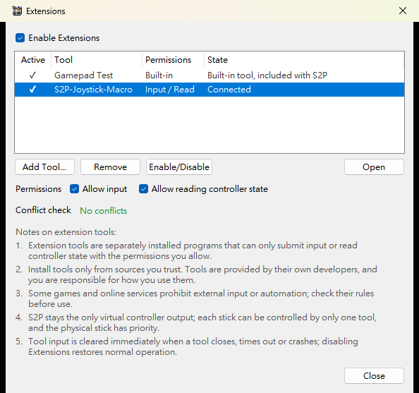

S2P can work with separately installed, independent extension tools. A tool
can only hand button, trigger, and stick states to S2P, or read controller
state, with the permissions you allow. S2P merges them with the physical
controller and sends the result through its one existing virtual Xbox
controller: no second virtual controller is created, and rumble, stick curves,
gyro, and button mapping are unaffected. Nothing extra runs while Extensions is
disabled.

**Getting extension tools:** S2P does not ship with external extension tools.
[S2P-Extensions](https://github.com/duoduo-88/S2P-Extensions) is a separate
project maintained by the S2P author that provides tools such as
S2P-Joystick-Macro. Download them from its
[latest release page](https://github.com/duoduo-88/S2P-Extensions/releases/latest)
and install them as that project describes. It is released and updated
separately from S2P-XInput-Lite, and the notes below apply to it as well.

> [!IMPORTANT]
> **Responsibility and notes**
>
> - Extension tools are provided by their own developers. S2P-XInput-Lite is
>   not responsible for the content, quality, or safety of third-party tools.
>   Install tools only from sources you trust.
> - You are responsible for how you use extension tools and for the results.
> - Some games and online services prohibit external input or automation;
>   check their rules before use.
> - Some extension tools may not work in ESP32 standalone mode: there the
>   controller connects directly to the host or phone instead of going through
>   S2P on the PC. Whether a tool supports standalone mode is set by that tool
>   or its development kit; check its documentation.
> - **Allow reading controller state** lets a tool see your button and stick
>   output. Enable it only for tools that need it.
> - S2P clears a tool's input immediately when the tool closes, times out, or
>   crashes. If anything goes wrong, disable the tool in the list to restore
>   normal operation.

1. Select **Extensions**.
2. Select **Add Tool...** and choose the tool EXE. A new tool is enabled in the
   list right away. You can add several tools; up to 4 can be enabled at once.
3. Select a tool in the list and, under **Permissions**, check **Allow input**
   (on by default) or **Allow reading controller state** (off by default). The
   tool reconnects by itself after a permission change.
4. Enabled tools start with S2P: when the connection starts (or when you
   enable a tool), S2P starts it in the background without showing a window,
   and the tool connects by itself. To use a tool's window, select it and
   choose **Open**, or click its name in the notification area menu. Use
   **Enable/Disable** to turn one off. Closing S2P closes the tools too (a
   tool must support this;
   [S2P-Joystick-Macro](https://github.com/duoduo-88/S2P-Extensions) does).

The first row is always the built-in **Gamepad Test**. It ships with S2P,
cannot be removed, and opens even when no tool is enabled. See
[8. Gamepad Tester](#8-gamepad-tester).

Only EXEs in the list (or tools S2P started) may connect; any other program is
shown as unauthorized.

| Status | Meaning |
|---|---|
| **Disabled** | Extensions or this tool is not enabled. |
| **Waiting for connection** | Waiting for the tool. Also shown while the connector is not running. |
| **Connected** | The tool is connected; its name is shown. "input timed out" means the tool was silent for over 1 s and its input was cleared. |
| **Disconnected** | The tool closed. |
| **Connection failed** | Unauthorized, missing permission, stick conflict, incompatible version, or tool not found. |

**Conflict check** lists every problem that keeps a tool from working as
expected:

- In the settings: the same EXE added twice, more than 4 enabled tools, or a
  tool without any permission.
- While tools run: a tool that was refused a stick because another tool
  controls it (listed until that tool releases the stick), a tool that asks
  for a permission you have not allowed, a second copy of a running tool,
  a program that is not in the list trying to connect, and another program
  holding S2P's pipe.

Running tools are checked only while the S2P connection runs. Buttons and
triggers never conflict: buttons are combined and triggers take the
larger value.

**Check for Updates** asks each tool's update source whether a newer version
exists and adds the result to the **State** column: **Update available**
(with the new version), **Up to date**, **No update info** (the tool has no
manifest), or **Update check failed**. When updates are found, S2P offers to
open their download pages; it never downloads or installs a tool by itself.
The tool's address is listed in a `.s2p.json` file next to its EXE, so keep
that file with the EXE.

Merge rules:

- **Buttons**: output while the controller or any tool holds them; released
  only when all release.
- **Triggers**: the largest value from the controller and all tools wins.
- **Sticks**: each stick can be controlled by only one tool, and the physical
  stick has priority. A tool's stick value is used only while the physical
  stick is at rest; moving the physical stick takes over immediately, and
  control returns to the tool about 0.15 s after the stick is back at center.
- When a tool closes, times out, or crashes, its input is cleared immediately
  without releasing buttons you still hold and without affecting other tools.

---

## 3. Stick settings

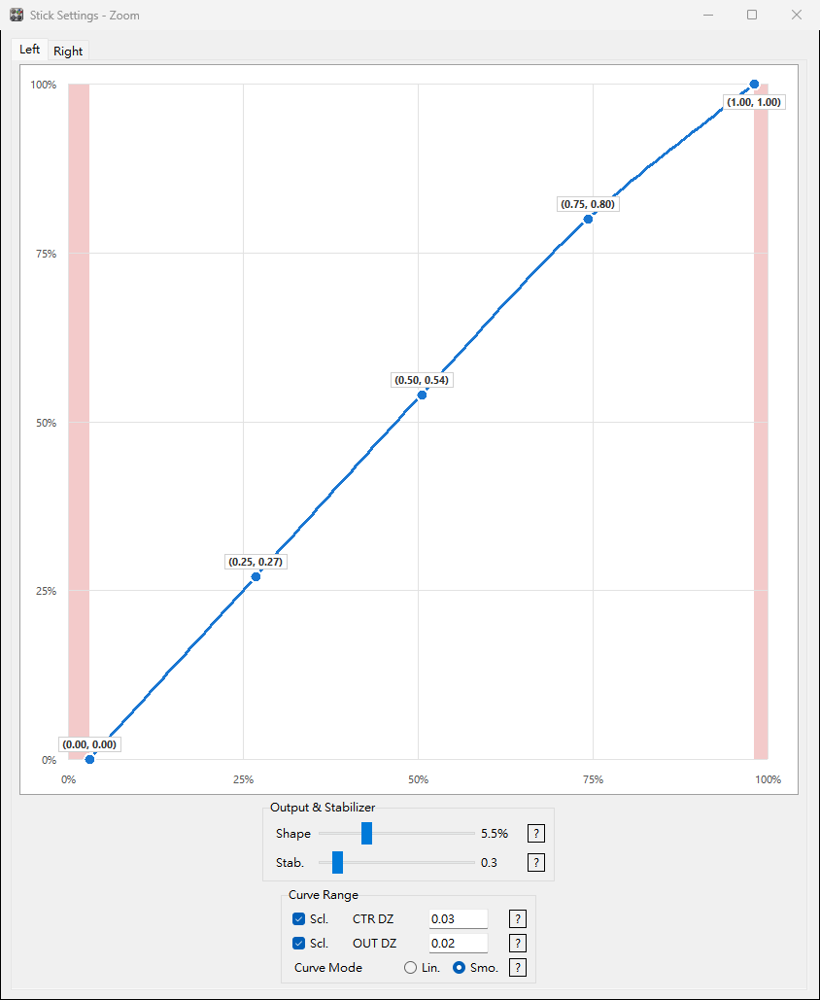

**Stick Settings** at the upper left of the main window has **Left** and
**Right** tabs for each stick. Select **Zoom** to open the separate, larger
editor shown above for fine curve adjustments.

### 3.1 Curve

The horizontal axis is stick travel and the vertical axis is output.

- Drag a control point to reshape the curve. The `0.25`, `0.50`, and `0.75`
  points affect small, middle, and near-edge movement.
- Double-click a control point to restore its default.
- Right-click a control point to type its X and Y coordinates.
- **Curve Mode**: `Lin.` connects the points with straight lines and `Smo.`
  uses a smooth curve.
- The light red bands on the left and right are the center and outer deadzones.

### 3.2 Deadzones

- `CTR DZ` (center deadzone) ignores small offsets around the stick center.
- `OUT DZ` (outer deadzone) lets the stick reach 100% output before it hits the edge.
- `Scl.` (scale): when checked, the curve's 0% start (or 100% end) moves to the
  deadzone edge and the whole curve is spread over the remaining travel.

Large deadzones shorten the usable travel, so increase them only enough to
remove drift or reach full output. A small leftover value right after the
controller connects clears when you flick the stick, so there is no need to
enlarge the deadzone for it (see the note in [1.2](#12-install-and-first-launch)).

### 3.3 Shape and Stab.

- **Shape** adjusts the outline of the stick's output. Higher values apply a
  stronger shape correction. Check the result with
  [Output shape](#83-output-shape) in Gamepad Tester.
- **Stab.** (stabilizer) adds smoothing where the curve is steeper than 1:1.
  `0.0` is off, `1.0` standard, `2.0` stronger, and `3.0` strongest. Higher
  values are steadier but feel smoother.

### 3.4 Stick calibration

1. Select **Calibrate ▼** > **Stick Calibration** at the bottom of the main window, then press any
   controller button when the calibration console asks.
2. Release the button and both sticks and keep them still. Center capture
   starts after 3 seconds.
3. When prompted, rotate both sticks fully around their outer edges until the
   left and right countdowns both finish.
4. Check the center and edges in [Gamepad Tester](#8-gamepad-tester). If the
   calibration was not saved, press any controller button to retry.

> [!TIP]
> Tune in this order: calibration → center deadzone → outer deadzone → curve → stabilizer.

---

## 4. Button mapping and Stick Map

### 4.1 Buttons

The **Buttons** tab (shown in the [main window screenshot](#2-main-window-and-profiles))
maps the controller's physical buttons to XInput outputs.

- The left column lists the Switch 2 Pro buttons, and each menu on the right
  chooses the XInput output.
- `NONE` sends nothing.
- **Reset** restores this tab's mapping.
- A typical profile swaps A/B and X/Y to match XInput button positions. Extra
  buttons such as CAPT, C, GR, and GL can map to XInput buttons, stick clicks,
  or `NONE`.
- With a menu open, scroll the list with the mouse wheel. Scrolling does not
  pick an option. After choosing one, select **Save/Apply**.

Menu items:

| Item | Output |
|---|---|
| `NONE` | Nothing |
| `A`, `B`, `X`, `Y` | XInput face buttons |
| `LB`, `RB`, `LT`, `RT` | Bumpers and triggers; `LT` / `RT` press fully |
| `START`, `BACK`, `GUIDE` | Menu buttons and the Guide button |
| `L_STK`, `R_STK` | Left / right stick click |
| `UP`, `DOWN`, `LEFT`, `RIGHT` | D-pad |
| `LS:↑`, `LS:↓`, `LS:←`, `LS:→` | Left stick pushed fully in that direction |
| `RS:↑`, `RS:↓`, `RS:←`, `RS:→` | Right stick pushed fully in that direction |
| **Shortcut** | Records a key, key combination, or left / right / middle mouse button. See [below](#record-keyboard-or-mouse-input). |
| **Gamepad Combo** | Presses 2 to 4 XInput buttons together. See [below](#press-several-xinput-buttons-at-once). |

A custom item shows its setting in the field, such as `KB:Ctrl+S`, `M:Left`,
or `Pad:X+Y`.

#### Record keyboard or mouse input

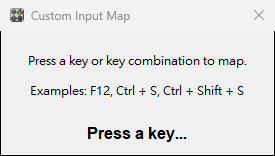

Choose **Shortcut** in a menu to open the recording window. Press the key or
key combination to map, such as F12, Ctrl+S, or Ctrl+Shift+S. The field shows
short forms such as `KB:1`, `KB:Ctrl+S`, and `M:Wheel↓`. Hover over it to see
the full mapping.

<a name="gamepad-combo"></a>

#### Press several XInput buttons at once

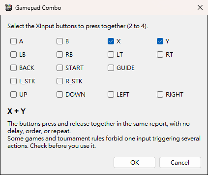

Choose **Gamepad Combo** in a button or Stick Map menu to have one input press
2 to 4 XInput buttons together, such as X + Y. Select the buttons and then **OK**.
The field shows the combo as `Pad:X+Y`. Choose **Gamepad Combo** again to
change it.

- The buttons press and release together in the same report, for as long as
  you hold the input. There is no delay, order, turbo, or repeat.
- Combos work in mapping layers and in ESP32-S3 standalone mode. Writing a
  profile with combos needs the bundled S2P-FW; flash it with **Flash FW**
  first if the ESP32 reports that combos are not supported.
- Some games and tournament rules forbid one input triggering several actions.
  Check before you use a combo there.

### 4.2 Stick Map

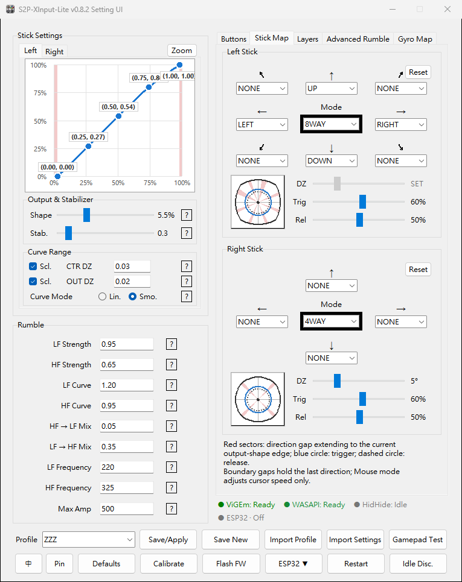

Stick Map uses stick directions as buttons, for example turning the left stick
into a D-pad. Each stick has its own settings and its own **Reset**.

- **Mode**:
  - `4WAY` / `8WAY`: output stick directions as buttons.
  - **Mouse**: move the pointer with the stick, with adjustable speed and deadzone.
  - **Linear Mouse Wheel**, **Linear LT** / **Linear RT**: turn stick travel
    into wheel or trigger output.
  - **Map to R Stick** / **Map to L Stick**: output this stick as the other stick.
- **Direction arrows and menus**: choose an output for each direction. `NONE` sends nothing.
  The items match the [4.1](#41-buttons) button menu without the `LS` / `RS`
  stick directions. **Shortcut** records a key, key combination, or mouse
  wheel up / down.
- **Direction diagram (radar thumbnail)**: red sectors are the gaps between
  directions. The solid blue circle is the trigger threshold and the dashed
  gray circle is the release threshold.
- **DZ / Trig / Rel**: direction deadzone, trigger threshold, and release threshold.

In the screenshot, the left stick uses `8WAY` with custom gaps, so its **DZ**
slider is disabled and shows **SET**. The right stick still uses the uniform
`4WAY` deadzone.

> [!TIP]
> Keep **Trig** above **Rel**. The resulting hysteresis prevents repeated
> activation when the stick rests on a direction boundary.

#### Set custom direction gaps in the radar editor

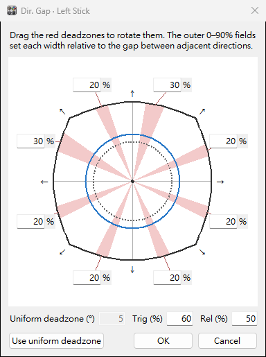

1. Set **Mode** to `4WAY` or `8WAY` and choose an output for each direction.
   Other modes have no radar.
2. Click the radar thumbnail to open the **Dir. Gap** window. Its border turns
   blue when the pointer is over it. You can also Tab to the thumbnail and
   press Enter or Space.
3. Read the radar: arrows mark the directions, red sectors are the gaps
   between them, the outline is the current output shape, and the solid blue
   and dashed gray circles are the trigger and release thresholds.
4. **Rotate a gap**: drag a red sector to shift that gap toward one side. The
   sector darkens while you drag. Each gap keeps a small margin from the
   direction centers and stops at its limit.
5. **Set a width**: the field outside each sector sets that gap's full width
   as 0–90% of the angle between adjacent directions. Adjacent `8WAY`
   directions are 45° apart, so 20% is a 9° gap. Adjacent `4WAY` directions
   are 90° apart, so 20% is 18°. Type a value and press Enter, or drag left or
   right on the field. Right-click a field to restore its saved or default value.
6. **Bottom fields**:
   - **Uniform deadzone (°)**: the half-width shared by every gap, 0–20°.
     It is disabled while custom gaps are in use.
   - **Trig (%)**: 10–100%.
   - **Rel (%)**: at least 3 percentage points below Trig.
7. Select **OK** to send the values to the main window, or **Cancel** or Esc to discard them.
8. Select **Save/Apply** in the main window to save and apply them.

To return to one setting for every gap, open the radar, select
**Use uniform deadzone**, then select **OK**. The button is available only
while custom gaps are set. `4WAY` and `8WAY` keep their own custom gaps, so
switching modes does not overwrite either one. With custom gaps set, clicking
the disabled **DZ** slider in the main window also opens the radar.

> [!NOTE]
> If the mode, thresholds, or profile change in the main window while the radar
> is open, **OK** reports that the settings changed. Close the radar and open
> it again to continue editing.

---

## 5. Layers

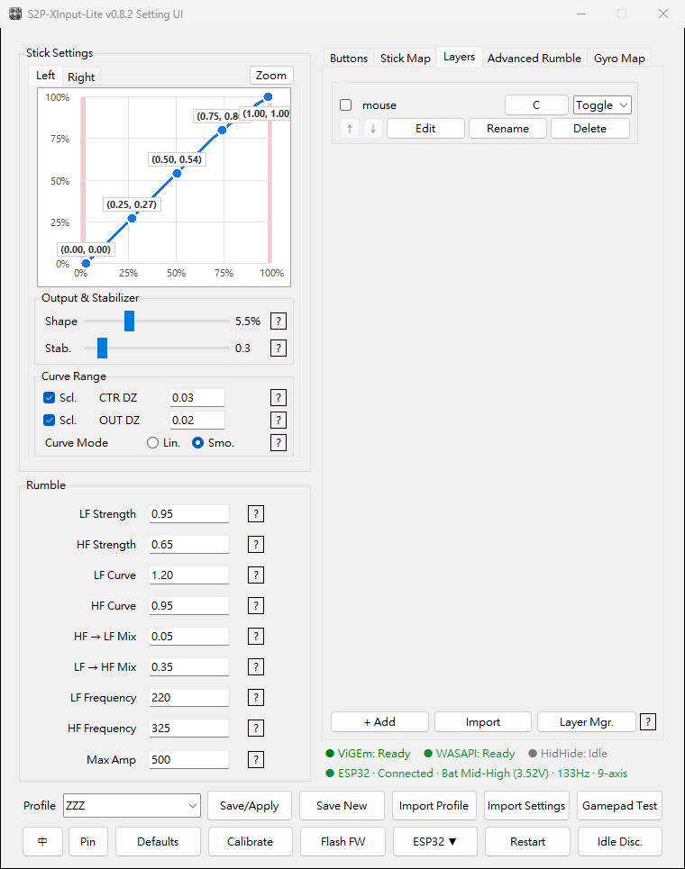

A mapping layer is a set of button and stick-direction mappings you can turn
on at any time. For example, while a button is held, ZR and L can become the
left and right mouse buttons and the right stick can move the mouse. An
enabled layer overrides the main mapping for every item it sets.

Each row has:

- **Checkbox**: enables the layer.
- **Activation button** and **Hold / Toggle**: the button and the way it switches the layer.
- **↑ / ↓**: change the order in the list.
- **Edit**, **Rename**, and **Delete**.

Below the list, **+ Add** creates a layer, **Import** imports layer files, and
**Layer Mgr.** opens the layer folder.

### 5.1 Create and edit a layer

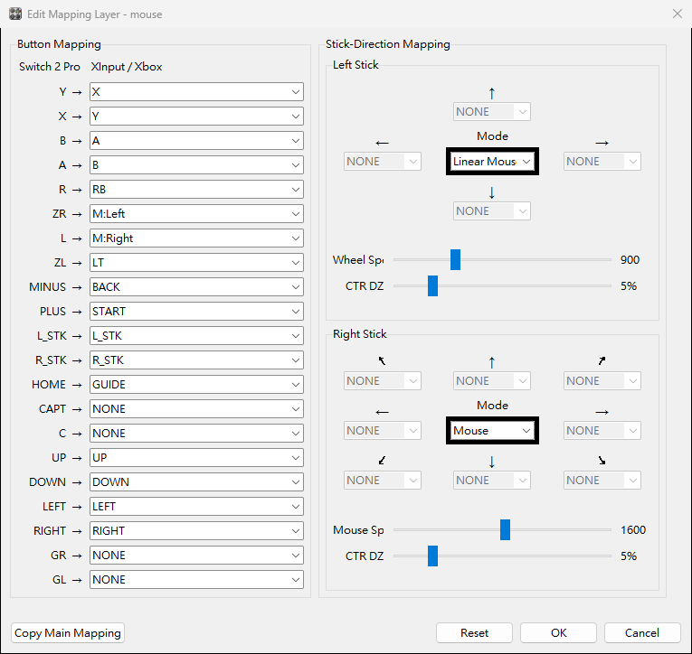

1. Select **+ Add** and enter a recognizable name.
2. Select **Edit** on its row to open the editor shown above.
3. Set button outputs under **Button Mapping** on the left and both sticks
   under **Stick-Direction Mapping** on the right. The stick options match
   [Stick Map](#42-stick-map). **Copy Main Mapping** copies the main window's
   mapping as a starting point.
4. Select **OK** to close the editor.
5. Choose the activation button, select **Hold** or **Toggle**, and check the
   box at the left to enable the layer.
6. Select **Save/Apply** in the main window.

- **Hold**: the layer is active while the activation button is held.
- **Toggle**: each press turns the layer on or off.

> [!WARNING]
> Layer edits stay in memory until **Save/Apply** succeeds. Canceling the
> editor discards that edit. If a layer changes or is deleted outside the
> program while you edit it, reopen the latest version before editing again.

---

## 6. Gyro Map

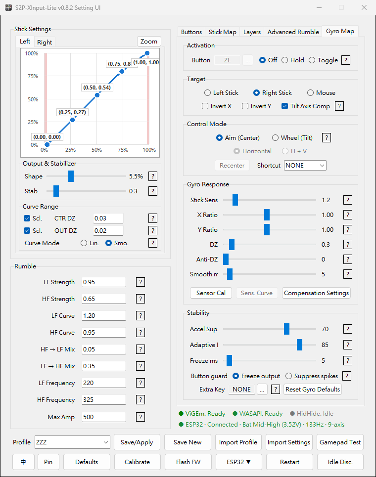

Gyro Map turns controller motion into stick or mouse output, commonly for
motion aiming in shooters. From top to bottom the tab has Activation, Target,
Control Mode, Gyro Response, and Stability sections. The **?** beside a field
explains it in detail.

### 6.1 Activation

- **Button**: select **…** to choose one or more activation buttons. Their
  original XInput or keyboard mappings still apply.
- **Off**: no gyro output.
- **Hold**: active while an activation button is held.
- **Toggle**: each press turns the gyro on or off.

### 6.2 Target

- **Left Stick** / **Right Stick**: output to the virtual controller's stick.
  Aiming usually uses the right stick.
- **Mouse**: output mouse movement.
- **Invert X / Invert Y**: reverse horizontal or vertical movement.
- **Tilt Axis Comp.**: corrects left/right and up/down when the controller is
  held at an angle, reducing axis cross-talk. When off, the sensor's fixed X
  and Z axes are used. Available in Aim (Center) mode only.

### 6.3 Control Mode

- **Aim (Center)**: output follows turn speed and returns to center when you
  stop turning. Suited to aiming.
- **Wheel (Tilt)**: the stick follows how far the controller is tilted from
  where it was when the gyro was activated. Suited to steering, and limited to
  stick output. Choose **Horizontal** or **H + V**. **Recenter** and
  **Shortcut** reset the neutral angle. A shortcut assigned here only resets
  the neutral angle and no longer sends its game mapping.

<a name="gyro-response"></a>

### 6.4 Gyro Response

Only the fields that apply to the current target and control mode are shown.

| Field | Description |
|---|---|
| **Stick Sens** | In Aim (Center) mode, how much turn speed moves the stick. |
| **Mouse Sens** | With mouse output, how far the pointer moves per degree of rotation. |
| **Max Tilt** | In Wheel (Tilt) mode, the tilt angle that gives full output. |
| **X Ratio / Y Ratio** | Relative horizontal and vertical gain, `0.10–2.00`. `1.00` leaves it unchanged. |
| **DZ** | In Aim (Center) mode, a radial deadzone on the combined horizontal and vertical turn speed, so diagonal turns keep their direction. Unit: °/s. |
| **Anti-DZ** | Compensates for the game's built-in stick deadzone. Applies only to gyro stick output. Default `0`. |
| **Tilt DZ** | In Wheel (Tilt) mode, ignores small tilts near neutral. |
| **Smooth ms** | Speed-adaptive smoothing in Aim (Center) mode. Slow movement uses this value and fast turns drop to about 5 ms. `0` turns it off. |
| **Tilt Smooth** | Smoothing time in Wheel (Tilt) mode. |

Buttons below the fields:

- **Sens. Curve**: available only in Aim (Center) mode with the gyro enabled
  and stick output.
- **Compensation Settings**: per-axis gyro output multipliers. Hidden for mouse output.

<a name="sensor-calibration"></a>

Sensor calibration is at the bottom of the main window: **Calibrate ▼** >
**Sensor Calibration**. Place the controller flat on a steady surface first;
the button shows the progress while it runs.
If no controller is connected yet, S2P offers to start the connection.
Wake or pair the controller as the connector window shows, and calibration
continues by itself once it connects. The wait ends after 2 minutes, or as
soon as the connector stops.

#### Sensitivity curve

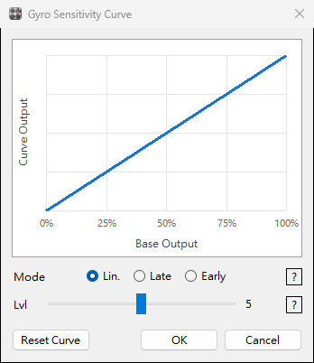

The horizontal axis is the gyro's base output and the vertical axis is the
output after the curve. **Mode** chooses **Lin.**, **Late** (accelerates near
the end), or **Early** (accelerates at the start). **Lvl** sets how strongly
the curve bends. Select **OK**, then **Save/Apply** in the main window.

<a name="gyro-compensation"></a>

#### Compensation settings

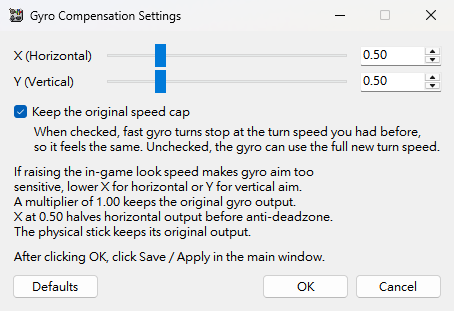

If raising the in-game look speed makes gyro aim too sensitive, lower **X**
for horizontal or **Y** for vertical aim. `1.00` keeps the original output.
At `0.50`, for example, horizontal output is halved before anti-deadzone. The
multipliers apply after smoothing and the sensitivity curve, and only to the
gyro. The physical stick keeps its original output. Select **OK**, then
**Save/Apply** in the main window.

Compensation only scales the output, so the fastest turn is still capped by
the new in-game look speed. For example, after raising the game from 140°/s
to 720°/s with a multiplier of `0.19`, slow aim feels the same, but fast turns
that used to stop at 140°/s can now speed up to 720°/s. To keep the original
feel exactly, turn on **Keep the original speed cap** in this window. The
gyro then stops at the original speed. It appears only in Aim (Center) mode
and is off by default.

To work out a suitable multiplier, use
[Gyro Preview and Calculator](#gyro-preview-and-calculator) in Gamepad Tester.

<a name="gyro-stability"></a>

### 6.5 Stability

| Field | Description |
|---|---|
| **Accel Sup** | Reduces the accelerometer's pull on orientation during fast turns or vibration. `0` is off. |
| **Adaptive DZ** | Keeps the deadzone at rest in Aim (Center) mode and shrinks it during deliberate turns. `0` keeps it fixed. |
| **Freeze ms** | Guard time after an extra key is pressed or released. `0` is off. |
| **Button guard** | **Freeze output** (default) pauses gyro output during the guard time, so the view may stop briefly. **Suppress spikes** keeps your movement and limits only the spike at the button press. Try 20 ms first. |
| **Extra Key** | Buttons that tend to shake the controller, such as the triggers. Pressing or releasing one starts the guard. Their mappings still apply. |

**Reset Gyro Defaults** restores this tab's defaults.

### 6.6 Recommended setup order

1. Place the controller flat on a steady surface and run **Calibrate ▼** > **Sensor Calibration**.
2. Choose the **Target**.
3. Choose activation buttons and **Hold** or **Toggle**.
4. Start testing with a low sensitivity.
5. Use **X Ratio / Y Ratio** to balance horizontal and vertical speed.
6. Increase **DZ** only if the view drifts while the controller is still.
7. Add a little **Anti-DZ** only if small movements do nothing in the game.
8. Adjust **Smooth ms** last.

Check the response with the [Aim Test](#aim-test-guide) in Gamepad Tester.

> [!WARNING]
> For magnetometer calibration, keep away from speakers, magnets, large metal
> objects, and powered equipment, and turn the controller in a 3D figure-eight
> in several directions as prompted.

---

## 7. Rumble

### 7.1 Basic rumble

The **Rumble** section at the lower left of the main window:

| Field | Description |
|---|---|
| **LF Strength** | Strength of the low-frequency path. |
| **HF Strength** | Strength of the high-frequency path. |
| **LF Curve / HF Curve** | Response curve from small to large signals. |
| **HF → LF Mix** | Blends part of the high-frequency path into low frequency. |
| **LF → HF Mix** | Blends part of the low-frequency path into high frequency. |
| **LF Frequency / HF Frequency** | The two vibration frequency commands. |
| **Max Amp** | Caps the final amplitude. Range `0–1023`, default `500`. |

Testing with several bridge programs and controllers showed that higher
strength makes the linear motors more likely to produce a faint knocking sound
when rumble changes quickly. There is no documented safe hardware limit, so
`500` (about 49% of the field range) is the general default. It keeps clear
feedback while reducing the chance of noise.

> [!CAUTION]
> `0–1023` is the protocol field range, not a recommendation to run every
> controller at the maximum for long periods. If you hear knocking, sharp
> noise, or unnatural vibration, lower **Max Amp**, **LF/HF Strength**, or the
> related band gains.

<a name="rumble-game"></a>

### 7.2 Advanced Rumble: Game

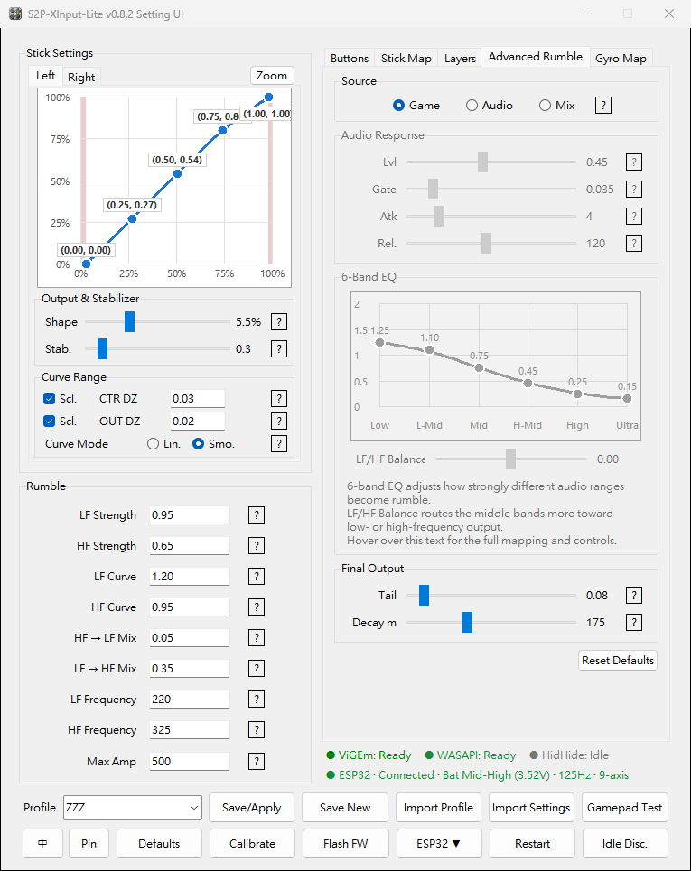

**Source** chooses where rumble comes from:

- **Game**: native game rumble only. Audio Response and 6-Band EQ are disabled.
- **Audio**: converts sound from the Windows default output device into rumble.
- **Mix**: blends game and audio rumble with soft saturation instead of adding
  them directly, to avoid clipping. Up to a **Mix** value of 0.50, game rumble
  keeps its full strength and audio is added in proportion; above 0.50, game
  rumble fades out until 1.00 leaves audio only.

Under **Final Output**, **Tail** and **Decay ms** control the rumble's tail
and fade. **Motor Emulation** emulates classic Xbox motors: stronger game
rumble gets a higher frequency, while medium rumble keeps the configured
frequency. It affects game rumble only; `0.00` is off and standalone mode
ignores it. **Reset Defaults** restores this tab.

<a name="audio-rumble"></a>

### 7.3 Audio and Mix

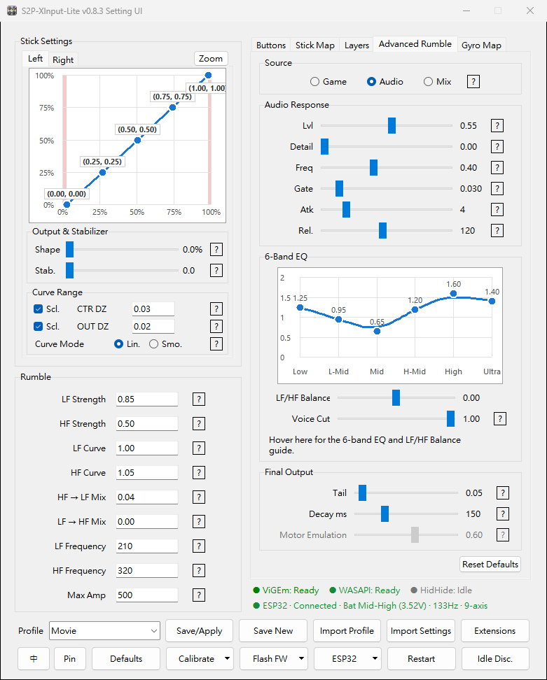

**Audio Response**:

| Field | Description | Adjusting |
|---|---|---|
| **Lvl** | Overall sensitivity of audio-to-rumble. | Raise it if rumble is weak; lower it if sounds start too strong. |
| **Detail** | Makes quieter sounds easier to feel (audio rumble only). `0.00` is off. | Raise it (start around 0.10) to feel more small detail; maximum strength stays the same and background sound near the gate is not amplified. Lower it if rumble feels busy. |
| **Freq** | Lets the HD Rumble frequencies follow the tone of the sound (audio rumble only). `0.00` is off. | Raise it (try 0.50–1.00) for more textured variation. Deeper sounds lower the frequency and brighter sounds raise it, within about LF 160–260 and HF 280–350. |
| **Gate** | Noise threshold. | Raise it if quiet scenes still rumble; lower it if only loud sounds react. |
| **Atk** | Attack speed. | Lower values respond faster. |
| **Rel.** | Release time after a sound ends. | Higher values give a longer tail. |

### 7.4 6-Band EQ

| Band | Range | Main content |
|---|---:|---|
| Low | 20–120 Hz | Deep impacts and sub-bass |
| L-Mid | 120–300 Hz | Low-end body |
| Mid | 300–700 Hz | Lower-mid detail |
| H-Mid | 700–2000 Hz | Upper-mid detail |
| High | 2000–4000 Hz | Friction and vocal edges |
| Ultra | 4000–8000 Hz | Sharp cues and very high detail |

- Drag a point to set that band's gain, or double-click to restore it. `1.00` is neutral.
- Hover over the text below the graph for the full band ranges and controls.
- These settings affect Audio and Mix only, not Game.

**LF/HF Balance** only changes how the middle bands are routed and does not
change the six band gains. `-1.00` favors LF, `0.00` is balanced, and `+1.00`
favors HF. Start between `-0.15` and `+0.15`.

<a name="voice-cut"></a>

**Voice Cut**, below LF/HF Balance, is for films and shows: while speech is
recognised it lowers rumble from the bands the voice occupies, so dialogue no
longer rumbles constantly. Explosions, gunshots, punches, blades and other
impacts are not cut, even when they land over dialogue. `0.00` is off; use
`0.80–1.00` for films. Sung vocals are treated as speech too, so leave it off
for music. While it is on, rumble is delayed by about 15 ms so each sentence is
recognised from its first syllable; the delay is not noticeable with video.

The **Movie** profile turns Voice Cut on and raises the H-Mid, High and Ultra
bands so gunshots and metal hits such as blades are clearly felt.

### 7.5 High-frequency noise

If Audio or Mix produces a constant high-pitched sound:

1. Lower the **High** and **Ultra** gains.
2. Move **LF/HF Balance** slightly toward LF.
3. Raise **Gate** to filter quiet background sound.
4. If every sound starts too strong, lower **Lvl**.
5. If the noise remains, lower **HF Strength** or **Max Amp**.

---

## 8. Gamepad Tester

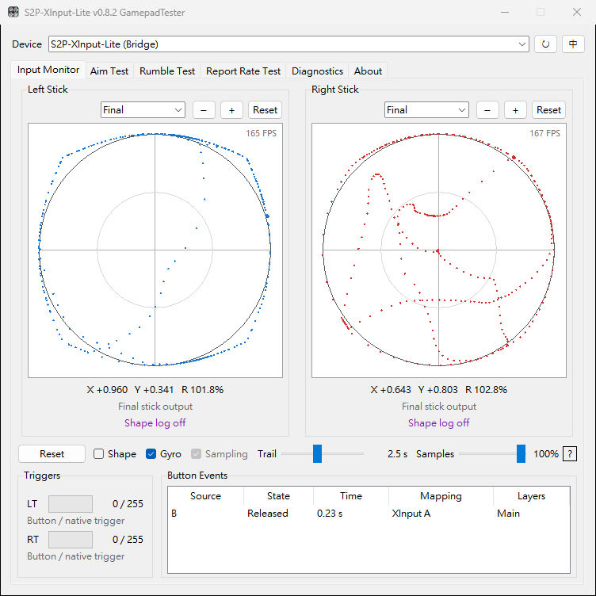

Select **Extensions** at the bottom of the main window, select the built-in
**Gamepad Test**, and choose **Open** (also available in the notification
area menu), or run
`GamepadTester.exe`, to open the standalone tester. It runs separately from
the settings window, so its high-rate drawing does not slow down settings.
Selecting the button again brings the existing tester forward.

> [!IMPORTANT]
> Gamepad Tester is built for the Switch 2 Pro Controller as connected and
> processed by S2P-XInput-Lite. Other XInput, WinMM, and Raw HID controllers
> support basic input, rumble, and report-rate tests, but they do not provide
> S2P's shared telemetry. Physical and processed sources, effective mappings,
> layers, battery, sensors, and ESP32 diagnostics may be missing. This is expected.

**Quick test:**

1. Wake the controller. To test S2P output, start the main program first and
   check that it is connected.
2. Open Gamepad Tester and choose **S2P-XInput-Lite (Bridge)** under
   **Device** at the top. If it is missing, select **↻** to rescan.
3. On **Input Monitor**, move both sticks and press buttons and triggers.
   Check that the dots and the event list change.
4. Switch to **Aim Test**, **Rumble Test**, **Report Rate Test**, or
   **Diagnostics** as needed.

<a name="test-source"></a>

### 8.1 Choose a test source

- **S2P-XInput-Lite (Bridge)**: the virtual controller output by the main
  program, with physical, gyro, and final sources.
- **Other controllers**: XInput or generic game controllers detected by
  Windows. Only the data that interface provides is shown.
- **Raw HID**: entries containing `Raw HID` are HID interfaces, used for the
  [Report Rate Test](#87-report-rate-test). **S2P Mobile Gamepad (Raw HID)** is
  an ESP32-S3 in Android USB HID standalone mode. It shows every button and the
  D-pad, and works in the Aim Test.
- When several devices share a name, the list adds the interface type and a
  number. Switching devices clears old measurements so data is not mixed.

### 8.2 Stick plots

The two plots show the left and right sticks. The crosshair center is zero,
the black circle is the 100% reference, the dot is the current position, and
the dots behind it are the recent trail. Below each plot are the current
coordinates and the radius **R**.

- The source menu above each plot offers **Stick**, **Gyro**, and **Final**
  for S2P, or **Input** for other controllers. `-` and `+` zoom, and **Reset**
  restores the view.
- **Trail** sets how many seconds the trail lasts, and **Samples** sets what
  share of the actual reports is drawn.
- **Gyro** shows the gyro reference lines.
- The FPS at the upper right counts display updates that changed, not the
  controller's report rate. Use the [Report Rate Test](#87-report-rate-test) for that.

### 8.3 Output shape

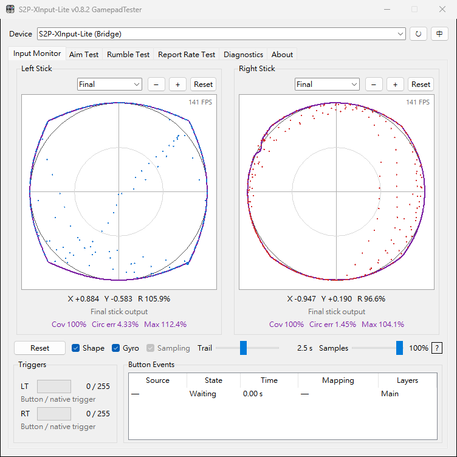

Check **Shape**, then rotate each stick slowly around its edge a few times.
The purple line records the maximum output reached in each direction. Below
the plot are **Cov** (coverage), **Circ err** (circularity error), and **Max** (maximum radius).

- Coverage reaches 100% once every 5° segment has a real sample.
- When the purple line stops expanding for one second, the measurement locks
  and stops redrawing, so a long-open tester does not keep using resources.
- Uncheck and recheck **Shape**, or change the source or settings, to start a
  new measurement. **Reset** clears the current one.

### 8.4 Buttons and triggers

- **Triggers**: the current LT and RT values and their input type.
- **Button Events**: **Source**, **State** (pressed or released), **Time**
  (how long), **Mapping** (the output that took effect), and **Layers**.

<a name="aim-test-guide"></a>

### 8.5 Aim Test

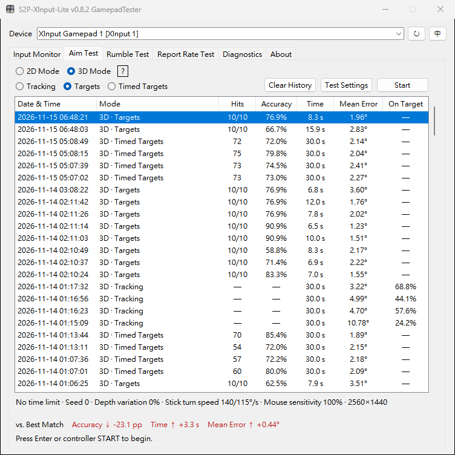

The **Aim Test** tab has four areas:

- **Upper left**: choose **2D Mode** or **3D Mode**, then **Tracking**,
  **Targets**, or **Timed Targets**. The **?** explains the controls and
  comparison rules.
- **Upper right**: **Gyro Preview**, **Calculator**, **Clear History**,
  **Test Settings**, and **Start**.
- **Center**: saved rounds. Select one to see how each result compares with its best.
- **Bottom**: the current test conditions and how each result differs from its
  best with the same target settings.

#### Test mapped gyro output

1. Connect the controller through S2P-XInput-Lite. In **Gyro Map**, set
   **Target** to **Right Stick** and **Control Mode** to **Aim (Center)**.
   Assign a button, choose **Hold** or **Toggle**, then select **Save/Apply**.
2. Open Gamepad Tester and choose **S2P-XInput-Lite (Bridge)** under
   **Device**. Aim Test reads the virtual controller's right-stick output as
   Windows sees it, so the active profile's mapping, deadzone, and response
   settings apply.
3. Choose **3D Mode → Tracking** and select **Start**. Activate the gyro and
   rotate the controller with your thumb off the right stick to check its
   response. For a shooting drill, choose **Targets** or **Timed Targets**.

#### Choose and run a drill

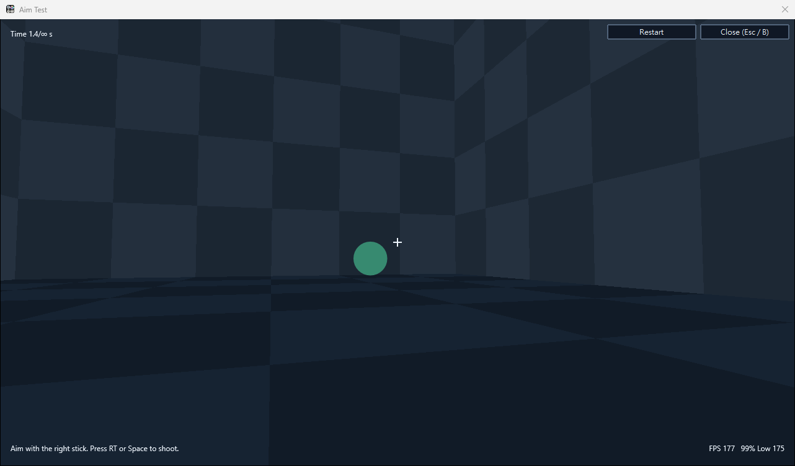

The screenshot shows **3D Mode → Targets** in a window. The timer is at the
upper left, **Restart** and **Close** are at the upper right, the control hint
is at the lower left, and **FPS** and **99% Low** are at the lower right. Move
the center reticle onto the ball and shoot to hit it.

In **2D Mode**, the mouse or right stick moves the reticle. In **3D Mode**, it
turns the camera. A detected controller has priority by default, so use RT or
Space to shoot. With no controller detected, use the mouse to aim and
left-click or press Space to shoot. To use both in the same round, enable
**Auto-switch between controller and mouse** in **Test Settings**. Stick
values set reticle or camera speed proportionally. The default drill is
**3D Mode → Targets**.

| Drill | 2D Mode | 3D Mode |
|---|---|---|
| **Tracking** | Follow the moving target with the reticle. | Turn the camera to follow the moving ball. |
| **Targets** | Click or shoot one target at a time. | Shoot one ball at a time. |
| **Timed Targets** | Hit as many replenishing targets as you can. | Hit as many replenishing balls as you can. |

Tracking runs for the configured duration. In Targets, a hit advances to the
next target, and the round ends at the configured hit count or optional time
limit. Timed Targets starts with two targets. Each stays until hit and is
replaced after a brief delay, and the timer ends the round with the total hit
count. When 3D targets overlap, the shot hits the first ball surface along the
crosshair ray.

Select **Start**, press Enter, or press controller START. Scoring starts after
a 3, 2, 1 countdown. If RT was held during the countdown, release it before
pressing it to shoot. Use **Restart**, Enter, or START to run the drill again,
and **Close**, Esc, or controller B to return to the tester. When mouse aim is
available in 3D, right-click to release the pointer for the window controls,
then right-click in the play area to resume mouse aim. A fullscreen test also
closes when you switch away, restoring the previous display mode.

#### Test settings

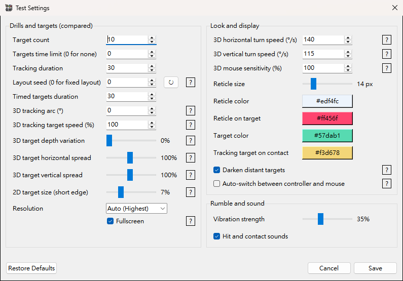

Select **Test Settings** to open this window. It has three panels:

- **Drills and targets (compared)** on the left sets the resolution,
  target counts, durations, the layout seed, and target placement. Only these
  settings decide which earlier rounds a result is compared with.
- **Look and display** at the upper right sets turn speeds, mouse
  sensitivity, the reticle, and colors.
- **Rumble and sound** at the lower right sets hit feedback.

The **?** beside a field explains it. Select **Save** to keep the
changes, or **Restore Defaults** and then **Save** to reset every test setting.

- **Fullscreen** is enabled by default. In windowed mode, **Auto (Highest)**
  fits the test window, including its title bar, to the current monitor's work
  area and leaves the Windows taskbar visible. In fullscreen, **Auto (Highest)**
  uses the highest resolution Windows validates for that monitor. Either mode
  accepts a specific size.
- A Targets time limit of `0` lets the round continue until you hit every target.
- A layout seed of `0` uses the built-in Targets sequence and Tracking path.
  Timed Targets also uses a repeatable sequence with seed `0`. Select **↻**
  for a new seed, then save it to replay the same layout.
- Every drill lets you set the reticle's color and size. The 2D target
  diameter is a percentage of the shorter screen edge. Depth variation and
  horizontal and vertical spread control where 3D Targets and Timed Targets appear.
- **3D mouse sensitivity (%)** defaults to 100%, which turns the camera by
  0.18° per pixel of pointer movement.
- **3D horizontal / vertical turn speed (°/s)** sets the camera turn rate at
  full right-stick deflection. It also applies to gyro mapped to the right
  stick. The defaults are 140°/s horizontal and 115°/s vertical.
- **3D tracking arc (°)** at 0° keeps the original path. At 180° the target
  turns back 90° to each side. At 360° it turns back directly behind you after
  crossing the front. Select **↻** beside the layout seed to pick a random
  starting direction. Seed 0 always starts to the right.
- **3D tracking target speed (%)** ranges from 10% to 600%. The arc path moves
  at 90°/s at 100% and 540°/s at 600%.
- **Darken distant targets** is enabled by default. The nearest 3D ball is
  brightest and farther balls get darker. Turn it off to show outlines on the balls.
- In Tracking, the target changes color and gives light vibration while you
  stay on it. In Targets and Timed Targets, the reticle changes color on
  target. Hits play a sound, show a short burst, and vibrate. Misses use a
  different sound. Set **Vibration strength** to `0` to turn off vibration, or
  use the checkbox to mute the sounds.

The **FPS** at the lower right counts successful Direct2D submissions or Tk
drawing updates. **99% Low** converts the P99 interval between updates to FPS,
so dips show up even when the average is high. The drawing target follows the
monitor's current refresh rate, and actual presentation also depends on
Windows and the GPU.

<a name="aim-display-size"></a>

#### Screen Resolution, Size, and Aspect Ratio

Resolution and physical screen size do not change how the Aim Test converts
input into movement. You do not need different turn speeds or gyro settings
for different resolutions:

- **3D** works in angles. The vertical field of view is fixed at 60°, full
  right-stick deflection turns at the **3D horizontal / vertical turn speed**
  in °/s, and the balls have a size and position in 3D space. A higher
  resolution only draws them more finely: about 16 pixels per degree at
  1080p, 22 at 1440p, and 33 at 4K, far finer than aiming needs.
- **2D** scales with the screen height. At full right-stick deflection the
  reticle moves one screen height per second, and the target diameter is a
  percentage of the shorter screen edge, so 1080p and 4K feel the same.
- **3D mouse sensitivity** counts pointer movement in pixels. It depends on
  the mouse DPI and the Windows pointer speed, not the screen resolution.

The **aspect ratio** is what makes a difference. Because the vertical field
of view is fixed, a wider screen shows more to the left and right in 3D. In
2D, targets spread across the full screen width, so a wider screen also means
longer horizontal moves:

| Aspect ratio | Example resolutions | 3D horizontal field of view | 2D crossing at full right stick |
|---|---|---|---|
| 4:3 | 1600×1200 | about 75° | 1.33 s |
| 16:10 | 1920×1200 | about 86° | 1.60 s |
| 16:9 | 1920×1080, 2560×1440, 3840×2160 | about 92° | 1.78 s |
| 21:9 | 2560×1080, 3440×1440 | about 108° | 2.37 s |
| 32:9 | 5120×1440 | about 128° | 3.56 s |

- In 3D, a wide screen needs fewer large turns to find a target, but tracking
  and fine aim still need the same turning angles.
- In 2D, rounds take longer on a wide screen, and **Mean Error** is measured
  in pixels, so 2D results from different resolutions do not compare
  directly. Resolution is part of the **Drills and targets (compared)** panel,
  so rounds at different resolutions are never compared with each other.

On a larger screen, or when you sit closer, the same °/s looks faster and the
targets look bigger. How far the view turns for a given controller rotation
stays the same. Matching the **3D horizontal / vertical turn speed** to the
game you play matters more than the screen: the closer it is to the game's
turn speed, the closer the test feels to the game.

<a name="gyro-preview"></a>

#### Gyro Preview and Calculator

Raising the in-game look speed also speeds up gyro mapped to the right stick.
A compensation multiplier scales the gyro output down so fine aim feels the
same as before. The physical stick output is unchanged.

**Gyro Preview** and **Calculator** appear only when the test source is
**S2P-XInput-Lite (Bridge)** and its gyro is available. Gyro Preview requires
**3D Mode**. If the current profile already has adjusted multipliers, you are
asked whether to reset them to 1.00 first.

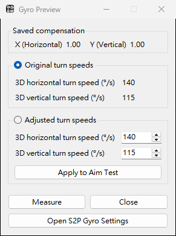

**Measure with Gyro Preview:**

1. Select **Gyro Preview**. The test scene fills the screen without a border,
   and the preview panel appears at the upper right.
2. **Saved compensation** shows the current S2P X (horizontal) and Y (vertical) multipliers.
3. **Original turn speeds** are fixed at the defaults of 140°/s horizontal and 115°/s vertical.
4. Enter the new horizontal and vertical speeds under **Adjusted turn speeds**.
   They start from the current test settings.
5. Choose the original or adjusted speeds and turn the camera with the right
   stick to compare how they feel.
6. Select **Measure**. With the same stick output, the preview turns through
   the original X and Y speeds and then the adjusted ones, then shows the
   suggested X and Y multipliers. A suggestion within `0.10–2.00` is written
   straight to the current S2P settings and profile and sent to the active
   connection. The panel reports whether it was applied live.
7. Select **Apply to Aim Test** to use the adjusted speeds in later Aim Test
   rounds. This changes only the Aim Test's 3D turn speeds, not the S2P settings.
8. Select **Close** or press Esc to end the preview. **Open S2P Gyro Settings**
   switches to Gyro Map in the main window.

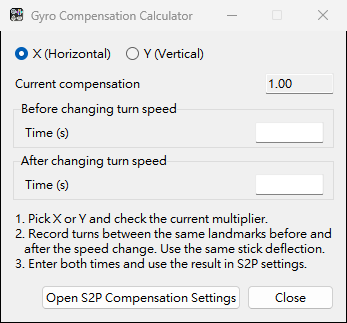

**Convert an in-game test with the Calculator:**

1. Select **Calculator**, choose **X (Horizontal)** or **Y (Vertical)**, and
   check **Current compensation**.
2. Before changing the in-game look speed, record a turn from landmark A to
   landmark B with a fixed right-stick deflection and aim state.
3. Change the in-game look speed and record the same turn again.
4. Enter both times in seconds under **Before changing turn speed** and
   **After changing turn speed** to get the suggested multiplier. With an
   original multiplier of 1.00, 3 seconds before and 2 seconds after gives 0.67.
5. Select **Open S2P Compensation Settings**, or open **Compensation Settings**
   from **Gyro Map** in the main window. Enter the X and Y multipliers, select
   **OK**, then select **Save/Apply**.

<a name="aim-results"></a>

#### Read and compare results

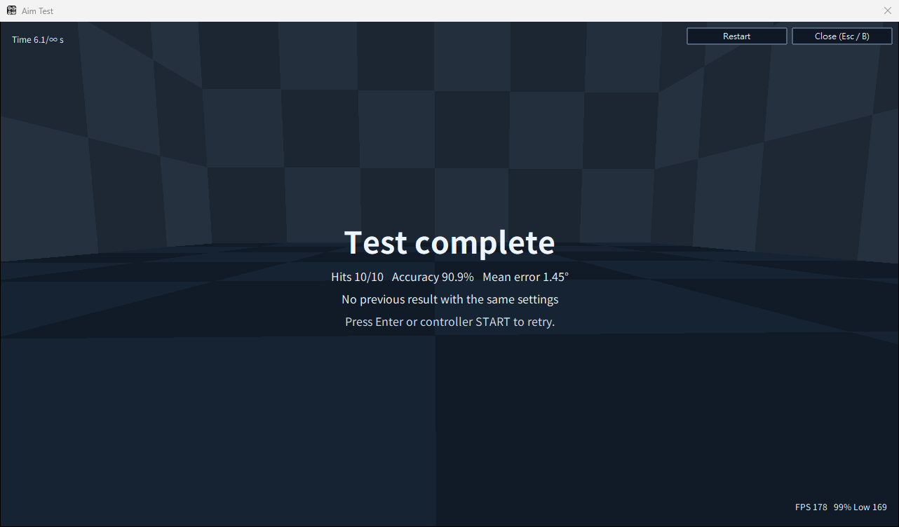

**Accuracy** is hits divided by shots. **Mean Error** is the average distance
from the reticle to the target center, in pixels for 2D and degrees for 3D.
Targets averages every shot taken while a target is present, including misses.
In Timed Targets, a shot during the gap between targets still counts toward
accuracy. Tracking weights error by time, and **On Target** is the share of
the round spent within the target. When 3D Tracking receives right-stick
input, the result also shows the peak horizontal output and the longest
continuous full-deflection time in milliseconds. That timer stops when
horizontal output leaves full deflection or reverses.

The end screen shows your result in the center and how each result differs
from its best in earlier rounds with the same target settings. The comparison uses only the
settings in the **Drills and targets (compared)** panel of Test Settings: the
mode, resolution, seed, and the relevant target count, duration, 2D target
size, depth, and spread. 3D Tracking also compares the arc and target speed.
Results remain comparable across changes to controller turn speed, mouse
sensitivity, colors, reticle, vibration, and sound.

Each result is compared with its own best, not with one particular round:

- Hits, accuracy, and On Target are compared with their highest values.
- Completion time and mean error are compared with their lowest values.
  Completion time counts only for **Targets** rounds that hit every target.
  **Timed Targets** does not compare time.

Arrows show the direction of change. Green marks a new best and red marks a
result short of the best.
Accuracy and On Target changes are in percentage points. **Clear History**
removes saved rounds.

<a name="rumble-test"></a>

### 8.6 Rumble Test

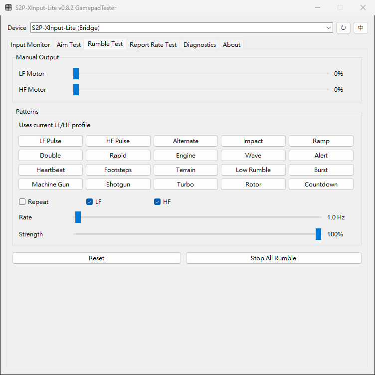

1. Under **Device**, choose **S2P-XInput-Lite (Bridge)** or an XInput device
   that supports rumble, then open **Rumble Test**.
2. **Manual Output**: start low and move **LF Motor** and **HF Motor**.
3. **Patterns**: select any pattern, such as Impact, Engine, or Machine Gun.
   **Repeat** loops the selected pattern until you select it again or stop
   all rumble. **Overlap** plays a newly selected pattern on top of the ones
   already playing; without it, the new pattern replaces them. **LF / HF**
   choose the bands, and **Strength** sets its strength. **Rate** sets how
   often a repeating pattern restarts; effects such as Heartbeat or Machine
   Gun keep their own timing, so a faster rate shortens the rest (or restarts
   the effect early) instead of speeding it up. The first row (LF Pulse,
   HF Pulse, Alternate, Ramp, Wave) is made of shapes, and Rate sets their
   tempo.
4. Select **Stop All Rumble** when finished. **Reset** restores this tab.

A Bridge test uses the current profile's LF/HF settings. With **Source** set
to Audio only, game rumble patterns are not output. If the tab shows
`No XInput rumble` or its controls are gray, check that the virtual controller
is enabled or choose an XInput device that supports rumble. The tester stops
rumble when you change devices, the output connection changes, or the tester
closes. Android USB HID standalone mode is input only and does not send game
rumble back to the controller.

### 8.7 Report Rate Test

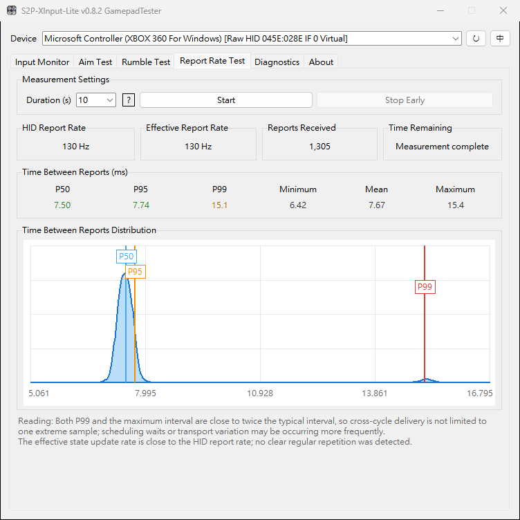

1. Under **Device**, choose an interface containing `Raw HID`, then open **Report Rate Test**.
2. Choose **Duration (s)** and select **Start**.
3. Keep moving one stick in large circles until it finishes, or select **Stop Early**.
4. Compare **HID Report Rate** with **Effective Report Rate**, and check the
   P50, P95, and P99 values and the distribution under **Time Between Reports**.
   An interpretation appears below the graph.

The screenshot measures the virtual controller's Raw HID interface. The values
describe that interface's reports, not the physical controller's or BLE's raw
rate. One physical device can expose several interfaces. If there is no valid
data, choose the interface whose values change when you move the controller.

### 8.8 Diagnostics

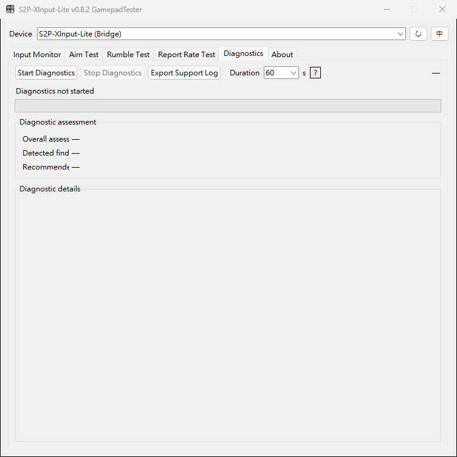

**Diagnostics** runs a 30, 60, or 120 second ESP32 health check:

1. Choose the S2P device under **Device** and pick a **Duration**.
2. Select **Start Diagnostics**. Keep the controller awake and move the
   sticks, turn the controller, and trigger rumble during the test.
3. When it finishes, **Diagnostic assessment** summarizes the overall result,
   findings, and recommendations. **Diagnostic details** lists the connection,
   input, latency, calibration, sensor, and rumble checks.
4. To report a problem, select **Export Support Log** to save a UTF-8 text file.

In Bridge mode the test briefly uses the main program's serial connection. In
standalone mode it opens the ESP32's diagnostic channel directly. The full
diagnostic commands require the bundled S2P-FW 1.0.9.

### 8.9 About

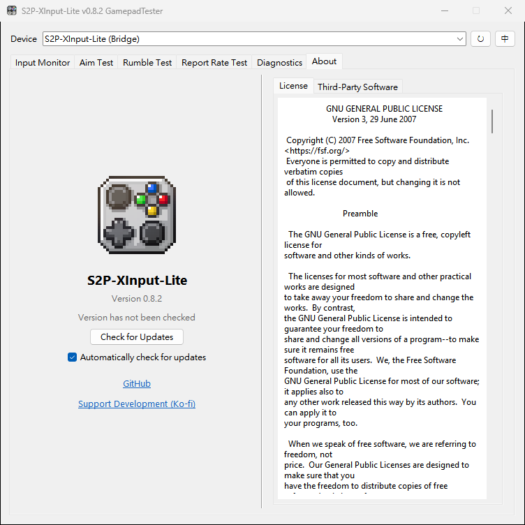

The left side shows the version, **Check for Updates**,
**Automatically check for updates**, and links to GitHub and Ko-fi. The
**License** and **Third-Party Software** tabs on the right show the full
notices shipped with the release.

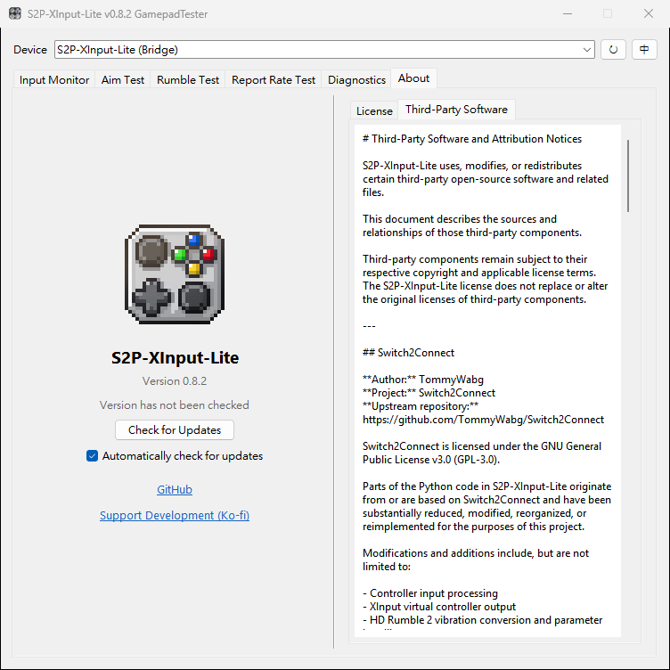

---

## 9. ESP32-S3

### 9.1 Two operating modes

| Mode | Windows program must stay open | USB output | ID |
|---|---|---|---|
| **ESP32 Bridge** | Yes | CDC; the desktop outputs XInput through ViGEmBus | `303A:4001` |
| **Android USB HID standalone** | No | CDC plus standard HID, shown as `S2P Mobile Gamepad` | `303A:4005` |

Both modes keep the CDC channel for settings, diagnostics, and recovery. These
are Espressif / TinyUSB shared default VID/PIDs, so the ID or product name
alone does not prove a device is S2P. The desktop verifies the firmware's
identity and capabilities. The older `CAFE:4020/4021/4022` IDs are only used
to recognize upgrade candidates and cannot enable the removed PC XInput or
Auto modes.

Older NVS values keep their meaning for `0=Bridge` and `2=HID`. `1=XInput` and
`3=Auto` become HID after upgrading, and the desktop explains that standalone
PC XInput / Auto was removed and that desktop XInput needs Bridge. Unknown
values or read errors start in Bridge.

The controller's four player lights show the measured battery level: one for
low, two for mid-low, three for mid-high, and four for high. Standalone mode
shows this too, without the Windows program.

<a name="flash-esp32-s3"></a>

### 9.2 Flash firmware

Before you start, have ready:

- An ESP32-S3 board with 16 MB flash. Other sizes are rejected by the check, and
  nothing is written.
- A USB data cable connected to the board's **USB / OTG** port, not the
  **UART / COM** port.
- The board's `BOOT` and `RESET` buttons. `RESET` may be labeled `EN` or `RST`.

**1. Check the version**

Select **Flash FW ▼ → Flash bundled firmware** at the bottom of the main window. The program reads the
installed firmware version first and shows "Reading the current ESP32-S3
firmware version…" for a few seconds.

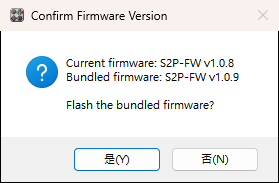

The confirmation lists the installed version and the bundled **S2P-FW 1.0.9**.
Choose **Yes** to continue or **No** to cancel. If the version check paused the
connector, canceling resumes it. You can also reflash the same version.

**Flash custom firmware…** first opens a window to select a `.bin` file. Only the
application image is replaced; the bundled bootloader and partition table are always
used. Files that are not ESP32-S3 firmware or exceed the app partition are rejected,
and a file without the S2P firmware identity shows a warning first. The confirmation
lists the file name, version, size and SHA-256; the remaining steps are the same.
To restore, select **Flash bundled firmware**.

**2. Put the ESP32-S3 into flash mode**

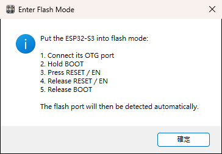

1. Select **OK** in the instructions.
2. Hold `BOOT`.
3. Press and release `RESET / EN`.
4. Release `BOOT`.

On a board without a `RESET` button, hold `BOOT` while plugging in the USB
cable, then release `BOOT`.

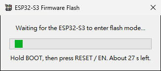

The program counts down and waits up to 30 seconds. It finds the ESP32-S3 ROM
flashing port by its USB identity, even if that COM port already existed. If it
times out, "Flash Port Not Found" appears. Select **Flash FW** again.
While it waits, select **Cancel** or close the window to stop; nothing has
been written yet.

**3. Check the chip and flash capacity**

When the port is found, the program shows its name. Select **OK** to start the
check.

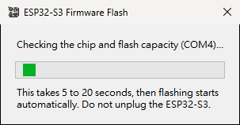

The check takes 5 to 20 seconds and only reads from the board. Flashing is
canceled if the chip is not an ESP32-S3 or the flash is not 16 MB.

**4. Flash and reconnect**

1. After the check, an esptool window opens and shows the flashing progress.
2. "Firmware flashing completed" appears when it finishes, and the ESP32 returns
   to Bridge.
3. Once USB re-enumerates, the connector starts automatically and searches for
   the controller.
4. If the bridge does not appear after a few seconds, press `RESET / EN` or
   reconnect the ESP32-S3.

> [!CAUTION]
> Do not unplug the ESP32-S3 or close the program while flashing. If flashing
> fails, the esptool exit code is shown. Enter flash mode again and retry.

If you use standalone mode, write your profile to the ESP32 again after
flashing, as described in [9.5](#95-write-settings-and-enable-android-usb-hid).

### 9.3 Pair the controller with the ESP32-S3

1. Connect the ESP32-S3 to the PC and start S2P-XInput-Lite.
2. To create a new pairing, hold `SYNC` on the controller.
3. When the program detects the SYNC pairing connection, it writes the
   ESP32-S3's pairing data to the controller.
4. Check that ESP32 in the status bar changes to `Connected`.

### 9.4 Close a bridge connection

Exit a normal bridge session with **Exit** in the notification area, and wait
until all BLE connections are released. Once a host session is established,
the ESP32 releases BLE automatically when CDC is absent for 3 seconds or the
host heartbeat times out after 8 seconds. Android USB HID does not need the
desktop program or CDC/DTR, and keeps its idle disconnect and wake-on-button
behavior. See the [hardware checklist](../docs/bridge-host-shutdown.md).

### 9.5 Write settings and enable Android USB HID

Only one ESP32 write or mode switch can run at a time. Stay connected and wait
for the completion message before closing the program or starting another operation.

1. Choose the profile to write, finish your changes, and select **Save/Apply**.
   Changes to `System Default` must first be saved with **Save New**.
2. Check that the ESP32 is connected and has the bundled S2P-FW 1.0.9.
3. Select **ESP32 ▼ → Write and enable standalone**.
4. Review the compatibility notice. If the profile uses Windows-only outputs,
   cancel to change them or confirm skipping the unsupported items.
5. Wait for the write, length / CRC check, apply, and controlled restart, and
   keep USB powered throughout. After the restart, the desktop verifies the
   device, USB mode, and profile.
6. Connect an Android device that supports USB host mode, using a data cable
   and an OTG adapter if needed. The system and the game must support USB HID controllers.

The ESP32 keeps the previous valid settings in A/B slots and switches to the
new slot only after it validates. If a write or mode save fails, do not assume
the switch happened.

### 9.6 Return to Bridge and recovery

- **Desktop menu**: reconnect the ESP32 to Windows and choose
  **ESP32 ▼ → Return to ESP32 bridge mode**. Wait for USB re-enumeration
  and the automatic search. If it does not recover, reconnect it or select **Restart**.
- **From the controller**: hold **HOME+X for 3 seconds, then release** to save
  and return to Bridge, or **HOME+A for 3 seconds, then release** to save and
  switch to Android USB HID. The chords read raw buttons before mappings and
  layers apply, and still switch to HID if Bridge CDC output stalls. The ESP32
  restarts only after it saves the new mode.
- **No controller**: in either mode, the CDC console accepts `mode bridge`;
  after it saves, `restart` performs a controlled restart. Close any desktop
  connection using that COM port before opening a serial terminal.
- **CDC is unavailable too**: put the chip in ROM Download Mode. Usually you
  hold **BOOT**, press and release **RESET/EN**, then release **BOOT**. On
  boards without a reset button, hold BOOT while reconnecting USB. Wiring and
  timing vary by board, so follow the vendor's instructions. Once the ROM
  device appears, use the flashing procedure in [9.2](#flash-esp32-s3). The
  chip and 16 MB flash checks still run before writing.

Returning to Bridge keeps the last saved standalone settings. **Restart** only
restarts the desktop connection.

<a name="standalone-scope"></a>

### 9.7 Standalone mode scope

**Supported**: stick calibration, curves, center and outer deadzones, output
shape, stabilizer and smoothing, button and direction mapping (including
per-direction 4WAY / 8WAY gaps for both sticks and enabled layers), compatible
mapping layers, linear triggers, gyro-to-stick (including the radial deadzone,
spike suppression, and independent X / Y compensation), idle disconnect, and
BLE reconnect. HID provides buttons, four axes, a D-pad, independent analog
triggers, and digital L2/R2 compatibility output.

**Not supported**: Windows keyboard / mouse output, Audio / Mix audio rumble,
per-application profile switching, and gyro mouse. HID has no rumble output
report, so Android game rumble and BLE HID are not provided. Windows game
rumble and audio rumble still go through Bridge.

Android compatibility depends on the device, system, and game. Apple devices
are not supported. For hardware validation status, see
[validation and official references](../docs/usb-hid-standardization.md).

<a name="build-firmware"></a>

### 9.8 Build your own firmware

The bundled S2P-FW 1.0.9 comes with its complete source. You can change it to
suit your needs, rebuild it, and flash the result with **Flash custom
firmware…**. The source is in:

- The release package: `app\esp32s3\source\esp32s3_usb_bridge_bluedroid`
- GitHub: `esp32s3/source/esp32s3_usb_bridge_bluedroid` under the same version tag

> [!WARNING]
> Modified firmware is not supported; use it at your own risk. Before you flash
> it, make sure you can use the ROM Download Mode in
> [9.6](#96-return-to-bridge-and-recovery), so that you can flash the bundled
> firmware back if something goes wrong.

**1. Set up the build tools**

- Install Espressif's official **ESP-IDF 5.5.4**. Use this exact version; other
  versions may fail to build or produce different results.
- `esp_tinyusb 1.7.6~2` and `tinyusb 0.19.0~3` are locked in
  `dependencies.lock`. The Component Manager downloads them on the first build,
  so you do not install them yourself.
- An ESP32-S3 board with 16 MB flash.

**2. Build**

Open an ESP-IDF 5.5.4 command prompt (the ESP-IDF PowerShell or CMD shortcut
the installer creates) and run:

```text
cd esp32s3\source\esp32s3_usb_bridge_bluedroid
idf.py set-target esp32s3
idf.py build
```

The firmware image is `build\esp32s3_bluedroid_bridge.bin`. `build`,
`managed_components` and `sdkconfig` are generated by the build; put
configuration changes in `sdkconfig.defaults`.

`scripts\build_firmware.ps1` in the source repository checks that a build
matches the bundled images. Once you change the source the hashes will differ
and the script will fail. That is expected; use `idf.py build` directly.

**3. Flash**

1. Click **Flash FW ▼ → Flash custom firmware…** and choose
   `build\esp32s3_bluedroid_bridge.bin`.
2. Enter flash mode and finish flashing as in [9.2](#flash-esp32-s3).

Only the firmware image at `0x10000` is replaced. The bootloader and partition
table always come from the bundled files, so:

- Do not change the partition table or the flash size settings.
- The image must fit in the app partition, or it is rejected.

**4. Stay compatible with the desktop app**

- The desktop app recognizes S2P firmware by the product, protocol and identity
  the firmware reports. Keep the `S2P-FW` and `s2p_bridge` identity strings.
  Without them you get a warning before flashing, and after connecting the S2P
  features such as writing profiles and switching modes stay off.
- If you change the CDC commands or the profile data format, the current
  desktop app may not be able to write settings. Change the desktop side to
  match.
- To go back to the original firmware, choose **Flash bundled firmware**.

**Android USB HID reference**

| Item | Value |
|---|---|
| VID:PID | `303A:4005` (Espressif / TinyUSB shared default) |
| Strings | Manufacturer `S2P-XInput-Lite`, product `S2P Mobile Gamepad`, serial `S2P-<12-digit MAC>` |
| Interfaces | CDC control `0`, CDC data `1`, HID `2` |
| Endpoints | CDC notification `0x81`, CDC OUT/IN `0x02` / `0x82`, HID interrupt IN `0x83` (32 bytes, 1 ms polling interval) |
| Output report | None, so Android game rumble is not supported |

The HID input report is 13 bytes with no report ID:

| Byte | Contents |
|---|---|
| 0–1 | 16 button bits, little-endian. Bits 0–15 are A, B, X, Y, L1, R1, Select, Start, LS, RS, Mode (HOME), reserved, reserved, L2, R2, reserved |
| 2 | Low 4 bits are the D-pad: `0` = up, plus 1 for every 45° clockwise, `8` = released. High 4 bits are zero |
| 3–10 | Four int16 axes (−32768 to 32767, little-endian): left X, left Y, right X (usage Z), right Y (usage Rz). Y is positive downward |
| 11 | Left trigger 0–255 (Simulation Brake) |
| 12 | Right trigger 0–255 (Simulation Accelerator) |

The button bits use Android's standard HID button usages rather than a
sequential 1–16 range. When a trigger reaches 32 or more, the matching L2 / R2
button bit is also set, for Android games that only read button events. For
the full descriptor, see `s_hid_report_descriptor` in
`main/standalone_xinput.c`, the compiled descriptor record
[`esp32s3/firmware/usb-descriptors.json`](../esp32s3/firmware/usb-descriptors.json),
and the [firmware source README](../esp32s3/source/esp32s3_usb_bridge_bluedroid/README.md).

**License and legal notes**

- The firmware is derived from
  [Switch2Connect](https://github.com/TommyWabg/Switch2Connect) and licensed
  under **GPL-3.0**. Changes for your own use are unrestricted.
- If you give a modified firmware image (`.bin`) to anyone else, you must also
  provide its complete corresponding source under GPL-3.0, mark it as a modified
  version with what you changed and when, and keep the notices in `LICENSE`,
  `THIRD_PARTY_NOTICES.md` and `third_party/licenses`.
- `303A:4005` is an identifier Espressif shares for development and testing. To
  distribute a device or turn it into a product, apply for your own PID under
  [Espressif's PID rules](https://github.com/espressif/usb-pids/blob/main/README.md).
  Do not use another vendor's VID/PID, product names or trademarks to make the
  device pose as their product.
- Do not add code, firmware or descriptors you have no right to distribute,
  such as firmware dumped from a commercial device.

---

## 10. Quick controls

### 10.1 Sliders and values

- Click the value to the right of a slider to open a dialog that shows its
  range, step, and description.
- Press and drag right on a parameter name to increase it, or left to
  decrease it. Each change uses that parameter's own step.
- Gamepad Tester parameters, including the Aim Test settings and the
  compensation windows, drag and restore the same way. Live values such as
  Input Monitor and Rumble Test settings are not saved, so their
  **Restore Saved** item is grayed out.

### 10.2 Right-click to restore

Right-click a supported parameter to choose:

- **Restore Saved**: discards unsaved changes.
- **Restore Default**: uses the `System Default` value.

In the compensation windows, **Restore Saved** follows what was saved last:

- **Gyro Compensation Settings**: the multipliers saved in the profile,
  including ones that **Gyro Preview** saved after a measurement.
- **Adjusted turn speeds** in Gyro Preview: the speeds last saved with
  **Apply to Aim Test**, or the Aim Test settings if you have not applied yet.

### 10.3 Curve control points

- Drag: move the point.
- Double-click: restore the point's default.
- Right-click: type its X and Y coordinates.

### 10.4 Help

The **?** beside a field explains it. Hover over the text below the 6-band
graph for band ranges, what LF/HF Balance does, and the point controls.

> [!WARNING]
> Select **Save/Apply** before **Restart**. Otherwise unsaved changes on screen are not applied.

---

## 11. Troubleshooting

### Save and operation messages

- **Profile changed outside the program**: reload it, overwrite it with your
  edits, or cancel and keep editing.
- **Mapping layer changed**: close the editor and reopen the latest layer.
- **Saved, but the list could not update**: the file was saved. Reopen the profile list later.
- **Another operation is in progress**: connection, calibration, flashing,
  and ESP32 writes run one at a time. Wait for the current one to finish.

### ViGEm is not Ready

1. Reinstall ViGEmBus.
2. Restart Windows.
3. Run S2P-XInput-Lite again.

### The game receives double input

- In USB mode, install and set up HidHide.
- Check whether Steam Input converts the input again.
- Make sure the game does not read both the physical controller and the
  virtual XInput controller.

### HidHide shows Error

Close HidHide Configuration Client, then try again in S2P-XInput-Lite. If
HidHide already lists other devices, enabling global hiding may also affect them.

### Controller not found

- Use a USB cable that carries data, and reconnect it.
- Windows BLE: remove the old pairing in Windows, start the program, and hold
  `SYNC` on the controller to pair again.
- ESP32: check the firmware version and pairing. See [9. ESP32-S3](#9-esp32-s3).

### ESP32 stays on Searching

- Make sure the ESP32-S3 uses the correct USB port and has compatible firmware.
- Reconnect the ESP32-S3.
- Put the controller in pairing mode again.

### A stick shows a leftover value after connecting

Flick both sticks once after the controller connects so they settle back to
center. See the note in [1.2](#12-install-and-first-launch).

### The ESP32 received old settings

- Select **Save/Apply** after changing values, and do not skip the save when prompted.
- After changing `System Default`, create your own profile with **Save New**.

### The device does not appear after switching modes

- Wait for the ESP32 to restart and USB to re-enumerate, or reconnect it.
- Returning to Bridge starts the connection automatically. If it does not
  recover, select **Restart**.
- HID mode appears as `S2P Mobile Gamepad` and keeps a CDC COM port. Bridge provides CDC only.

### Audio rumble does not respond

- Check `WASAPI: Ready` and the Windows default output device.
- Set **Source** to **Audio** or **Mix**.
- Lower **Gate** or raise **Lvl**.

### Rumble continues in quiet scenes

- Raise **Gate** and lower **Lvl**.
- Lower the **High** and **Ultra** bands.
- Make sure microphone monitoring or system sounds are not sent to the default output.

### Rumble makes a knocking sound

- Lower **Max Amp** and **LF/HF Strength**.
- Lower the band gains that cause the noise.
- Avoid running near the `1023` maximum for long periods.

### Gyro drift

- Place the controller flat and run **Calibrate ▼** > **Sensor Calibration** again.
- Keep away from speakers, magnets, and large metal objects.
- Increase **DZ** slightly if needed.

### A profile cannot be overwritten

`System Default` is read-only. Create your own profile with **Save New**.

### Settings are gone after restarting

- Check that you selected **Save/Apply** after the change.
- Make sure the program folder is writable and the program is not running
  from inside the ZIP.

### Restore a stable setup

1. Right-click suspicious parameters and restore their last saved values.
2. If the problem remains, switch to `System Default` to compare.
3. Select **Defaults** only when you want to reset everything.
4. Select **Save/Apply**.
5. Select **Restart** and test input and rumble again.

> [!NOTE]
> **Defaults** does not change stick calibration or saved profiles, but it
> disables mapping layers and removes this program's HidHide hiding.

---

## Appendix: Recommended tuning order

| Area | Order |
|---|---|
| Sticks | Calibration → center deadzone → outer deadzone → curve → stabilizer |
| Gyro | Sensor Calibration → Target → activation → sensitivity → X/Y ratio → deadzone → smoothing → compensation |
| Game rumble | Test Game mode at the default Max Amp `500`; lower Max Amp or LF/HF Strength if you hear noise |
| Audio rumble | Gate → Lvl → 6 bands → LF/HF Balance → Tail / Decay |
| Profiles | Keep one verified stable profile and save experiments with **Save New** |
