# S2P-XInput-Lite v0.8.0 使用手冊

本手冊介紹安裝、連線、方案、搖桿、按鍵映射、陀螺儀、震動、HidHide、ESP32-S3
橋接／獨立模式，以及手把測試的瞄準測試、回報率量測與診斷功能。

本手冊適用於桌面版 v0.8.1 與隨附的 S2P-FW 1.0.8。Windows 與 Android 的韌體
實機驗證範圍請參閱韌體相關章節。

主要功能截圖取自 v0.7.14 英文介面；按主視窗左下角的「中 / En」即可切換語言。畫面中的方案與數值僅供示意，請依自己的裝置調整。

文中的英文項目後方以括號標示中文介面名稱；`NONE`、`4WAY`、`Pin` 等在中文介面仍保留英文的項目，括號中則說明其用途。

> [!IMPORTANT]
> 修改數值後，必須按「儲存/套用（Save/Apply）」才會寫入目前方案並套用至連線。只切換方案或關閉視窗，不代表已經儲存。

> [!TIP]
> 建議先建立自己的方案，再逐項調整。`System Default`（系統預設）是唯讀基準，無法直接覆寫。

## 目錄

- [1. 開始使用](#1-開始使用)
- [2. 主介面與方案](#2-主介面與方案)
- [3. 搖桿設定](#3-搖桿設定)
- [4. 按鍵與方向映射](#4-按鍵與方向映射)
- [5. Mapping Layers（映射層）](#5-mapping-layers映射層)
- [6. 陀螺儀映射](#6-陀螺儀映射)
- [7. 震動設定](#7-震動設定)
- [8. HidHide 與 ESP32-S3](#8-hidhide-與-esp32-s3)
- [9. 手把測試](#9-手把測試)
  - [9.9 瞄準測試](#aim-test-guide)
- [10. 快速操作技巧](#10-快速操作技巧)
- [11. 疑難排解](#11-疑難排解)
- [附錄：建議調整順序](#附錄建議調整順序)

---

## 1. 開始使用

### 1.1 系統需求

- Windows 10 或 Windows 11。
- Switch 2 Pro Controller 與可傳輸資料的 USB-C 線材。
- ViGEmBus 1.22.0，用來建立 XInput 相容虛擬控制器。
- USB 有線模式建議安裝 HidHide，避免遊戲同時收到實體 HID 與虛擬 XInput 輸入。
- ESP32 模式需要相容的 ESP32-S3 裝置。

### 1.2 第一次啟動

ZIP 根目錄只保留 **S2P-XInput-Lite.exe**、**GamepadTester.exe**、
**START_HERE.txt** 與 **app/**。第一個 EXE 開啟主程式，第二個 EXE 開啟獨立
手把測試工具。請將 app 資料夾與 EXE 一起保留；執行環境、韌體、驅動、授權
聲明與完整手冊都收在其中。

1. 將發佈壓縮檔完整解壓到新的資料夾，不要直接在壓縮檔內執行。
2. 若尚未安裝 ViGEmBus，執行 `app\driver\Install-ViGEmBus.bat`。
3. 連接控制器或 ESP32-S3。
4. 執行 `S2P-XInput-Lite.exe`。
5. 確認視窗底部的 ViGEm 顯示綠色 `Ready`。
6. 選擇方案並完成設定後，按「儲存/套用」。

連線程序會另外開啟黑色 CMD 視窗，即時顯示配對、連線、輸入與傳輸狀態。遊玩期間請保持 CMD 視窗開啟；關閉 CMD 會中止目前連線。縮小設定介面時，只有主視窗會移到 Windows 右下角通知區，黑色 CMD 仍會顯示且連線不中斷。按一下通知區圖示可還原設定介面；按右鍵則可選擇「顯示設定」或「結束程式」。

設定介面與手把測試程式各自只允許一份。重複啟動時會還原並帶出原有視窗，不會再建立另一份程序或搶占控制器。

> [!NOTE]
> 更新時請解壓到新資料夾，以「匯入設定」選擇舊版含 EXE 的程式根目錄。舊版 `src/` 與新版 `app/src/` 配置皆可匯入。若只需手動轉移 config.ini，請在程式關閉時複製到新版 `app/src/config.ini`。

### 1.3 連線方式

#### USB 有線

控制器直接以 USB-C 連接電腦。延遲低且更新率穩定，建議搭配 HidHide。

#### ESP32-S3

控制器以 BLE 連接 ESP32-S3，再由 ESP32-S3 透過 USB 將資料傳給電腦。

v0.7.14 / S2P-FW 1.0.7 僅保留 Bridge 與 Android USB HID 獨立模式。
Android 模式不需要持續開啟 Windows 程式；Windows 桌面 XInput、ViGEmBus、
震動及音訊震動請使用 Bridge。舊 PC XInput／Auto 已移除。

控制器四顆玩家燈會累進顯示實測電量：低電量亮一顆、中低亮兩顆、中高亮三顆、
高電量亮四顆。隨附的 S2P-FW 1.0.8 在獨立模式也能顯示，不需要持續開啟
Windows 程式。

#### Windows BLE

開啟 Windows 藍牙並啟動程式，再按住控制器的 `SYNC`，由程式處理配對與連線；不需先在 Windows 設定中手動新增裝置。更新率與穩定度可能受到藍牙硬體及無線環境影響。

---

## 2. 主介面與方案

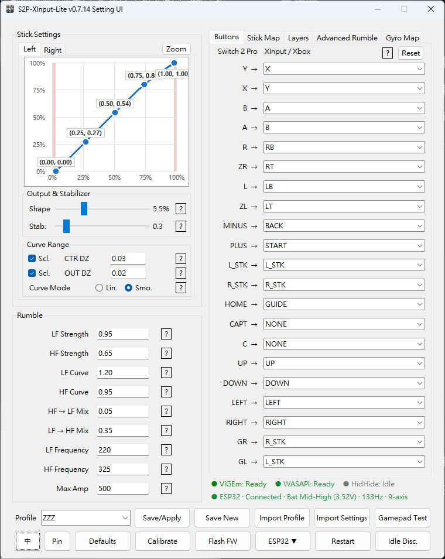

- **搖桿設定**：調整曲線控制點、輸出、防抖與基本震動選項。
- **功能頁籤**：切換 Buttons（按鍵映射）、Stick Map（搖桿方向映射）、Layers（映射層）、Advanced Rumble（進階震動）與 Gyro Map（陀螺儀映射）；圖中為 Xbox 按鍵對應。
- **狀態列**：查看 ViGEm、WASAPI、HidHide、控制器與 ESP32 狀態。
- **方案選擇器**：選取要編輯或套用的方案。
- **匯入設定**：從另一個 S2P-XInput-Lite 安裝資料夾遷移相容設定。

英文截圖左側的 **Output & Stabilizer（輸出與防抖）**、**Curve Range（曲線範圍）**、**Curve Mode（平滑模式）** 與 **Scl.（壓縮）**，分別對應中文介面的同名區域或選項。

底部其餘控制項可儲存或新增方案、匯入單一方案、切換語言、還原預設、校正、
刷入韌體、重啟連線與 Pin（指定優先裝置）。

### 2.1 狀態列

- `ViGEm: Ready`：虛擬 XInput 控制器可用。
- `WASAPI: Ready`：系統音訊擷取可用。
- `HidHide: Ready`：HidHide 已安裝且設定完成。
- `HidHide: Missing`：尚未安裝 HidHide。
- `Pad: Searching`：尚未偵測到控制器。
- `ESP32`：目前使用或正在搜尋 ESP32-S3。

### 2.2 方案操作

- **切換方案**：從 `Profile`（目前方案） 下拉選單選擇已儲存方案。
- **儲存/套用（Save/Apply）**：儲存目前方案並立即套用。
- **另存新方案（Save New）**：使用目前畫面數值建立新方案。
- **匯入方案（Import Profile）**：匯入外部 `.ini` 方案。
- **匯入設定（Import Settings）**：從舊版或同版本 S2P-XInput-Lite 安裝資料夾遷移設定。

儲存或切換方案後，執行中的連線會嘗試直接套用設定，不必重新連線。
若套用失敗，已儲存的設定會在下次連線生效；需要時可使用「重新啟動」。

### 2.3 匯入設定

在主視窗底部找到 **Import Settings**（匯入設定）；選擇來源資料夾後，預覽會列出相容資料、略過項目及衝突。

1. 點選 **匯入設定**。
2. 選擇舊版或同版本 S2P-XInput-Lite 的**程式根目錄**，不要選 `src`。
3. 檢查 Preview 中的應用程式設定、持久化手把校正、使用者方案與 managed Mapping Layer。
4. 若方案名稱或 Layer ID 衝突，明確選擇「全部覆蓋」或「全部略過」。
5. 確認匯入；完成後 GUI、方案清單及 Layer 清單會重新整理。

目前版本會提供 schema 與預設值，因此這不是降版或直接複製資料夾；新版新增 key
會使用目前預設。`System Default` 永遠不會被覆蓋；runtime cache、log、firmware、
exe 與建置產物不會匯入。任一已驗證寫入失敗時，`config.ini`、使用者方案與 managed
Layer 會一起 rollback。

無效數值、未完成的自訂按鍵錄製與不支援的映射，會先被擋下，避免覆蓋正常方案。
匯入預覽開啟期間新增的校正資料會保留；來源明確匯入同一筆校正時，才使用來源內容。

> [!WARNING]
> `System Default` 為唯讀方案。需要修改時，請使用「另存新方案」。

### 2.4 未儲存變更與外部檔案修改

- 切換方案時若有未儲存變更，可選擇先儲存、放棄或取消。「取消」會保留目前方案及畫面調整；關閉視窗不會自動儲存。
- 目前方案被其他程式修改時，衝突提示中的「是」會重新載入外部版本，「否」會以畫面內容覆蓋，「取消」則保留目前編輯、不寫入檔案。
- 載入期間或儲存剛完成後又發生外部修改，下次覆蓋前仍會提醒。需要保留外部內容時，請重新開啟或載入最新版本。
- 輸入無效時，請修正後再儲存；出現驗證錯誤不代表畫面調整已儲存或套用。
- 若提示「設定已儲存，但方案清單暫時無法更新」，檔案已經儲存，稍後重新開啟方案選單即可；目前方案會保留在已儲存的那一份。

---

## 3. 搖桿設定

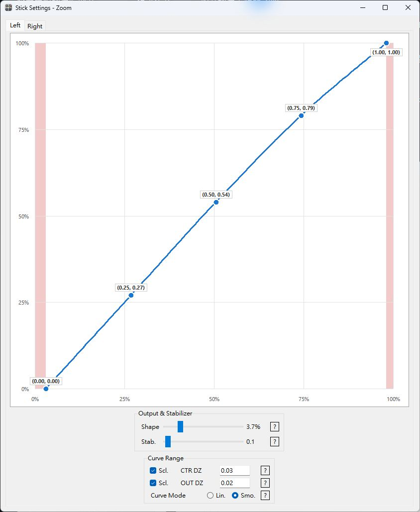

在主視窗的 Stick Settings（搖桿設定）按 **Zoom**（放大），即可開啟下圖的放大編輯器。

- **25% 控制點**：調整小幅推桿時的輸出反應。
- **50% 控制點**：調整中段反應。
- **75% 控制點**：調整接近外圈時的反應。
- **Shape（形狀）與 Stab.（防抖）**：控制曲線形狀與防抖補償。

### 3.1 曲線操作

- 拖曳藍色控制點可修改曲線。
- 左搖桿使用藍色，右搖桿使用紅色。
- 雙擊控制點可還原該點預設。
- 右鍵控制點可直接輸入 X、Y 座標。
- `Zoom`（放大） 可開啟大型曲線編輯視窗。
- `Lin.`（線性） 使用線性連接。
- `Smo.`（平滑） 使用平滑曲線。

### 3.2 死區

- `CTR DZ`（中心死區）：中心死區，用來消除搖桿中心偏移。
- `OUT DZ`（外圍死區）：外圈死區，讓搖桿尚未完全推到底時即可達到 100%。

死區過大會縮短有效行程。建議只增加到足以消除漂移或外圈不足的程度。

### 3.3 Shape（形狀）與 Stab.（防抖）

#### Shape（形狀）

調整搖桿輸出的整體形狀與反應感。數值越高，曲線形狀修正越明顯。

#### Stab.（防抖）

在曲線斜率大於 1:1 的放大區域增加防抖：

- `0.0`：關閉。
- `1.0`：標準補償。
- `2.0`：加強補償。
- `3.0`：最強補償。

數值越高，輸出越穩定，但也可能產生較明顯的平滑感。

### 3.4 搖桿校正

1. 按主視窗下方「校正搖桿（Calibrate）」。
2. 依命令列提示讓搖桿回到中心。
3. 沿完整外圈緩慢旋轉搖桿。
4. 完成後回到主介面測試。

> [!TIP]
> 建議依序進行：校正 → 中心死區 → 外圈死區 → 曲線 → 防抖。

---

## 4. 按鍵與方向映射

### 4.1 Buttons（按鍵映射）

`Buttons`（按鍵映射） 頁面將控制器的實體按鍵映射為 Xbox 360 輸出。

- 左側為實體按鍵。
- 右側下拉選單為 Xbox 輸出。
- `NONE`（無） 表示不輸出。
- `Reset`（還原） 會還原本頁映射。
- 修改後仍需按 `Save/Apply`（儲存/套用）。

一般方案可將 A/B 與 X/Y 對調，以符合 Xbox 的按鍵位置。CAPT、C、GR、GL 等額外按鍵也能指定為 Xbox 按鍵或 `NONE`（無）。

選擇 **Shortcut（自訂按鍵）** 可錄製鍵盤或滑鼠輸入。欄位使用 `KB:1`、`KB:Ctrl+S`、`M:Wheel↓` 等簡寫，游標移上去即可查看完整映射。展開下拉選單後，可直接在清單項目上使用滾輪；捲動不會直接套用選項，點選後仍需按 **Save/Apply（儲存/套用）** 才會儲存。

### 4.2 Stick Map（搖桿方向映射）

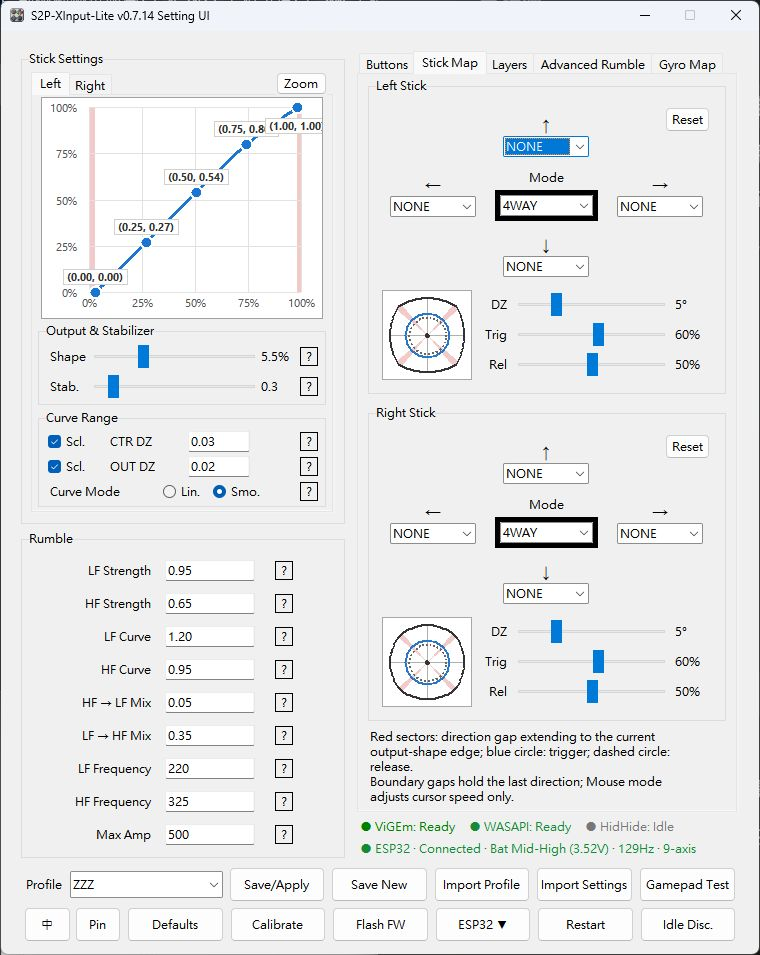

- **Mode**（模式）：選擇方向判定方式，例如 `4WAY`（四方向）。
- **方向圖**：紅色區域表示目前方向缺口或邊界。
- **DZ（死區）／Trig（觸發）／Rel（放開）**：設定死區、觸發門檻與釋放門檻。
- **左右搖桿**：可分別設定，並分別還原。

在 `4WAY` 或 `8WAY` 模式，點擊方向圖即可開啟雷達編輯器。拖曳紅色區塊可旋轉
個別死區，旁邊欄位可設定整片死區的寬度，範圍為相鄰方向夾角的 0–90%。例如
`8WAY` 的 20% 代表 9°。啟用個別死區後，主畫面的數值會顯示 **SET**。在編輯器按
**使用統一死區** 可讓該模式的各方向缺口使用同一個設定。確認後回主視窗按 **儲存/套用**。

#### 重要參數

- `DZ`（死區）：方向判定死區。
- `Trig`（觸發）：進入方向區域後的觸發門檻。
- `Rel`（放開）：離開方向區域後的釋放門檻。

> [!TIP]
> `Trig`（觸發） 應高於 `Rel`（放開），形成遲滯區，避免搖桿停在方向邊界時快速重複觸發。

---

## 5. Mapping Layers（映射層）

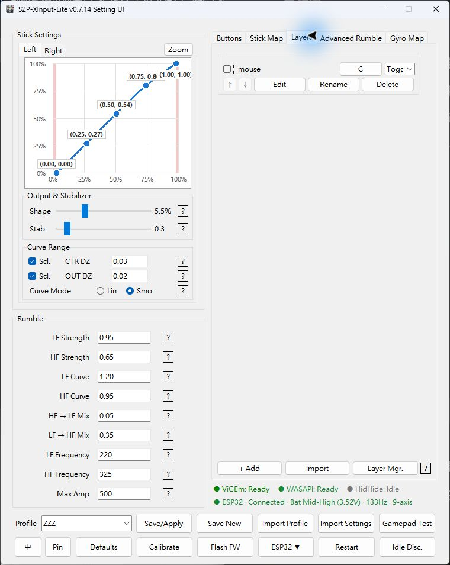

- **啟用方塊**：勾選後啟用該映射層。
- **啟動方式**：指定啟動按鍵及 `Toggle`（切換）／`Hold`（按住）。
- **層操作**：Edit（編輯）、Rename（改名）、Delete（刪除）。
- **層管理工具**：新增、匯入與管理映射層。

### 5.1 建立映射層

1. 按 `+ Add`（新增）。
2. 輸入容易辨識的名稱。
3. 按 `Edit`（編輯） 設定按鍵、鍵盤或滑鼠映射。
4. 指定啟動按鍵。
5. 選擇 `Hold`（按住） 或 `Toggle`（切換）。
6. 勾選映射層左側方塊。
7. 按 `Save/Apply`（儲存/套用）。

### 5.2 Hold（按住）與 Toggle（切換）

- `Hold`（按住）：按住指定按鍵時啟用，放開後停用。
- `Toggle`（切換）：每按一次切換啟用或停用。

> [!WARNING]
> Mapping Layer 的編輯會先保留在記憶體。只有 `Save/Apply`（儲存/套用） 成功後，層檔案與方案狀態才算正式保存。

左、右搖桿的數值各自獨立；取消編輯不會保留該次修改。若編輯期間映射層已被外部修改或刪除，請重新開啟最新項目再編輯，避免套用到錯誤的層。

---

## 6. 陀螺儀映射

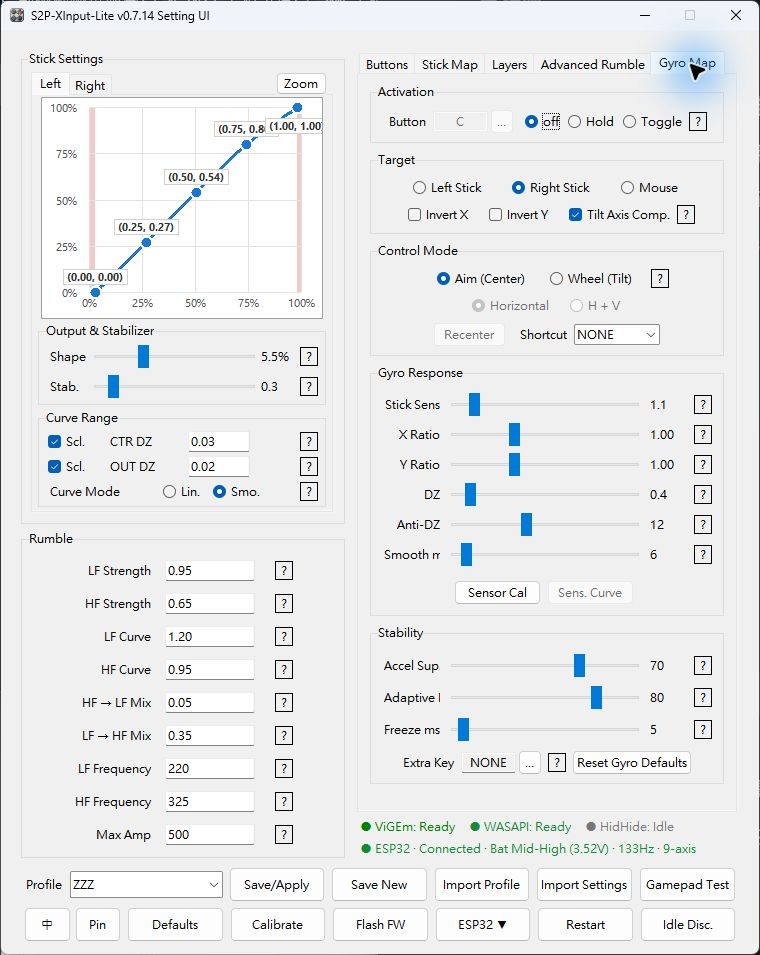

- **Activation**（啟動方式）：指定啟用按鍵，並選擇 Off（關閉）、Hold（按住）或 Toggle（切換）。
- **Target**（輸出目標）：輸出至左搖桿、右搖桿或滑鼠。
- **Control Mode**（控制模式）：Aim (Center)（回中／瞄準）或 Wheel (Tilt)（傾斜／方向盤）。
- **Gyro Response**（陀螺儀反應）：感度、X/Y 比例、死區、反死區與平滑。
- **Stability（穩定控制）與校正**：穩定性設定、Sensor Cal（感測器校正）及感度曲線。

### 6.1 Activation（啟動方式）

- `Off`（關閉）：關閉陀螺儀映射。
- `Hold`（按住）：按住指定按鍵時啟用。
- `Toggle`（切換）：按一下啟用，再按一下關閉。

### 6.2 Target（輸出目標）

- `Left Stick`（左搖桿）：陀螺儀輸出至左搖桿。
- `Right Stick`（右搖桿）：陀螺儀輸出至右搖桿，常用於瞄準。
- `Mouse`（滑鼠）：輸出為滑鼠移動。
- `Invert X / Y`（反轉 X／Y）：反轉水平或垂直方向。

### 6.3 Control Mode（控制模式）

- `Aim (Center)`（回中（瞄準））：以中心為基準，適合射擊遊戲瞄準。
- `Wheel (Tilt)`（傾斜（方向盤））：依控制器傾斜角度輸出，適合方向盤或傾斜控制。

### 6.4 Gyro Response（陀螺儀反應）

- `Stick Sens`（搖桿感度）：陀螺儀轉換為搖桿時的感度。
- `X Ratio / Y Ratio`（X 比例／Y 比例）：分別調整水平及垂直比例。
- `DZ`（死區）：消除中心小幅漂移。
- `Anti DZ`（反死區）：提高小幅動作的最低輸出。
- `Smooth ms`（平滑 ms）：平滑時間。越高越穩定，但延遲感也越明顯。

### 6.5 建議設定順序

1. 將控制器放在穩定平面，執行 `Sensor Cal`（感測器校正）。
2. 選擇 Target（輸出目標）。
3. 選擇 Hold（按住）或 Toggle（切換）。
4. 從較低感度開始測試。
5. 使用 X/Y Ratio 修正水平與垂直速度差。
6. 只有中心漂移時才增加 DZ。
7. 小動作無法輸出時，再少量增加 Anti DZ。
8. 最後調整 Smooth ms。

> [!WARNING]
> 進行磁力計校正時，請遠離喇叭、磁鐵、大型金屬物與通電設備，並依提示讓控制器完成多方向的 3D 八字翻轉。

---

## 7. 震動設定

### 7.1 基本震動

- `LF Strength`（低頻震動強度）：低頻路徑強度。
- `HF Strength`（高頻震動強度）：高頻路徑強度。
- `LF Curve / HF Curve`（低頻／高頻輸出曲線）：調整小訊號到大訊號的反應曲線。
- `HF → LF Mix`（低頻補償）：將部分高頻路徑混入低頻。
- `LF → HF Mix`（高頻補償）：將部分低頻路徑混入高頻。
- `LF Frequency / HF Frequency`（LF／HF 頻率）：設定兩個震動頻率命令。
- `Max Amp`（最大振幅）：限制最終振幅。

### 7.2 Max Amp（最大振幅）與異音

震動振幅欄位範圍為 `0–1023`，預設值為 `500`，約為欄位上限的 49%。

經過多款橋接軟體及不同手把的實際測試，震動強度越高，線性馬達在震動快速變化時，越可能出現輕微的撞擊聲。不過在一般使用情況下影響並不明顯。

由於目前沒有明確的硬體安全輸出上限，本程式以 `500` 作為通用預設值，在保留清楚回饋的同時，降低過強輸出造成異音的可能。

> [!CAUTION]
> `0–1023` 是協議欄位範圍，不代表所有控制器都適合長時間使用最高值。若出現明顯撞擊聲、尖銳聲或不自然震感，請降低 Max Amp（最大振幅）、LF/HF Strength（低頻／高頻震動強度） 或相關頻段增益。

### 7.3 Game（遊戲）／Audio（音訊）／Mix（混合）

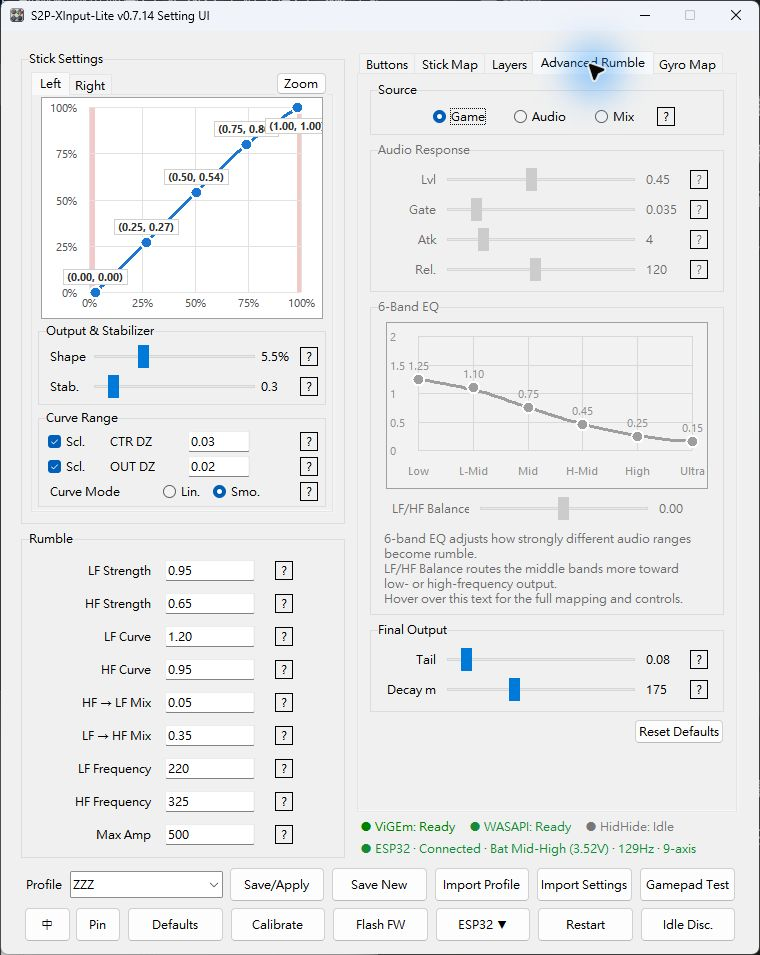

- **Source**（輸出來源）：選擇 Game（遊戲）、Audio（音訊）或 Mix（混合）。
- **六頻段曲線**：調整各音訊頻段的增益。
- **LF/HF Balance**（LF／HF 重心）：控制中間頻段偏向低頻或高頻路徑。
- **Final Output**（最終輸出）：控制震動尾端與衰減。

#### Game（遊戲）

只使用遊戲原生震動。

#### Audio（音訊）

將 Windows 預設輸出裝置的音訊轉換為震動。

#### Mix（混合）

柔和混合遊戲原生震動與音訊震動，避免直接硬性疊加造成飽和。

### 7.4 Audio Response（音訊反應）

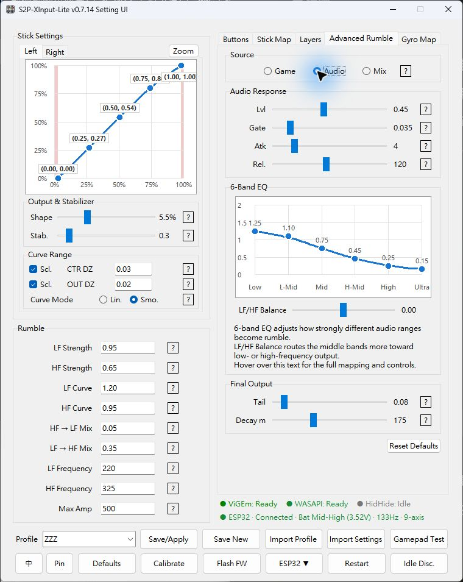

- **Audio**（音訊）：將 Windows 預設輸出裝置的聲音轉為震動。
- **Lvl（強度）／Gate（噪閘）／Atk（啟動）／Rel（釋放）**：設定音訊震動反應。
- **六頻段**：Low（低）、L-Mid（低中）、Mid（中）、H-Mid（中高）、High（高）、Ultra（超高頻段）。
- **LF/HF Balance**（LF／HF 重心）：控制中間頻段路由。

#### Lvl（強度）

音訊轉震動的整體敏感度。

- 整體太弱：提高 Lvl（強度）。
- 聲音一開始就過強：降低 Lvl（強度）。

#### Gate（噪閘）

噪音門檻。

- 安靜處仍持續震動：提高 Gate（噪閘）。
- 只有非常大聲才有反應：降低 Gate（噪閘）。

#### Atk（啟動）

起振速度。數值較小時反應較快。

#### Rel（釋放）

聲音結束後的釋放時間。數值較高時，震動尾端延續較久。

### 7.5 六頻段

| 頻段 | 範圍 | 主要內容 |
|---|---:|---|
| Low | 20–120 Hz | 深沉撞擊與超低頻 |
| L-Mid | 120–300 Hz | 低頻厚度 |
| Mid | 300–700 Hz | 中低頻細節 |
| H-Mid | 700–2000 Hz | 中高頻細節 |
| High | 2000–4000 Hz | 摩擦與人聲邊緣 |
| Ultra | 4000–8000 Hz | 尖銳提示與超高頻細節 |

- 拖曳控制點可調整該頻段增益。
- 雙擊控制點可還原該頻段預設。
- `1.00` 為中性增益。
- 這些設定只影響 Audio（音訊） 與 Mix（混合），不影響純 Game（遊戲） 模式。

### 7.6 LF/HF Balance（LF／HF 重心）

- `-1.00`：中間頻段偏向 LF。
- `0.00`：平衡。
- `+1.00`：中間頻段偏向 HF。
- 建議先從 `-0.15～+0.15` 範圍測試。

LF/HF Balance（LF／HF 重心） 只改變中間頻段的路由，不會修改六個頻段本身的增益。

### 7.7 高頻噪音排查

若 Audio（音訊） 或 Mix（混合） 模式出現持續高頻聲：

1. 降低 High（高頻段） 與 Ultra（超高頻段） 增益。
2. 將 LF/HF Balance（LF／HF 重心） 稍微向 LF 移動。
3. 提高 Gate（噪閘），過濾安靜背景聲。
4. 若所有聲音一開始就過強，降低 Lvl（強度）。
5. 若仍有異音，降低 HF Strength（高頻震動強度） 或 Max Amp（最大振幅）。

---

## 8. HidHide 與 ESP32-S3

### 8.1 HidHide

USB 有線模式下，遊戲可能同時看到：

- 實體控制器 HID。
- S2P-XInput-Lite 建立的虛擬 XInput 控制器。

這會造成按鍵或方向被讀取兩次。HidHide 可隱藏實體 HID，同時允許 S2P-XInput-Lite 繼續讀取。

#### 狀態說明

- `HidHide: Ready`：已安裝且設定完成。
- `HidHide: Missing`：尚未安裝。點擊狀態文字可開啟下載頁。
- `HidHide: Off / Setup`：已安裝但尚未完成隱藏設定。
- `HidHide: Error`：無法讀取或修改 HidHide 設定。

選擇不再提醒後，程式不會每次啟動重複詢問。需要時仍可點擊視窗底部的 HidHide 狀態。

> [!WARNING]
> HidHide 設定失敗時，請先關閉 HidHide Configuration Client，再回到 S2P-XInput-Lite 重試。若 HidHide 清單中已有其他裝置，啟用全域隱藏也可能影響那些裝置。

### 8.2 刷入 ESP32-S3 韌體

1. 按主視窗底部「刷入相容韌體（Flash FW）」。
2. 程式先讀取目前韌體版本，並與內建的 `S2P-FW 1.0.8` 比對。
3. 確認畫面會列出目前版本與內建版本；可選擇刷入或取消。若版本檢查曾暫停
   連接程式，取消後會自動恢復。
4. 確認刷入後，將 ESP32-S3 的 OTG 接口接到電腦並按住 `BOOT`。
5. 按一下 `RESET / EN`，先放開 `RESET / EN`，再放開 `BOOT`。
6. 程式會依 USB 身分辨識 ESP32-S3 ROM 刷機連接埠；即使該 COM 已存在也能
   使用，接著自動刷入韌體。
7. 刷寫成功後 ESP32 會切回橋接模式；USB 重新列舉完成後，桌面連接程式會
   自動啟動並重新搜尋手把。
8. 若數秒後橋接裝置仍未出現，請按一下 `RESET / EN` 或重新插拔 ESP32-S3。

> [!CAUTION]
> 刷寫期間不要拔除 ESP32-S3，也不要關閉程式。

### 8.2.1 一般橋接關閉保護

v0.7.14 的一般橋接關閉保護須同時使用更新後的桌面程式及 S2P-FW 1.0.7。
一般橋接請用「結束程式」退出，並等待確認所有
BLE 連線解除。主機工作階段建立後，CDC 連續消失 3 秒或主機心跳逾時 8 秒會
開始自動釋放 BLE。Android USB HID 不需要桌面程式或 CDC/DTR，
保留原有閒置斷線與按鍵喚醒功能。本修正仍待實機休眠電流及關閉驗證，
詳見[實機檢查表](../docs/bridge-host-shutdown.md)。

### 8.3 控制器與 ESP32-S3 配對

1. 將 ESP32-S3 接到電腦並啟動 S2P-XInput-Lite。
2. 讓控制器進入配對模式。
3. 需要建立新配對時，按住控制器的 `SYNC`。
4. 程式偵測到 SYNC 配對連線後，會將 ESP32-S3 配對資料寫入控制器。
5. 確認底部 Pad／ESP32 狀態變為已連線。

### 8.4 ESP32 兩種運作方式

| 模式 | 是否需要保持 Windows 程式開啟 | USB 輸出 | 識別碼 |
|---|---|---|---|
| ESP32 Bridge | 是 | CDC；桌面經 ViGEmBus 輸出 XInput | `303A:4001` |
| Android USB HID 獨立模式 | 否 | CDC＋標準 HID，`S2P Mobile Gamepad` | `303A:4005` |

兩種模式均保留 CDC 設定／診斷及救援通道。這些是 Espressif/TinyUSB 共享預設
VID/PID，不能單憑識別碼或產品名稱認定為 S2P；桌面須驗證韌體身分及能力。
舊 `CAFE:4020/4021/4022` 僅供辨識升級候選，不能啟用已移除的 PC XInput／Auto。

舊 NVS `0=Bridge`、`2=HID` 維持原意；`1=XInput`、`3=Auto` 升級後改為 HID，
桌面會提示「獨立 PC XInput／Auto 已取消，已改為 Android USB HID；桌面 XInput
請切回 Bridge」。未知值或讀取錯誤以 Bridge 啟動。遷移本身不主動重啟。

### 8.5 寫入設定並啟用 Android USB HID

一次只能執行一項 ESP32 寫入或模式切換。操作期間請保持連接，等待完成提示後再關閉程式或開始下一項操作。

1. 選擇要寫入的方案，完成設定後按 **Save/Apply**（儲存/套用）。
2. 確認 ESP32 已連線並使用隨附的 `S2P-FW 1.0.8`，才能在獨立模式套用 4WAY／8WAY 逐區方向死區。
3. 點擊 **ESP32 ▼**，選擇 **寫入並啟用 Android USB HID 獨立模式**。
4. 檢查相容性提示；方案包含 Windows 專用輸出時，取消修改或確認略過不支援項目。
5. 等待寫入、長度／CRC 驗證、執行期套用及受控重新啟動，期間保持 USB 供電。
6. 以資料線及必要的 OTG 轉接器連接支援 USB 主機功能的 Android 裝置。
   系統及遊戲必須支援 USB HID 手把；相容性仍待各裝置實測。

未儲存變更需先儲存；`System Default` 修改後需使用 **Save New**（另存新方案）。A/B 儲存槽保留
上一份有效設定，新資料驗證成功才切為有效槽。寫入／模式保存失敗時不要假設已切換。
舊版 Auto 選單截圖已從本節移除，請以本節文字及目前程式為準。

### 8.6 切回 Bridge 與救援

- **桌面選單**：將 ESP32 接回 Windows，選擇 **ESP32 ▼ → 切回 ESP32 橋接模式**。
  等待重新列舉及桌面自動搜尋；仍未恢復時再重新插拔或使用 **重新啟動連線**。
- **已連線手把**：長按 **HOME+X 3 秒再放開**，保存並切回 Bridge；
  長按 **HOME+A 3 秒再放開**，保存並切至 Android USB HID。HOME+Y 已移除。
  組合鍵會在套用映射與圖層前讀取原始按鍵。選擇目前模式時，其他手把仍可發起切換。
  Bridge 的 CDC 傳送卡住時，仍可用手把切到 HID。ESP32 成功保存新模式後才會重啟。
- **沒有手把**：兩種模式的 CDC 皆可接受 `mode bridge`，成功保存後以 `restart`
  受控重啟。使用序列終端前先關閉占用該 COM 埠的桌面連線。
- **CDC 也無法使用**：進入晶片 ROM Download Mode。依開發板說明確認原生 USB
  埠及 BOOT／RESET（EN）按鍵：通常按住 **BOOT**，短按並放開 **RESET/EN**，
  再放開 **BOOT**；無 RESET 鍵的板子通常需按住 BOOT 重新接上 USB。
  各板接線及時序可能不同，請依板商說明。確認 ROM 裝置後使用既有刷寫流程；
  寫入前仍須通過晶片及 16 MB Flash 檢查。完成後放開 BOOT 並按 RESET/EN
  或重新供電，回到應用程式。ROM 不提供 S2P 應用協定。

切回 Bridge 不會刪除最後保存的獨立設定。**重新啟動連線**只重啟桌面連線。

### 8.7 獨立模式支援範圍與驗證限制

連線、校正與韌體刷寫會依序進行，避免同時占用裝置。若提示另一項操作仍在進行，請等待它完成。取消刷寫確認時，先前暫停的連線會自動恢復。

沿用既有搖桿校正、曲線、中心／外圈死區、左右搖桿與啟用映射層的 4WAY／8WAY 逐區方向死區、輸出形狀、防抖／平滑、按鍵及方向映射、
相容 Mapping Layers、線性扳機、陀螺儀轉搖桿、idle disconnect 與 BLE 重連。
HID 保留按鍵、四軸、十字鍵與獨立類比扳機，以及數位 L2／R2 相容輸出。

不執行 Windows 鍵盤／滑鼠、Audio（音訊）／Mix（混合）音訊震動、依程序切換方案或陀螺儀滑鼠。
HID 沒有震動 output report，不承諾 Android 遊戲震動，也不提供 BLE HID。
Windows 遊戲震動及音訊震動仍由 Bridge 桌面路徑處理。

本次未操作實體硬體。Windows／Android 描述符與輸入、ViGEmBus、震動／音訊震動、
USB 拔插、睡眠／remote wake、idle disconnect、BLE 重連、實際 NVS 升級、
組合鍵及 ROM 救援全部待測。歷史量測不代表新版通過。
Apple 裝置不在目前支援範圍；Android 相容性依裝置、系統與遊戲而異。
詳見[驗證與官方參考](../docs/usb-hid-standardization.md)。

---

## 9. 手把測試

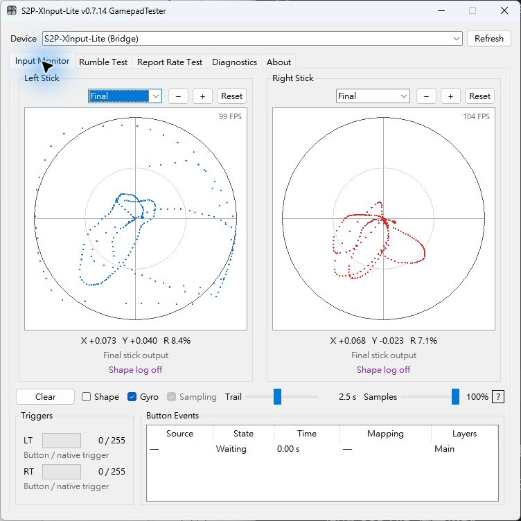

*圖中選擇的是已連線的 S2P-XInput-Lite Bridge（橋接）；資料與可用控制項會依裝置而異。*

截圖中的 **Device（測試手把）**、**Refresh（重新整理）**、**Left Stick（左搖桿）**、**Right Stick（右搖桿）**、**Final（合成結果）**、**Trail（軌跡長度）**、**Samples（採樣點）**、**Sampling（實際採樣）** 與 **Button Events（按鍵與映射事件）**，可直接在中文介面找到相應名稱。

- **裝置與重新整理**：選擇要檢查的控制器，或重新掃描裝置。
- **功能分頁**：切換輸入監看、瞄準測試、震動測試、回報率、診斷及關於頁。
- **搖桿來源與縮放**：左右搖桿可分別選擇資料來源及調整視圖。
- **左右搖桿圖**：即時呈現位置、軌跡、輸出形狀與輔助線。
- **取樣與軌跡控制**：調整取樣比例、軌跡時間及顯示項目。
- **扳機輸入**：分別顯示 LT、RT 的目前數值及輸入類型。
- **按鍵事件**：列出按鍵狀態、持續時間、實際映射與作用中的圖層。

按主視窗底部的 **手把測試** 開啟獨立測試程式。測試程式與設定視窗分開
執行，因此高更新率繪圖不會拖慢設定操作。再次按下按鈕會將既有測試視窗
叫到最上層，不會重複開啟。也可直接啟動獨立的手把測試應用，不必先開啟
設定視窗。

> [!IMPORTANT]
> 手把測試主要針對由 S2P-XInput-Lite 本身連線及處理的 Switch 2 Pro
> Controller。其他 XInput、WinMM 或 Raw HID 手把也能進行基本輸入、震動及
> 回報率測試，但不會提供 S2P 的共享遙測；實體／處理後來源、有效映射、
> Mapping Layer、電量、感測器、傳輸狀態與 ESP32 診斷等資訊可能缺少，
> 這是預期行為。

### 9.1 選擇測試來源

- **S2P-XInput-Lite**：測試目前程式輸出的 XInput 控制器，並顯示套用前、
  套用後及合成結果。
- **其他控制器**：可選擇 Windows 偵測到的 XInput 或一般遊戲控制器；
  僅顯示該介面實際提供的資料，不會補出 S2P 專屬資訊。
- 若同名裝置超過一支，選單會加上介面類型及編號，避免選錯。
- `重新整理` 會重新掃描裝置；切換裝置或來源時會清除舊量測，避免不同資料
  混在同一條軌跡。

**快速測試步驟：**

1. 連接並喚醒手把；若要測試 S2P 輸出，先啟動主程式並確認連線。
2. 執行 `GamepadTester.exe`，或按主視窗的 **Gamepad Test**（手把測試）。
3. 按 **Refresh**（重新整理），在頂端 **Device**（測試手把） 選取想測試的裝置；找不到時先檢查 Windows 連線再重新掃描。
4. 開啟 **Input Monitor**（輸入監看），移動左右搖桿並按下按鍵與扳機，確認圓點和事件表會變化。
5. 視需求切換 **Rumble Test**（震動測試）、**Report Rate Test**（回報率量測） 或 **Diagnostics**（診斷模式）；這些頁面對裝置介面有不同要求，請依下列步驟操作。

### 9.2 搖桿圖

左右搖桿可各自選擇來源。十字線中央是零點，黑色外圈是 100% 基準；即時
圓點顯示目前位置。

- **軌跡點**：調整實際報告中有多少比例畫入軌跡。
- **軌跡長度**：設定軌跡保留秒數。
- `-`、`+` 與 `重設`：縮放或恢復圖面。
- S2P 輸出來源會同時顯示死區、外圈限制、曲線及陀螺儀相關參考線。

軌跡使用所選來源收到的真實取樣，依各筆資料的座標畫點。同一像素上的點會合併顯示。
角落的 FPS 統計有變化的畫面更新。若要量測裝置回報率，請在 **回報率量測** 分頁選取
要測的 Raw HID 介面。支援的 Windows 執行環境會由原生背景執行緒畫點，並使用
Canvas 合成，必要時會切回 Tk 圖塊。

### 9.3 顯示輸出形狀

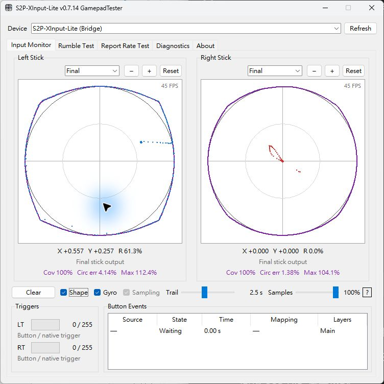

勾選 **Shape**（顯示輸出形狀）後，沿搖桿外圈緩慢旋轉一周。紫色線會記錄每個方向
實際到達的最大輸出，並顯示覆蓋率、圓度誤差與最大半徑。

- 每個 5° 區段都取得真實樣本後，覆蓋率會到達 100%。
- 紫色線追上最新最大值，且連續一秒沒有再擴張時，量測會鎖定並停止重畫，
  避免視窗長時間開啟時持續消耗繪製效能。
- 關閉再開 **Shape**（顯示輸出形狀），或切換來源／設定，即可開始新的量測。
- 按控制列的 **重設** 會清除目前的量測並還原該列設定。再次勾選 **顯示輸出形狀** 即可開始量測。

### 9.4 按鍵與扳機

下方表格會列出來源按鍵、按下／放開狀態、持續時間、實際生效映射及映射層。
左側同時顯示 LT／RT 的原始扳機值與最後輸出。只有能精確關聯至已驗證 CDC 身分的 S2P 行動 USB HID，才使用專用的按鍵、軸、扳機及 POV 對照；無法關聯時保留一般 HID 行為。

### 9.5 震動測試

更換測試裝置、輸出連線變動或關閉測試時，程式會停止原裝置的震動測試。

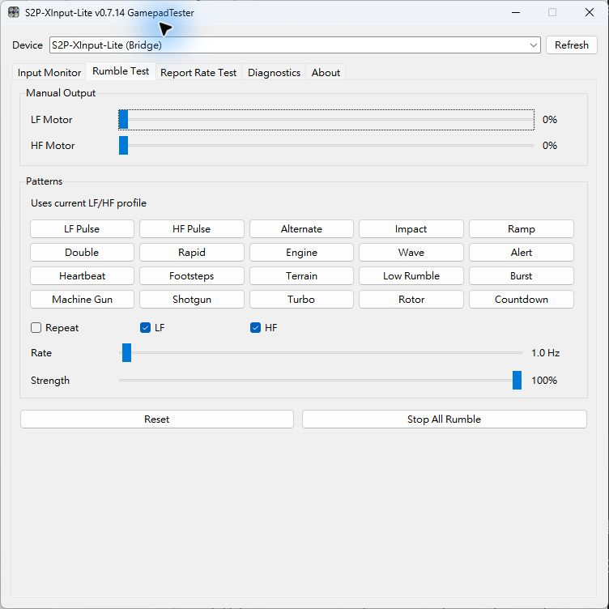

英文截圖的 **Manual Output（手動震動輸出）**、**LF Motor（LF／左馬達）**、**HF Motor（HF／右馬達）**、**Patterns（震動模板）**、**Repeat（重複播放）**、**Rate（播放頻率）** 與 **Strength（模板強度）**，分別是中文介面對應項目。

- **手動輸出**：直接調整 LF 與 HF 馬達強度。
- **馬達強度**：分別顯示兩個震動頻段目前的輸出百分比。
- **測試樣式**：選擇脈衝、交替、撞擊、引擎、波浪等預設效果。
- **播放控制**：設定重複、LF／HF 頻段、速度與強度。
- **停止控制**：重設目前設定，或立即停止所有震動。

先在 **Device**（測試手把）選擇 S2P-XInput-Lite (Bridge) 或支援震動的 XInput 裝置，開啟 **Rumble Test**（震動測試）；先以低強度調整 LF／HF，或選擇一個 Patterns（震動模板）按鈕。需要連續播放時勾選 **Repeat**（重複播放），結束時按 **Stop All Rumble**（停止所有震動）。若顯示 `No XInput rumble`（此手把沒有可用的 XInput 震動介面）或控制項呈灰色，請確認虛擬控制器已啟用，或改選支援震動的 XInput 裝置。Bridge 測試會套用目前方案的 LF／HF 設定；純 Audio（音訊）模式下遊戲震動樣式不會輸出。

切換至 **震動測試** 頁，可向支援 XInput 震動的 Windows 裝置輸出測試波形。
停止或關閉測試時會送出零震動。手機 USB HID 模式目前只提供輸入，不會將
網頁或遊戲的震動回傳至手把。

### 9.6 回報率

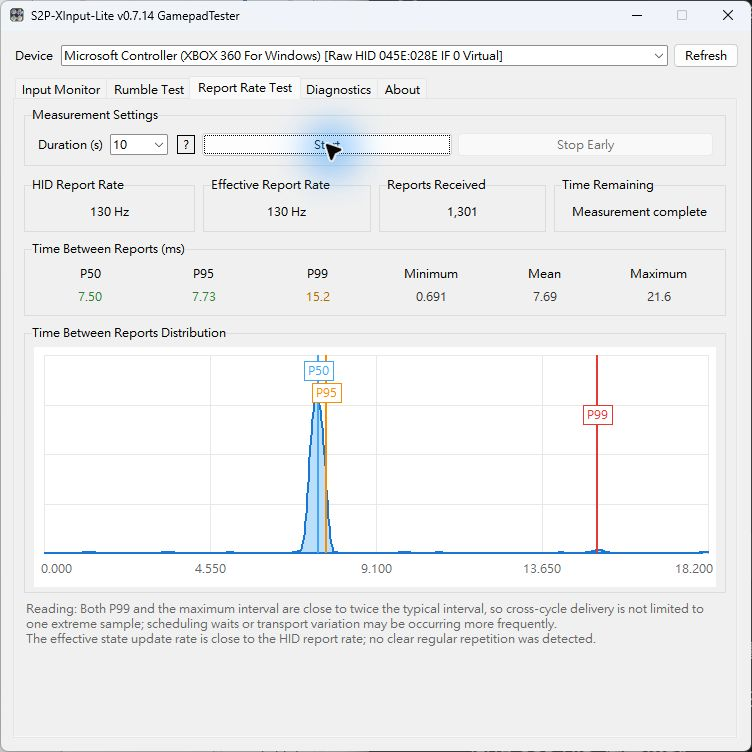

*圖中選的是虛擬控制器的 Raw HID 介面；數值代表所選介面的回報，不能直接視為實體手把或 BLE 的原始回報率。*

截圖中的 **Measurement Settings（量測設定）**、**Reports Received（收到回報數）**、**Time Remaining（剩餘時間）**、**Minimum（最小）**、**Mean（平均）**、**Maximum（最大）** 與 **Time Between Reports Distribution（回報時間差分佈）**，都可在中文介面對照查看。

- **量測設定**：選擇測試時間並開始或提早停止。
- **即時摘要**：顯示 HID 回報率、有效回報率、回報數量與剩餘時間。
- **間隔統計**：列出 P50、P95、P99、最小值、平均值及最大值。
- **間隔分布**：用圖形呈現回報間隔的分布與時間軸。
- **讀取狀態**：顯示量測是否進行中及目前結果狀態。

1. 在 **Device**（測試手把） 選擇 Raw HID collection，開啟 **Report Rate Test**（回報率量測）。
2. 選擇 **Duration (s)**（量測秒數）並按 **Start**（開始量測）；持續大幅移動一支搖桿直到結束，或按 **Stop Early**（提前停止）。
3. 比較 **HID Report Rate**（HID 回報率） 與 **Effective Report Rate**（有效回報率），並查看回報間隔分布；若無有效資料，改試另一個 collection。

開啟 **回報率** 頁可直接量測 Raw HID collection，不受畫面更新率取樣影響。
選擇 collection 與測試時間後開始量測，並持續以較大幅度繞圈移動其中一支
搖桿。結果會列出 HID 回報總數、含有效搖桿資料的回報數、有效回報率、
P50／P95／P99 間隔、分佈統計與時間軸。同一實體裝置可能有多個介面，請
選擇移動手把時資料確實會變化的 collection。

### 9.7 診斷

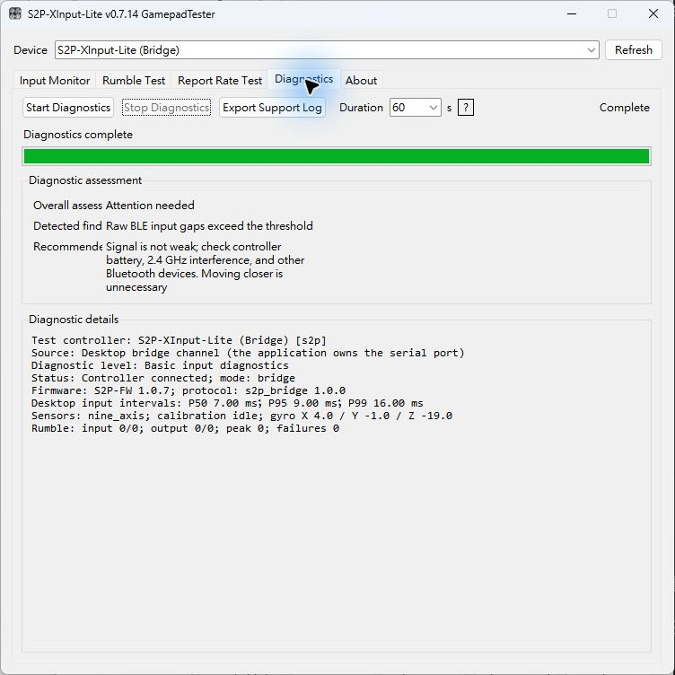

*此圖為一次實際診斷的範例，顯示 BLE 輸入間隔警告；結果會依連線狀況而異。*

截圖上方的 **Start Diagnostics（開始診斷）**、**Stop Diagnostics（停止診斷）**、**Export Support Log（匯出支援 Log）** 與 **Duration（診斷時間）**，是這一頁的主要操作。

- **診斷控制**：開始、停止診斷並選擇測試時間。
- **診斷狀態**：顯示目前階段與測試進度。
- **診斷評估**：摘要整體判定、發現項目與建議處理方式。
- **診斷細節**：持續列出連線、輸入、感測器與震動檢查結果。
- **匯出支援紀錄**：將診斷資料輸出為可供回報問題的文字檔。

**診斷** 頁可執行 30、60 或 120 秒的 ESP32 健康檢查。測試期間請保持手把
喚醒，並操作搖桿、感測器與震動。摘要會檢查韌體模式、連線與輸入連續性、
延遲、校正、動作感測器、陀螺儀處理及震動，最後提供通過／警告／失敗判定。
按 **Export Support Log（匯出支援 Log）** 可將畫面內容保存為 UTF-8 文字檔。

橋接模式會暫時使用主程式目前的序列連線；獨立模式則直接開啟 ESP32 診斷
通道。完整診斷命令需要隨附的 `S2P-FW 1.0.8`。

### 9.8 關於

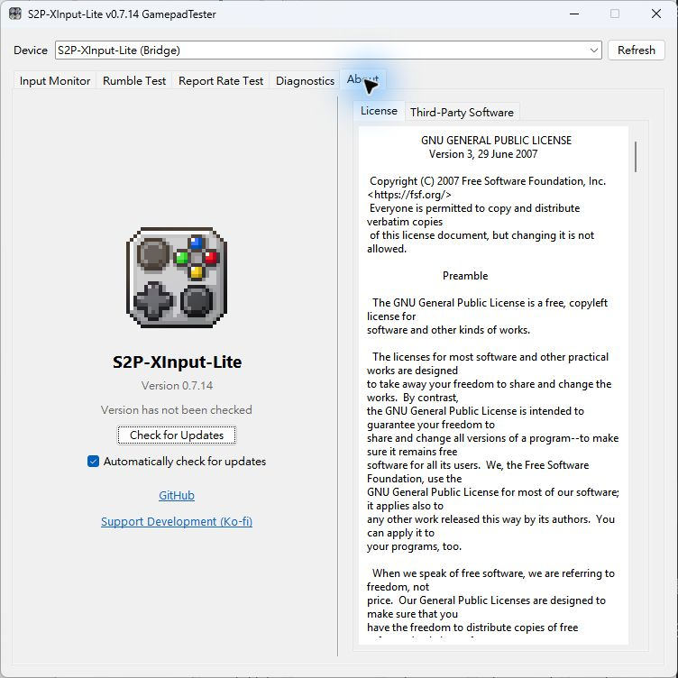

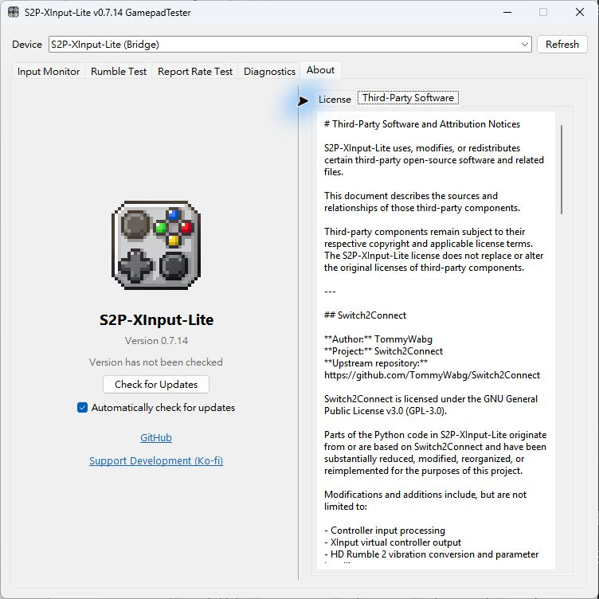

**About（關於）** 頁的 **License（許可協議）** 與 **Third-Party Software（第三方程式）** 分頁，可切換查看兩份文件；**Check for Updates（檢查更新）** 可手動檢查版本。

- **產品資訊**：顯示圖示、名稱及版本。
- **專案連結**：開啟 GitHub、贊助與支援開發連結。
- **文件分頁**：切換授權協議與第三方軟體聲明。
- **文件內容**：捲動閱讀隨發行包提供的完整聲明。

**關於** 頁左側固定顯示 Logo、版本、GitHub 與 Ko-fi 連結；右側提供可捲動
的 **許可協議** 與 **第三方程式** 頁簽，內容來自發佈包隨附的聲明檔。

---

### 9.9 瞄準測試

#### 測試陀螺儀映射的右搖桿輸出

1. 透過 S2P-XInput-Lite 連接控制器。在 **陀螺儀映射** 將輸出目標設為 **右搖桿**，
   控制模式選 **回中（瞄準）**。指定啟用按鍵，選擇 **按住** 或 **切換**，再按 **儲存/套用**。
2. 開啟 **手把測試**，在裝置清單選取 **S2P-XInput-Lite（目前橋接輸出）**。瞄準測試會
   讀取 Windows 收到的虛擬手把右搖桿輸出，套用中的映射、死區與反應設定都會反映在操作上。
3. 在 **瞄準測試** 選擇 **3D 模式 → 跟槍**，再按 **開始**。啟用陀螺儀後，先放開實體
   右搖桿，只轉動控制器來檢查反應。要測試射擊時可改用 **點靶** 或 **限時點靶**。

#### 選擇並開始測試

在 **2D 模式**，用滑鼠或右搖桿移動準心。在 **3D 模式**，用滑鼠或右搖桿轉動視角。偵測到手把時，
預設用手把瞄準，按 RT 或空白鍵射擊。未偵測到手把時，可用滑鼠瞄準，按左鍵或空白鍵射擊。
若要在同一回合交替使用兩種裝置，請在 **測試設定** 勾選 **啟用手把與滑鼠自動銜接**。
準心或視角的移動速度與搖桿輸出成正比。預設為 **3D 模式 → 點靶**。

| 測試 | 2D 模式 | 3D 模式 |
|---|---|---|
| **跟槍** | 移動準心跟上移動的靶。 | 轉動視角追蹤移動球靶。 |
| **點靶** | 逐一點擊或射擊畫面上的靶。 | 逐一射擊空間中的球靶。 |
| **限時點靶** | 在倒數內盡可能擊中補上的靶。 | 在倒數內盡可能擊中補上的球靶。 |

跟槍依設定的秒數結束。點靶每次命中才換靶，達到指定命中數或時限便結束。限時點靶開場有
兩顆靶，各自保留至命中，短暫間隔後再補上新靶。3D 靶重疊時，會擊中準心射線最先碰到的球面。
倒數歸零時結算總命中數。

按 **開始**、Enter 或手把 START，畫面倒數 3、2、1 後開始計分。倒數時若已按住 RT，
須先放開再按才會射擊。用右上角的 **重新開始**、
Enter 或 START 重跑目前的測試。3D 回合可用滑鼠瞄準時，按右鍵可釋放游標操作視窗按鈕，
再在測試區按右鍵恢復滑鼠瞄準。
用 **關閉**、Esc 或手把 B 返回手把測試。全螢幕測試在切換到
其他視窗時也會關閉，並還原原本的顯示模式。

#### 測試設定與更新率

- **全螢幕** 預設勾選。視窗模式的 **自動（最高）** 會讓測試視窗連同標題列填滿目前螢幕的工作區，保留 Windows 工作列。
  **全螢幕** 的 **自動（最高）** 使用 Windows 在該螢幕上驗證可用的最高解析度。兩種模式都可手動選擇尺寸。
- 在 **測試設定** 可調整點靶數量、點靶時限、跟槍秒數及限時點靶秒數。點靶時限設為 `0` 時，
  打完指定數量才結束。
- 出靶種子設為 `0` 時，點靶使用內建靶序，跟槍使用內建路線。限時點靶在種子為 `0` 時也有固定可重播
  的出靶序列。按 **↻** 產生新種子，再儲存便能重跑同一配置。
- 所有模式都可調整準心的顏色與大小。2D 靶的直徑以畫面短邊的百分比設定。遠近差異、水平及垂直
  範圍控制 3D 點靶與限時點靶的出靶位置。
- **3D 滑鼠感度（%）** 預設為 100%，游標每移動一像素，視角轉動 0.18°。設為 50% 時，每像素轉動角度減半。
- **加深遠近效果** 預設勾選。會依該局的出靶距離分配明暗，最近的 3D 球靶最亮，
  較遠的靶會逐漸變暗，並保留和背景的亮度差。關閉後，3D 球靶會顯示外框。
- 跟槍時，準心落在靶上會讓靶變色，並提供輕點回饋。點靶和限時點靶則會讓對靶的準心變色。
  命中會播放音效、顯示短暫的碎片效果，並在支援的控制器上震動。未命中會播放另一種短音。
  震動強度設為 `0` 即可關閉震動，音效可用核取方塊關閉。按 **恢復預設** 再儲存可重設測試設定。

左上角顯示計時。右下角的 **FPS** 依成功的 Direct2D 提交或 Tk 繪圖更新計算，**99% Low** 則把
P99 繪圖間隔換算為 FPS，可看出平均 FPS 高時是否仍有較長的間隔。繪圖目標跟隨螢幕目前的更新率，
實際呈現也受 Windows 與顯示卡影響。量測手把回報間隔請使用 **回報率量測**。

#### 判讀與比較成績

**命中率** 是命中數除以射擊次數。**平均偏差** 是準心到靶心的平均距離，2D 用像素，3D 用角度。
點靶取有靶時各次射擊的平均，包含未命中。限時點靶在補靶空檔射擊仍計入命中率。跟槍的平均偏差
按時間加權，**跟靶率** 則是準心落在靶內的時間比例。

結束畫面的中央會顯示成績，以及和相同條件下歷史最佳成績的差異。已儲存的回合會列在 **瞄準測試** 分頁。
比對條件包含模式、畫面大小、種子、震動、音效，以及適用的靶數、秒數、靶心大小、遠近與出靶範圍。
不同顏色、準心大小或 3D 滑鼠感度的成績可以互相比較。

**點靶** 依序比較命中數、命中率、完成耗時和平均偏差，兩回合都打完所有靶才比較完成耗時。
**限時點靶** 依序比較命中數、命中率和平均偏差。**跟槍** 先比較跟靶率，再比較平均偏差。
箭頭表示數值上升或下降，綠色代表進步，紅色代表退步。命中率和跟靶率的差異以百分點顯示。
選取一筆紀錄可查看比較，也可用 **清除紀錄** 移除已儲存的回合。模式旁的 **?** 可查看比對規則。

## 10. 快速操作技巧

### 10.1 滑桿與數值

- 點擊滑桿目前數值，可開啟參數輸入視窗。
- 輸入視窗會顯示設定範圍、步進與參數說明。
- 在參數文字上按住並向右拖曳可增加數值。
- 向左拖曳可減少數值。
- 每次變化會依照該參數自己的步進，而非固定等比例變化。

### 10.2 右鍵還原

在支援的參數上按右鍵，可選擇：

- **還原至上次儲存數值**：取消尚未儲存的修改。
- **還原至系統預設**：使用 System Default 的數值。

### 10.3 搖桿曲線控制點

- 雙擊：還原該控制點預設。
- 右鍵：直接輸入 X、Y 座標。
- 拖曳：直接修改控制點位置。

### 10.4 六頻段提示

將滑鼠移到六頻段區域的說明文字時，游標旁會顯示問號提示，內容包括：

- 六個頻段的 Hz 範圍。
- Low（低）、L-Mid（低中）、Mid（中）、H-Mid（中高）、High（高）、Ultra（超高頻段）的對應。
- LF/HF Balance（LF／HF 重心） 的作用。
- 控制點拖曳與雙擊還原方式。

### 10.5 Restart（重啟連線）與 Pin（指定優先裝置）

- **重新啟動連線**：重新啟動桌面連線並載入已儲存設定，不會寫入 ESP32。
- **ESP32 ▼**：寫入目前方案並切換獨立輸出，或切回橋接模式。
- `Pin`（指定優先裝置）：將目前偵測到的控制器設為優先裝置；成功時會有提示震動。

> [!WARNING]
> 使用 Restart 前請先按 `Save/Apply`（儲存/套用），否則畫面上的未儲存變更可能不會套用。

---

## 11. 疑難排解

### 儲存或操作提示

- **方案被外部修改**：選擇重新載入、以目前編輯覆蓋，或取消後保留目前編輯。
- **映射層已變更**：關閉該編輯視窗，重新開啟最新項目。
- **已儲存，但清單無法更新**：檔案已經儲存，稍後重新開啟方案選單即可。
- **另一項操作仍在進行**：等待連線、校正、刷寫或 ESP32 寫入完成，再重試。

### ViGEm 不是 Ready

1. 重新安裝 ViGEmBus。
2. 重新啟動 Windows。
3. 再次執行 S2P-XInput-Lite。

### 遊戲收到兩組輸入

- USB 模式請安裝並設定 HidHide。
- 檢查 Steam Input 是否又進行一次輸入轉換。
- 確認遊戲沒有同時讀取實體 HID 與虛擬 XInput 控制器。

### 找不到控制器

- 確認 USB 線材可以傳輸資料。
- 重新插拔控制器。
- BLE 模式可先從 Windows 移除舊配對，再啟動程式並按住控制器 `SYNC`，由程式重新配對。
- ESP32 模式請確認 ESP32 韌體與配對狀態。

### ESP32 一直顯示 Searching

- 確認 ESP32-S3 使用正確 USB 接口。
- 確認已刷入相容韌體。
- 重新插拔 ESP32-S3。
- 讓控制器重新進入配對模式。

### 寫入 ESP32 時使用了舊設定

- 修改後先按 **Save/Apply**（儲存/套用）。
- 若程式提示尚未儲存，不要略過儲存步驟。
- `System Default` 修改後請使用 **Save New**（另存新方案） 建立個人方案。

### 切換獨立／橋接模式後裝置沒有出現

- 等待 ESP32 完成重新啟動與 USB 重新列舉。
- 拔除後重新插入 ESP32。
- 回到橋接模式後會自動啟動連線；若仍未恢復，再使用 **重新啟動連線**。
- HID 模式顯示為 `S2P Mobile Gamepad`，同時保留 CDC COM；Bridge 只提供 CDC。

### 音訊震動沒有反應

- 確認 WASAPI 顯示 `Ready`。
- 確認 Windows 預設輸出裝置正確。
- 將 Source（輸出來源） 設為 `Audio`（音訊） 或 `Mix`（混合）。
- 降低 Gate（噪閘） 或提高 Lvl（強度）。

### 安靜處仍持續震動

- 提高 Gate（噪閘）。
- 降低 Lvl（強度）。
- 降低 High（高頻段） 與 Ultra（超高頻段） 頻段。
- 確認麥克風監聽或系統提示音沒有送到預設輸出。

### 震動出現撞擊聲

- 降低 Max Amp（最大振幅）。
- 降低 LF/HF Strength（低頻／高頻震動強度）。
- 降低容易觸發異音的六頻段增益。
- 避免長時間使用接近 `1023` 的最大振幅。

### Audio（音訊）／Mix（混合）有高頻聲

- 降低 High（高頻段） 與 Ultra（超高頻段）。
- 將 LF/HF Balance（LF／HF 重心） 稍微向 LF 移動。
- 提高 Gate（噪閘）。
- 降低 HF Strength（高頻震動強度）。

### 陀螺儀漂移

- 重新執行 Sensor Cal（感測器校正）。
- 校正時將控制器放在穩定平面。
- 遠離喇叭、磁鐵與大型金屬物。
- 必要時少量增加 DZ。

### 方案無法覆寫

`System Default` 是唯讀方案。請使用 `Save New`（另存新方案） 建立個人方案。

### 重啟後設定消失

- 確認修改後按過 `Save/Apply`（儲存/套用）。
- 確認程式資料夾可寫入。
- 不要在壓縮檔內直接執行。

### 回復穩定設定

1. 先將可疑參數還原至上次儲存值。
2. 若問題仍在，切換至 `System Default` 比較。
3. 只有確定要全面重設時才按 `Defaults`（還原預設）。
4. 按 `Save/Apply`（儲存/套用）。
5. 按 `Restart`（重啟連線），重新測試輸入與震動。

> [!NOTE]
> 全面還原不會修改搖桿校正與已儲存方案，但會停用 Mapping Layers，並取消本程式的 HidHide 隱藏設定。

---

## 附錄：建議調整順序

### 搖桿

校正 → 中心死區 → 外圈死區 → 曲線 → 防抖。

### 陀螺儀

校正 → Target（輸出目標） → 啟用方式 → 感度 → X/Y 比例 → 死區 → 平滑。

### 遊戲震動

先使用 Game（遊戲） 模式與 Max Amp（最大振幅） `800` 測試；有異音再降低 Max Amp（最大振幅） 或 LF/HF Strength（低頻／高頻震動強度）。

### 音訊震動

Gate（噪閘） → Lvl（強度） → 六頻段 → LF/HF Balance（LF／HF 重心） → Tail（餘震強度）／Decay（衰減）。

### 方案管理

保留一個已驗證的穩定方案，實驗性設定使用 `Save New`（另存新方案） 另存。

> [!NOTE]
> 本手冊適用於 S2P-XInput-Lite v0.8.0。後續版本請參閱程式內說明及發佈說明。
