# S2P-XInput-Lite v0.8 使用手冊

[English](USER_GUIDE.md)

S2P-XInput-Lite 把 Switch 2 Pro Controller 轉成 Windows 遊戲可直接使用的 XInput 相容（Xbox）手把，
並提供搖桿曲線、按鍵與方向映射、映射層、陀螺儀、震動與音訊震動等設定。隨附的手把測試程式
可檢查輸入、震動、回報率，也能做瞄準測試。

本手冊適用於桌面版 **v0.8** 與隨附的 ESP32-S3 韌體 **S2P-FW 1.0.9**。

截圖使用英文介面；按主視窗左下角的 **中／En** 可切換語言。文中以「英文名稱（中文介面名稱）」
標示同一個項目，例如 **Save/Apply**（儲存/套用）。畫面中的方案與數值僅供示意。

> [!IMPORTANT]
> 修改數值後，必須按 **Save/Apply**（儲存/套用）才會寫入目前方案並套用到連線。
> 只切換方案或關閉視窗，不代表已經儲存。

> [!TIP]
> 建議先用 **Save New**（另存新方案）建立自己的方案再逐項調整。`System Default`（系統預設）
> 是唯讀的基準方案，無法直接覆寫。

## 目錄

- [1. 開始使用](#1-開始使用)
- [2. 主視窗與方案](#2-主視窗與方案)
- [3. 搖桿設定](#3-搖桿設定)
- [4. 按鍵映射與 Stick Map](#4-按鍵映射與-stick-map)
- [5. Layers（映射層）](#5-layers映射層)
- [6. Gyro Map（陀螺儀映射）](#6-gyro-map陀螺儀映射)
- [7. 震動設定](#7-震動設定)
- [8. 手把測試](#8-手把測試)
  - [8.5 瞄準測試](#aim-test-guide)
- [9. ESP32-S3](#9-esp32-s3)
  - [9.2 刷入韌體](#flash-esp32-s3)
- [10. 快速操作技巧](#10-快速操作技巧)
- [11. 疑難排解](#11-疑難排解)
- [附錄：建議調整順序](#附錄建議調整順序)

---

## 1. 開始使用

### 1.1 系統需求

- Windows 10 或 Windows 11。
- Switch 2 Pro Controller，以及可傳輸資料的 USB-C 線材。
- ViGEmBus 1.22.0，用來建立 XInput 相容的虛擬手把。
- 使用 USB 有線模式時，建議安裝 HidHide，避免遊戲同時收到實體手把與虛擬手把的輸入。
- 使用 ESP32 模式時，需要相容的 ESP32-S3 開發板。

### 1.2 安裝與第一次啟動

發佈的 ZIP 根目錄只有 **S2P-XInput-Lite.exe**、**GamepadTester.exe**、**START_HERE.txt** 與
**app** 資料夾。第一個 EXE 開啟主程式，第二個開啟獨立的手把測試程式。執行環境、韌體、驅動、
授權聲明與手冊都在 app 資料夾內，請和 EXE 放在一起。

1. 將 ZIP 完整解壓縮到新的資料夾，不要直接在壓縮檔內執行。
2. 若尚未安裝 ViGEmBus，執行 `app\driver\Install-ViGEmBus.bat`。
3. 連接手把或 ESP32-S3（見 [1.3 連線方式](#13-連線方式)）。
4. 執行 `S2P-XInput-Lite.exe`。
5. 確認視窗底部的 `ViGEm: Ready` 為綠色。
6. 選擇方案、完成設定後按 **Save/Apply**（儲存/套用）。

> [!NOTE]
> 手把剛連線（或重新連線）時，搖桿的靜止位置可能會稍微超出中心死區，造成小幅殘留輸出。
> 這和很多手把開機後的情況一樣，連線後輕撥一下兩支搖桿讓它回中即可歸零。

### 1.3 連線方式

| 方式 | 說明 |
|---|---|
| **USB 有線** | 手把直接以 USB-C 接電腦。延遲低、更新率穩定，建議搭配 HidHide。 |
| **ESP32-S3** | 手把以 BLE 連到 ESP32-S3，再由 ESP32-S3 透過 USB 傳給電腦。詳見 [9. ESP32-S3](#9-esp32-s3)。 |
| **Windows BLE** | 開啟 Windows 藍牙並啟動程式，再按住手把的 `SYNC`，由程式處理配對與連線，不需要先在 Windows 設定中新增裝置。更新率與穩定度受藍牙硬體與無線環境影響。 |

ESP32-S3 有兩種運作方式：**Bridge**（橋接）需要保持 Windows 程式開啟，由桌面透過 ViGEmBus
輸出 XInput 並處理震動與音訊震動；**Android USB HID 獨立模式** 不需要 Windows 程式，ESP32-S3
本身就是一支 USB HID 手把。實體 USB XInput 有授權問題，請勿加入。

### 1.4 連接程式視窗與通知區

連線時會另外開啟一個黑色的連接程式（CMD）視窗，即時顯示配對、連線、輸入與傳輸狀態。遊玩期間
請保持它開啟，關閉它會中止目前的連線。ESP32 中斷時，這個視窗會保留並顯示原因。

按設定視窗右上角的 **X** 時，只有設定視窗會收到 Windows 右下角的通知區，S2P 會繼續執行，連接程式視窗與連線不受影響；
按「–」最小化則和一般程式一樣縮到工作列。按一下通知區圖示可還原設定視窗；按右鍵可選擇「顯示設定」或「結束程式」。
只有「結束程式」才會真正關閉 S2P。

設定視窗與手把測試程式各自只允許開啟一份。重複啟動時會帶出原本的視窗，不會再建立另一份程序或搶走手把。

### 1.5 更新到新版

1. 將新版 ZIP 解壓縮到**新的資料夾**。
2. 開啟新版主程式，按 **Import Settings**（匯入設定），選擇舊版含 EXE 的程式根目錄。
   詳見 [2.4 匯入設定](#24-import-settings匯入設定)。
3. 使用 ESP32-S3 時，再用 **Flash FW**（刷入相容韌體）確認韌體版本，見 [9.2 刷入韌體](#flash-esp32-s3)。

若只想手動轉移 `config.ini`，請在程式關閉時複製到新版的 `app\src\config.ini`。

---

## 2. 主視窗與方案

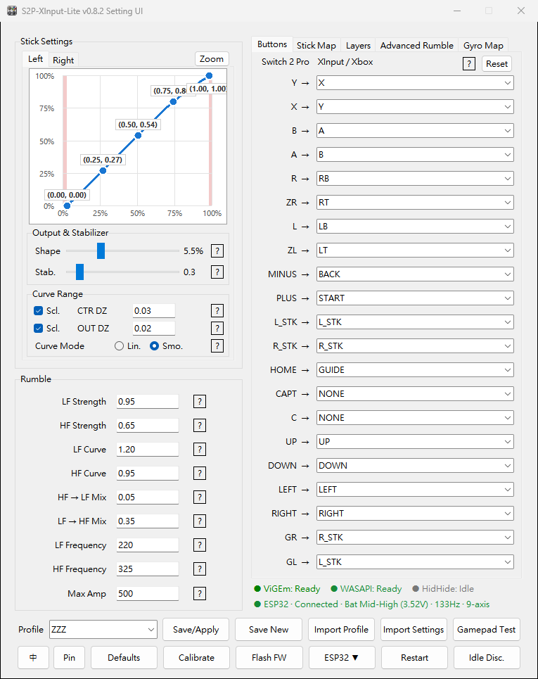

主視窗分成四個區域：

- **左上 Stick Settings**（搖桿設定）：搖桿曲線、輸出形狀、防抖與死區，見 [3. 搖桿設定](#3-搖桿設定)。
- **左下 Rumble**（震動設定）：基本震動強度、曲線、頻率與最大振幅，見 [7.1 基本震動](#71-基本震動)。
- **右側頁籤**：**Buttons**（按鍵映射）、**Stick Map**（搖桿方向映射）、**Layers**（映射層）、
  **Advanced Rumble**（進階震動）與 **Gyro Map**（陀螺儀映射）。上圖為 Buttons 頁籤。
- **底部**：狀態列、方案選擇與功能按鈕。

### 2.1 狀態列

| 狀態 | 意義 |
|---|---|
| `ViGEm: Ready`（正常） | 虛擬 XInput 手把可用。 |
| `WASAPI: Ready`（可用） | 系統音訊擷取可用，音訊震動可以運作。 |
| `HidHide: Ready`（正常） | HidHide 已安裝且已隱藏實體手把。 |
| `HidHide: Idle`（待用） | 已安裝，但目前沒有需要隱藏的 USB 手把，例如使用 ESP32 或藍牙時。 |
| `HidHide: Off / Setup`（關閉／設定） | 已安裝但尚未完成隱藏設定。點擊狀態文字可設定。 |
| `HidHide: Missing`（缺少） | 尚未安裝。點擊狀態文字可開啟下載頁。 |
| `HidHide: Error`（錯誤） | 無法讀取或修改 HidHide 設定，見 [11. 疑難排解](#11-疑難排解)。 |
| `ESP32 · Connected · Bat … · 129Hz · 9-axis` | 經 ESP32 連線中，依序顯示電量、輸入回報率與感測器模式。 |
| `ESP32 · Idle; press any button to wake` | 手把已閒置斷線，按任一鍵即可喚醒，見 [2.6](#26-idle-disc閒置自動斷線)。 |
| `Pad: Searching` | 尚未偵測到手把。 |

### 2.2 底部按鈕

| 按鈕 | 用途 |
|---|---|
| **Profile**（目前方案） | 選擇要編輯或套用的方案。在選單上按右鍵可重新命名或刪除方案。 |
| **Save/Apply**（儲存/套用） | 儲存目前方案並立即套用到連線。 |
| **Save New**（另存新方案） | 以目前畫面的數值建立新方案。 |
| **Import Profile**（匯入方案） | 匯入外部 `.ini` 方案。 |
| **Import Settings**（匯入設定） | 從另一個 S2P-XInput-Lite 安裝資料夾遷移設定，見 [2.4](#24-import-settings匯入設定)。 |
| **Extensions**（擴充工具） | 開啟內建的手把測試，或管理獨立的擴充工具（可同時啟用多個並檢查衝突），見 [2.7](#27-extensions擴充工具)。 |
| **中／En** | 切換介面語言。 |
| **Pin**（指定優先裝置） | 將目前偵測到的手把設為優先裝置，成功時手把會震動提示。 |
| **Defaults**（還原預設） | 將目前畫面全部還原為預設值，見 [11. 疑難排解](#回復穩定設定)。 |
| **Calibrate ▼**（校正） | 選單：**Stick Calibration**（校正搖桿）見 [3.4 搖桿校正](#34-搖桿校正)；**Sensor Calibration**（感測器校正）校正陀螺儀、加速度計與磁力計，見 [6.4](#64-gyro-response陀螺儀反應)。 |
| **Flash FW**（刷入相容韌體） | 檢查並刷入 ESP32-S3 韌體，見 [9.2](#flash-esp32-s3)。 |
| **ESP32 ▼** | 寫入方案並切換 Android USB HID 獨立模式，或切回橋接模式，見 [9.5](#95-寫入設定並啟用-android-usb-hid)。 |
| **Restart**（重啟連線） | 重新啟動桌面連線並載入已儲存的設定，不會寫入 ESP32。 |
| **Idle Disc.**（閒置自動斷線） | 設定無線連線閒置多久後自動斷線，見 [2.6](#26-idle-disc閒置自動斷線)。 |

### 2.3 方案操作

- **切換方案**：從 **Profile** 下拉選單選擇已儲存的方案。
- **儲存並套用**：按 **Save/Apply**。執行中的連線會直接套用新設定，不必重新連線。
  若即時套用失敗，已儲存的設定會在下次連線時生效，需要時可按 **Restart**。
- **建立新方案**：按 **Save New**，輸入名稱。修改 `System Default` 後只能用這個方式保存。

### 2.4 Import Settings（匯入設定）

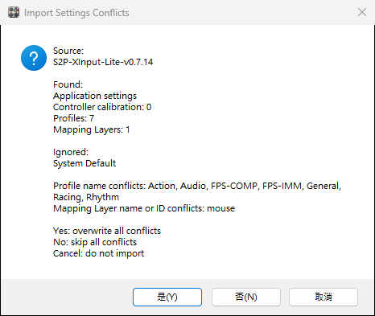

1. 按 **Import Settings**（匯入設定）。若畫面有未儲存的變更，會先詢問是否儲存。
2. 選擇舊版或同版本 S2P-XInput-Lite 的**程式根目錄**（含 EXE 的資料夾），不要選 `src`。
   舊版的 `src\` 與新版的 `app\src\` 配置都可以匯入。
3. 檢查預覽列出的應用程式設定、手把校正、方案與映射層數量，以及略過的項目。
4. 若方案名稱或映射層 ID 衝突（如上圖），選擇 **是**（全部覆蓋）、**否**（全部略過）或 **取消**（不匯入）。
5. 確認匯入。完成後方案清單與映射層清單會重新整理。

匯入時以目前版本的設定結構與預設值為準，新版新增的項目使用目前預設值。`System Default`
永遠不會被覆蓋；執行期快取、記錄檔、韌體、EXE 與建置產物不會匯入。任何一項寫入失敗時，
`config.ini`、使用者方案與映射層會一起還原。無效數值、未完成的自訂按鍵錄製與不支援的映射會
先被擋下，避免覆蓋正常的方案。

### 2.5 未儲存變更與外部檔案修改

- 切換方案時若有未儲存變更，可選擇先儲存、放棄或取消。「取消」會保留目前方案與畫面調整。
  關閉視窗不會自動儲存。
- 目前方案被其他程式修改時，衝突提示的「是」會重新載入外部版本，「否」會以畫面內容覆蓋，
  「取消」則保留目前編輯、不寫入檔案。
- 輸入無效時，請修正後再儲存。出現驗證錯誤代表這次的調整尚未儲存或套用。
- 若提示「設定已儲存，但方案清單暫時無法更新」，檔案其實已經儲存，稍後重新開啟方案選單即可。

### 2.6 Idle Disc.（閒置自動斷線）

按 **Idle Disc.** 可選擇無線連線閒置多久後自動斷線：**關閉**、5、10、15、30 或 60 分鐘，
預設 15 分鐘。這是全域設定，不隨方案切換。斷線後狀態列顯示
`ESP32 · Idle; press any button to wake`，按手把任一鍵即可喚醒重連。

### 2.7 Extensions（擴充工具）

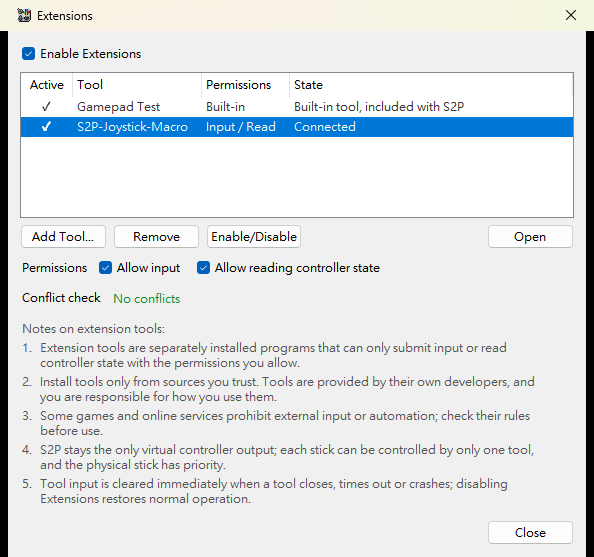

S2P 可以加入另外安裝、獨立執行的擴充工具。工具只能依你允許的權限，把按鍵、扳機與搖桿狀態交給 S2P，
或讀取控制器狀態；S2P 合併實體手把輸入後，從原本唯一的虛擬 Xbox 手把輸出。不會建立第二支虛擬手把，
也不會影響震動、搖桿曲線、陀螺儀與按鍵映射。未啟用時不會啟動任何額外工作。

> [!IMPORTANT]
> **責任與注意事項**
>
> - 擴充工具由其各自的開發者提供，S2P-XInput-Lite 不負責第三方工具的內容、品質或安全性。請只安裝信任來源的工具。
> - 使用擴充工具所產生的操作與結果，由使用者自行負責。
> - 部分遊戲或線上服務可能禁止外部輸入或自動化操作，使用前請先確認相關規範。
> - 「允許讀取控制器狀態」會讓工具讀到你的按鍵與搖桿輸出，只對需要的工具開啟。
> - 工具關閉、逾時或當機時，S2P 會立即清除其輸入；遇到異常時，在清單停用該工具即恢復原本操作。

1. 按 **Extensions**（擴充工具）。
2. 按 **Add Tool...**（新增工具）選擇工具 EXE，加入後即在清單中啟用。可加入多個工具，最多同時啟用 4 個。
3. 選取清單中的工具，在 **Permissions**（權限）勾選 **Allow input**（允許提交輸入，預設開啟）或
   **Allow reading controller state**（允許讀取控制器狀態，預設關閉）。權限變更後工具會自動重新連線。
4. 已啟用的工具會跟著 S2P 一起啟動：連線開始時（或剛啟用工具時）S2P 會在背景開啟它，不會跳出視窗，
   工具自行連線。要使用工具的畫面時，選取工具按 **Open**（開啟），或從系統匣右鍵選單點工具名稱。
   不需要時以 **Enable/Disable**（啟用／停用）停用。關閉 S2P 時，工具也會一起關閉（需工具本身支援，S2P-Joystick-Macro 已支援）。

清單第一列固定是內建的 **Gamepad Test**（手把測試），隨 S2P 提供、不能移除，即使清單中沒有啟用的工具也能開啟，
見 [8. 手把測試](#8-手把測試)。

只有清單中的 EXE（或由 S2P 開啟的工具）才能連線，其他程式會顯示「未授權」。

| 狀態 | 說明 |
|---|---|
| **Disabled**（未啟用） | 未勾選啟用，或該工具已停用。 |
| **Waiting for connection**（等待連線） | 等待工具連線；連接程式未啟動時也會顯示。 |
| **Connected**（已連接） | 工具已連線；顯示工具名稱。若顯示「輸入逾時」，表示工具超過 1 秒沒有回應，其輸入已清除。 |
| **Disconnected**（已中斷） | 工具已關閉。 |
| **Connection failed**（連線失敗） | 未授權、權限不足、搖桿衝突、版本不相容或找不到工具。 |

**Conflict check**（衝突檢查）會列出所有讓工具無法正常運作的問題：

- 設定：同一個 EXE 重複加入、啟用超過 4 個工具、沒有任何權限的工具。
- 執行中：工具要求控制某支搖桿，但已由其他工具控制而被拒絕（顯示到對方放開搖桿為止）、工具要求的權限未允許、
  同一個工具開了第二份、不在清單中的程式嘗試連線，以及 S2P 的通訊管道被其他程式占用。

執行中的檢查只在 S2P 連線啟動時進行。按鍵與扳機不會衝突：按鍵合併，扳機取較大值。

**Check for Updates**（檢查更新）會向每個工具的更新來源查詢是否有新版本，並把結果加在 **State**（狀態）欄：
**Update available**（有更新，附新版本號）、**Up to date**（已是最新版本）、**No update info**（未提供更新資訊，
工具沒有清單檔）或 **Update check failed**（更新檢查失敗）。發現更新時會詢問是否開啟下載頁面；S2P 不會自行下載或
安裝工具。工具的更新來源寫在 EXE 旁的 `.s2p.json` 檔，請讓它和 EXE 放在一起。

合併規則：

- **按鍵**：實體手把或任一工具按住就會輸出，全部放開才會放開。
- **扳機**：採用實體與所有工具中最大的數值。
- **搖桿**：同一支搖桿只能由一個工具控制，並以實體搖桿優先。只有實體搖桿靜止時才採用工具的數值；
  推動實體搖桿會立刻接手，回到中心約 0.15 秒後才交還工具。
- 工具關閉、逾時或當機時會立即清除它的輸入，但不會放開你在實體手把上仍按住的按鍵，也不影響其他工具。

---

## 3. 搖桿設定

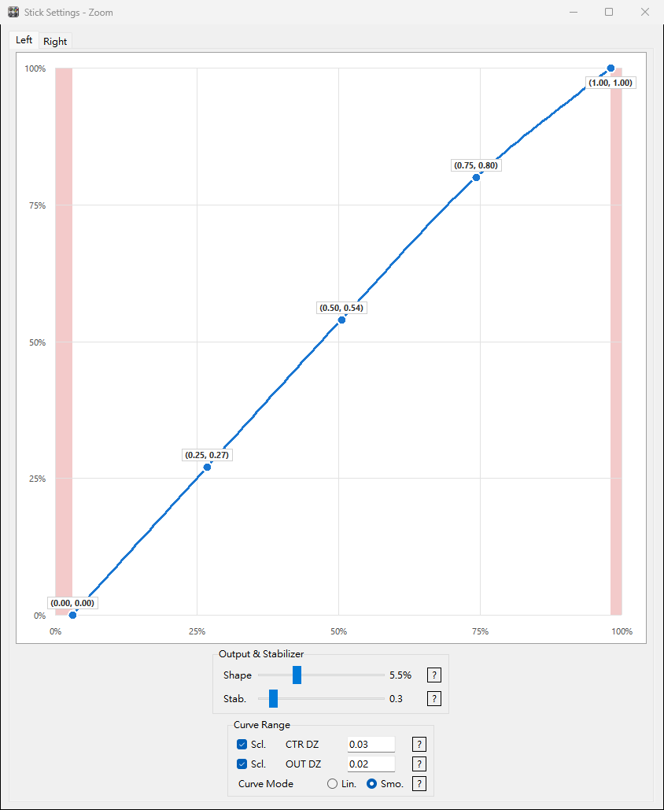

主視窗左上的 **Stick Settings**（搖桿設定）以 **Left**／**Right** 頁籤分別設定左右搖桿。
按 **Zoom**（放大）會開啟上圖的獨立放大視窗，方便精細調整曲線。

### 3.1 曲線

橫軸是搖桿推動幅度，縱軸是輸出。

- 拖曳控制點可修改曲線；`0.25`、`0.50`、`0.75` 三點分別影響小幅、中段與接近外圈的反應。
- 雙擊控制點可還原該點預設值。
- 在控制點上按右鍵可直接輸入 X、Y 座標。
- **Curve Mode**（平滑模式）：`Lin.`（線性）以直線連接控制點，`Smo.`（平滑）使用平滑曲線。
- 圖中左右兩側的淺紅色區域分別是中心死區與外圍死區。

### 3.2 死區

- `CTR DZ`（中心死區）：消除搖桿中心的小幅偏移。
- `OUT DZ`（外圍死區）：讓搖桿還沒推到底時就能達到 100% 輸出。
- `Scl.`（壓縮）：勾選後，曲線的 0% 起點（或 100% 終點）會移到死區邊界，並將完整曲線重新分布到剩餘行程。

死區過大會縮短有效行程，建議只加到剛好能消除漂移或外圈不足的程度。手把剛連線時的小幅
殘留輸出，輕撥搖桿即可歸零，不需要為此加大死區（見 [1.2](#12-安裝與第一次啟動) 的說明）。

### 3.3 Shape（形狀）與 Stab.（防抖）

- **Shape**（形狀）：調整搖桿輸出外框的形狀。數值越高，輸出形狀的修正越明顯。可在手把測試的
  [輸出形狀](#83-輸出形狀) 檢查實際效果。
- **Stab.**（防抖）：在曲線斜率大於 1:1 的放大區域增加防抖。`0.0` 為關閉，`1.0` 標準，
  `2.0` 加強，`3.0` 最強。數值越高輸出越穩，但平滑感也越明顯。

### 3.4 搖桿校正

1. 按主視窗底部的 **Calibrate ▼**（校正），選擇 **Stick Calibration**（校正搖桿），依校正命令列視窗的提示按手把任一鍵開始。
2. 放開按鍵與兩支搖桿，保持完全不動，3 秒後開始擷取中心點。
3. 提示出現後，兩支搖桿沿外圈持續完整旋轉，直到左右的倒數秒數都結束。
4. 完成後用 [手把測試](#8-手把測試) 確認中心與外圈。若顯示校正未儲存，按手把任一鍵重新校正。

> [!TIP]
> 建議依序調整：校正 → 中心死區 → 外圍死區 → 曲線 → 防抖。

---

## 4. 按鍵映射與 Stick Map

### 4.1 Buttons（按鍵映射）

Buttons 頁籤（見 [2. 主視窗](#2-主視窗與方案) 的截圖）將手把的實體按鍵映射為 XInput 輸出。

- 左欄為 Switch 2 Pro 的實體按鍵，右欄下拉選單為 XInput 輸出。
- `NONE`（無）表示不輸出。
- **Reset**（還原）會還原本頁映射。
- 一般方案可將 A/B 與 X/Y 對調，以符合 XInput 的按鍵位置。CAPT、C、GR、GL 等額外按鍵也能指定為
  XInput 按鍵、搖桿按下或 `NONE`。
- 展開下拉選單後可直接用滾輪捲動清單；捲動不會套用選項，點選後仍需按 **Save/Apply**。

下拉選單的項目：

| 項目 | 輸出 |
|---|---|
| `NONE` | 不輸出 |
| `A`、`B`、`X`、`Y` | XInput 面板按鍵 |
| `LB`、`RB`、`LT`、`RT` | 肩鍵與扳機；`LT`／`RT` 按下時為全按 |
| `START`、`BACK`、`GUIDE` | 選單鍵與 Guide 鍵 |
| `L_STK`、`R_STK` | 左／右搖桿按下 |
| `UP`、`DOWN`、`LEFT`、`RIGHT` | 十字鍵 |
| `LS:↑`、`LS:↓`、`LS:←`、`LS:→` | 左搖桿推到底的方向 |
| `RS:↑`、`RS:↓`、`RS:←`、`RS:→` | 右搖桿推到底的方向 |
| **Shortcut**（自訂按鍵） | 錄製鍵盤按鍵、組合鍵或滑鼠左／右／中鍵，見[下方說明](#錄製鍵盤或滑鼠輸入) |
| **Gamepad Combo**（自訂手把組合） | 同時按下 2 到 4 個 XInput 按鍵，見[下方說明](#同時按下多個-xinput-按鍵) |

設定好的自訂項目會直接顯示在欄位中，例如 `KB:Ctrl+S`、`M:Left`、`Pad:X+Y`。

#### 錄製鍵盤或滑鼠輸入

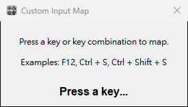

在下拉選單選擇 **Shortcut**（自訂按鍵），會開啟上圖的錄製視窗。按下要映射的按鍵或組合鍵，
例如 F12、Ctrl+S、Ctrl+Shift+S。欄位會以 `KB:1`、`KB:Ctrl+S`、`M:Wheel↓` 等簡寫顯示，
游標移上去可查看完整映射。

#### 同時按下多個 XInput 按鍵

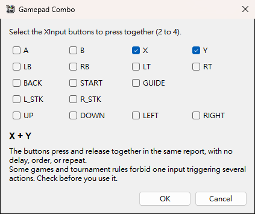

在按鍵或 Stick Map 的下拉選單選擇 **Gamepad Combo**（自訂手把組合），可讓一個輸入同時按下 2 到 4 個
XInput 按鍵，例如 X + Y。勾選按鍵後按 **OK**（確定），欄位會顯示為 `Pad:X+Y`。要修改時再選一次
**Gamepad Combo** 即可。

- 組合內的按鍵會在同一幀一起按下、一起放開，按住多久就維持多久，不含延遲、順序、連發或自動重複。
- 映射層與 ESP32-S3 獨立模式也能使用。寫入含組合鍵的方案需要隨附的 S2P-FW；若 ESP32 回報不支援組合鍵，
  請先用 **Flash FW** 刷入。
- 部分遊戲或比賽規則禁止一鍵觸發多個動作，使用前請自行確認。

### 4.2 Stick Map（搖桿方向映射）

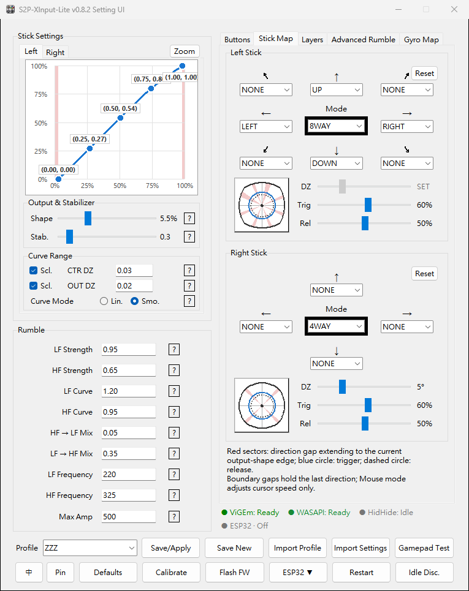

Stick Map 可把搖桿方向當成按鍵使用，例如把左搖桿映射成十字鍵。左右搖桿可分別設定、分別還原。

- **Mode**（模式）：
  - `4WAY`（四方向）／`8WAY`（八方向）：把搖桿方向輸出為按鍵。
  - **Mouse**（映射為滑鼠）：用搖桿移動游標，可調整速度與死區。
  - **Linear Mouse Wheel**（線性滑鼠滾輪）、**Linear LT／Linear RT**（線性扳機）：把搖桿推幅轉成滾輪或扳機輸出。
  - **Map to R Stick／Map to L Stick**（映射為右搖桿／左搖桿）：把這支搖桿輸出成另一支搖桿。
- **方向箭頭與下拉選單**：為每個方向選擇輸出，`NONE` 表示該方向不輸出。項目和 [4.1](#41-buttons按鍵映射)
  的按鍵映射相同，但沒有 `LS`／`RS` 搖桿方向；**Shortcut**（自訂按鍵）可錄製鍵盤按鍵、組合鍵或滑鼠滾輪上／下。
- **方向圖（雷達縮圖）**：紅色扇形是方向之間的死區缺口，藍色實線圓是觸發門檻，灰色虛線圓是放開門檻。
- **DZ**（死區）／**Trig**（觸發）／**Rel**（放開）：設定方向死區、觸發門檻與放開門檻。

上圖的左搖桿使用 `8WAY` 並設定了個別方向死區，所以 **DZ** 滑桿停用並顯示 **SET**。
右搖桿仍使用 `4WAY` 的統一死區。

> [!TIP]
> **Trig** 應高於 **Rel**，形成遲滯區，避免搖桿停在方向邊界時快速重複觸發。

#### 用雷達圖設定個別方向死區

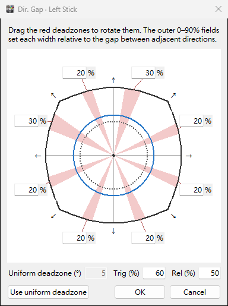

1. 將 **Mode** 設為 `4WAY` 或 `8WAY`，並為各方向選擇輸出。其他模式沒有雷達圖。
2. 點擊方向圖縮圖，開啟 **Dir. Gap**（方向死區）視窗。游標移到縮圖上時外框會變藍。
   也可以用 Tab 選取縮圖，再按 Enter 或空白鍵開啟。
3. 對照雷達圖：箭頭標示各方向，紅色扇形是方向之間的死區缺口，外框是目前的輸出形狀，
   藍色實線圓與灰色虛線圓分別是觸發與放開門檻。
4. **旋轉缺口**：按住紅色扇形並拖曳，可把缺口往某一側偏移。拖曳中的扇形會變深色。
   缺口兩側都會和方向中心保留一點距離，拖到極限時會自動停住。
5. **調整寬度**：扇形外的欄位設定該缺口的寬度，範圍為相鄰方向夾角的 0–90%。
   例如 `8WAY` 的相鄰夾角是 45°，20% 代表 9°；`4WAY` 的相鄰夾角是 90°，20% 代表 18°。
   可直接輸入數字後按 Enter，也可以在欄位上左右拖曳。在欄位按右鍵可還原為已儲存值或預設值。
6. **底部欄位**：
   - **Uniform deadzone (°)**（統一死區）：各缺口共用的半寬，範圍 0–20°。有個別設定時此欄位停用。
   - **Trig (%)**（觸發）：範圍 10–100%。
   - **Rel (%)**（放開）：至少比觸發低 3 個百分點。
7. 按 **OK**（確定）將設定寫回主視窗，按 **Cancel**（取消）或 Esc 放棄這次編輯。
8. 回主視窗按 **Save/Apply** 才會儲存並生效。

要回到統一設定，開啟雷達圖後按 **Use uniform deadzone**（使用統一死區），再按 **OK**。
這個按鈕只在已有個別設定時可用。`4WAY` 與 `8WAY` 的個別設定各自保存，切換模式不會互相覆蓋。
已有個別設定時，點擊主視窗上停用的 **DZ** 滑桿也會開啟雷達圖。

> [!NOTE]
> 雷達圖開啟期間，若主視窗的模式、門檻或方案被改變，按 **OK** 時會提示設定已變更。
> 請關閉後重新開啟雷達圖再編輯。

---

## 5. Layers（映射層）

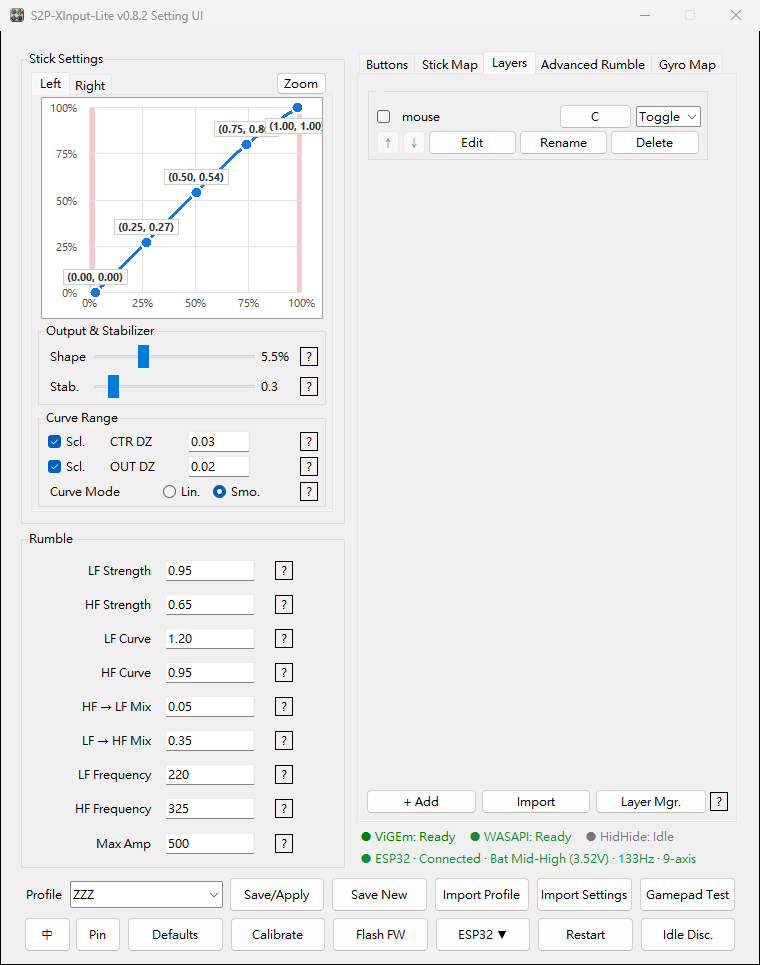

映射層是一組可隨時切換的按鍵與搖桿方向映射。例如按住某顆鍵時，暫時把 ZR／L 改成滑鼠左右鍵、
把右搖桿改成滑鼠。啟用的映射層會覆蓋主映射中有設定的項目。

每一列映射層包含：

- **核取方塊**：勾選後啟用此映射層。
- **啟動按鍵** 與 **Hold／Toggle**：指定切換用的按鍵與方式。
- **↑／↓**：調整清單順序。
- **Edit**（編輯）、**Rename**（改名）、**Delete**（刪除）。

清單下方的 **+ Add**（新增）建立新映射層，**Import**（匯入）匯入映射層檔案，
**Layer Mgr.**（映射層管理）開啟映射層資料夾。

### 5.1 建立與編輯映射層

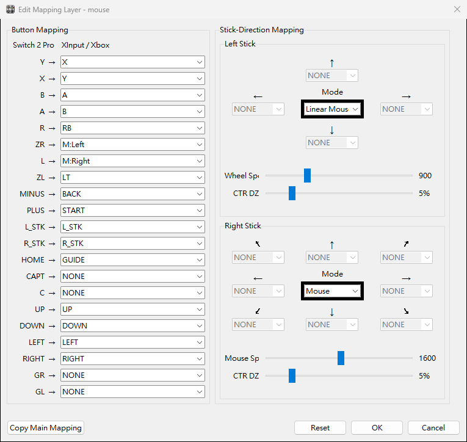

1. 按 **+ Add**，輸入容易辨識的名稱。
2. 按該列的 **Edit**，開啟上圖的編輯視窗。
3. 左側 **Button Mapping**（按鍵映射）設定按鍵輸出；右側 **Stick-Direction Mapping**（搖桿方向映射）
   設定左右搖桿，選項與 [Stick Map](#42-stick-map搖桿方向映射) 相同。
   **Copy Main Mapping**（複製主映射）可先帶入主視窗的映射再修改。
4. 按 **OK** 關閉編輯視窗。
5. 指定啟動按鍵，選擇 **Hold**（按住）或 **Toggle**（切換），並勾選左側方塊啟用。
6. 按主視窗的 **Save/Apply**。

- **Hold**（按住）：按住啟動按鍵時啟用，放開後停用。
- **Toggle**（切換）：每按一次切換啟用或停用。

> [!WARNING]
> 映射層的編輯會先保留在記憶體，只有 **Save/Apply** 成功後，映射層檔案與方案狀態才算正式保存。
> 取消編輯不會保留該次修改。若編輯期間映射層已被外部修改或刪除，請重新開啟最新項目再編輯。

---

## 6. Gyro Map（陀螺儀映射）

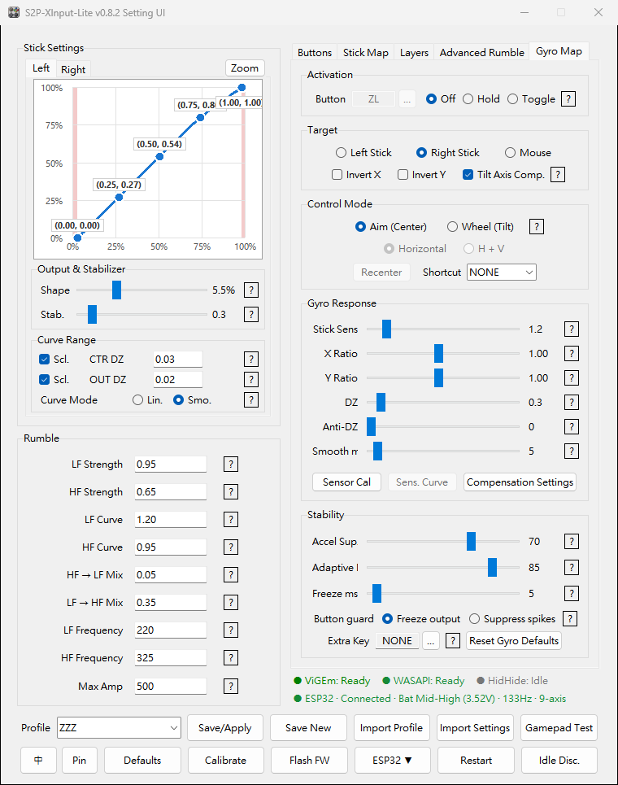

Gyro Map 把手把的轉動轉成搖桿或滑鼠輸出，常用於射擊遊戲的體感瞄準。頁面由上到下分成
Activation、Target、Control Mode、Gyro Response 與 Stability 五區，欄位旁的 **?** 有詳細說明。

### 6.1 Activation（啟動方式）

- **Button**（按鍵）：按 **…** 選擇一顆或多顆啟動按鍵。原本的 XInput／鍵盤映射仍會保留。
- **Off**（關閉）：不產生任何陀螺儀輸出。
- **Hold**（按住）：按住啟動按鍵時啟用。
- **Toggle**（切換）：每按一次切換啟用或停用。

### 6.2 Target（輸出目標）

- **Left Stick**（左搖桿）／**Right Stick**（右搖桿）：輸出到虛擬手把的搖桿，瞄準通常選右搖桿。
- **Mouse**（滑鼠）：輸出為滑鼠移動。
- **Invert X／Y**（反轉 X／Y）：反轉水平或垂直方向。
- **Tilt Axis Comp.**（傾斜軸補償）：手把傾斜時自動修正左右與上下的方向，減少斜拿造成的串軸。
  關閉後固定使用感測器的 X／Z 軸。只在回中模式可用。

### 6.3 Control Mode（控制模式）

- **Aim (Center)**（回中（瞄準））：依轉動速度輸出，停止轉動便自動回中，適合瞄準。
- **Wheel (Tilt)**（傾斜（方向盤））：依手把相對於啟用瞬間的傾斜角度控制搖桿，適合方向盤；
  只支援左右搖桿輸出。可選 **Horizontal**（僅水平）或 **H + V**（水平＋垂直），
  **Recenter**（重設中立）與 **Shortcut**（自訂按鍵）用來重設中立角度。指定的重設按鍵會專門用於
  重設中立，不再送出原本的遊戲映射。

### 6.4 Gyro Response（陀螺儀反應）

依目前的輸出目標與控制模式，只會顯示適用的欄位。

| 欄位 | 說明 |
|---|---|
| **Stick Sens**（搖桿感度） | 回中模式下，轉動速度轉成搖桿偏移的倍率。 |
| **Mouse Sens**（滑鼠感度） | 滑鼠輸出時，每轉動一度對應的游標移動倍率。 |
| **Max Tilt**（最大傾角） | 傾斜模式下，傾斜到此角度時輸出滿值。 |
| **X Ratio／Y Ratio**（X／Y 比例） | 水平與垂直的相對倍率，範圍 `0.10–2.00`，`1.00` 為不改變。 |
| **DZ**（死區） | 回中模式以水平與垂直的合成轉速判斷死區（圓形死區），保留斜向轉動的方向。單位：度／秒。 |
| **Anti-DZ**（反死區） | 補償遊戲內建的搖桿死區，只作用於陀螺儀的搖桿輸出。預設 `0`。 |
| **Tilt DZ**（傾斜死區） | 傾斜模式下，忽略中立角度附近的小幅傾斜。 |
| **Smooth ms**（平滑 ms） | 回中模式的速度自適應平滑：慢速使用設定值，快速轉動會降到約 5 ms。`0` 為關閉。 |
| **Tilt Smooth**（傾斜平滑） | 傾斜模式的平滑時間。 |

欄位下方的按鈕：

- **Sens. Curve**（感度曲線）：只在回中模式、啟用陀螺儀且輸出到搖桿時可用。
- **Compensation Settings**（補償設定）：分軸調整陀螺儀輸出倍率；輸出為滑鼠時不顯示。

感測器校正位於主視窗底部 **Calibrate ▼**（校正）→ **Sensor Calibration**（感測器校正）。
請先將手把平放在穩定的平面上再執行，校正期間按鈕會顯示目前進度。

#### 感度曲線

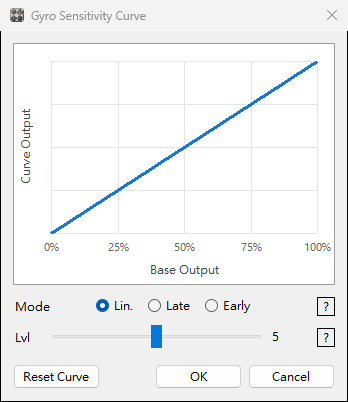

橫軸是陀螺儀的基本輸出，縱軸是曲線處理後的輸出。**Mode** 可選 **Lin.**（線性）、**Late**
（後段加速）或 **Early**（前段加速），**Lvl**（強度）調整曲線彎曲的程度。按 **OK** 後回主視窗
按 **Save/Apply**。

#### 補償設定

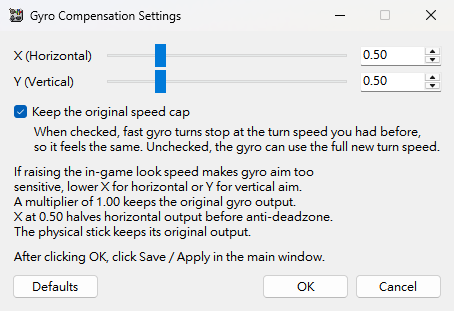

調高遊戲內的視角速度後，如果陀螺儀微瞄變得太敏感，可降低對應的倍率：**X** 調水平，**Y** 調垂直。
`1.00` 保留原本的輸出；例如 X 設為 `0.50`，水平輸出在反死區之前會減半。倍率在平滑與感度曲線
之後才套用，而且只作用於陀螺儀，實體搖桿維持原本的輸出。按 **OK** 後回主視窗按 **Save/Apply**。

補償只等比縮小輸出，最快轉速的上限仍是新的遊戲視角速度。例如遊戲從 140°/s 調到 720°/s、補償設為
`0.19` 時，慢速微瞄的手感和原本一樣，但原本在 140°/s 封頂的快速轉動，現在可以一路加速到 720°/s。
若希望手感完全和調整前一樣，可在補償設定視窗勾選 **Keep the original speed cap**（保留原本的速度上限），
讓陀螺儀在原本的速度封頂。這個選項只在回中模式顯示，預設關閉。

要算出合適的倍率，可用手把測試的 [補償預覽與補償計算](#陀螺儀補償預覽與補償計算)。

### 6.5 Stability（穩定控制）

| 欄位 | 說明 |
|---|---|
| **Accel Sup**（加速抑制） | 快速轉動或震動時，降低加速度計對姿態的拉動。`0` 為關閉。 |
| **Adaptive DZ**（自適死區） | 回中模式靜止時保留死區，明確轉動時自動縮小。`0` 為固定死區。 |
| **Freeze ms**（防晃 ms） | 額外按鍵按下或放開後的防晃時間。`0` 為關閉。 |
| **Button guard**（防晃模式） | **Freeze output**（暫停輸出，預設）：防晃時間內暫停陀螺儀輸出，視角可能短暫停住。**Suppress spikes**（抑制突波）：保留原本的轉動，只限制按鍵瞬間的突波，可先試 20 ms。 |
| **Extra Key**（額外按鍵） | 選擇容易造成手把晃動的按鍵，例如扳機。按下或放開都會觸發防晃，原映射仍保留。 |

**Reset Gyro Defaults**（還原陀螺儀預設）會把本頁還原為預設值。

### 6.6 建議設定順序

1. 將手把平放在穩定的平面上，按主視窗底部 **Calibrate ▼** → **Sensor Calibration**（感測器校正）。
2. 選擇 **Target**。
3. 指定啟動按鍵，選擇 **Hold** 或 **Toggle**。
4. 從較低的感度開始測試。
5. 用 **X Ratio／Y Ratio** 修正水平與垂直的速度差。
6. 只有靜止時仍會漂移才增加 **DZ**。
7. 小幅轉動在遊戲中沒反應時，再少量增加 **Anti-DZ**。
8. 最後調整 **Smooth ms**。

可搭配手把測試的 [瞄準測試](#aim-test-guide) 實際檢查反應。

> [!WARNING]
> 進行磁力計校正時，請遠離喇叭、磁鐵、大型金屬物與通電設備，並依提示讓手把完成多方向的 3D 八字翻轉。

---

## 7. 震動設定

### 7.1 基本震動

主視窗左下的 **Rumble**（震動設定）：

| 欄位 | 說明 |
|---|---|
| **LF Strength**（低頻震動強度） | 低頻路徑的強度。 |
| **HF Strength**（高頻震動強度） | 高頻路徑的強度。 |
| **LF Curve／HF Curve**（低頻／高頻輸出曲線） | 調整小訊號到大訊號的反應曲線。 |
| **HF → LF Mix**（低頻補償） | 將部分高頻路徑混入低頻。 |
| **LF → HF Mix**（高頻補償） | 將部分低頻路徑混入高頻。 |
| **LF Frequency／HF Frequency**（LF／HF 頻率） | 兩個震動頻率命令。 |
| **Max Amp**（最大振幅） | 限制最終振幅。範圍 `0–1023`，預設 `500`。 |

經過多款橋接軟體與不同手把的實際測試，震動強度越高，線性馬達在震動快速變化時越可能出現輕微的
撞擊聲。目前沒有明確的硬體安全上限，因此以 `500`（約欄位上限的 49%）作為通用預設值，在保留
清楚回饋的同時降低異音的可能。

> [!CAUTION]
> `0–1023` 是協議欄位範圍，不代表所有手把都適合長時間使用最高值。若出現明顯撞擊聲、尖銳聲或
> 不自然的震感，請降低 **Max Amp**、**LF/HF Strength** 或相關頻段增益。

### 7.2 Advanced Rumble：Game（遊戲）模式

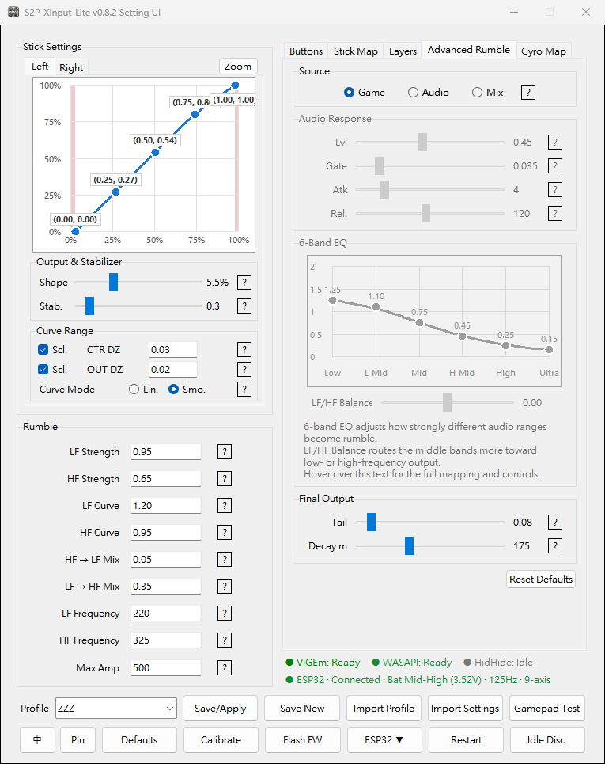

**Source**（輸出來源）選擇震動的來源：

- **Game**（遊戲）：只輸出遊戲原生震動。此時 Audio Response 與 6-Band EQ 會停用。
- **Audio**（音訊）：將 Windows 預設輸出裝置的聲音轉成震動。
- **Mix**（混合）：以柔和飽和的方式合併遊戲震動與音訊震動，避免直接相加造成削波。

**Final Output**（最終輸出）的 **Tail**（餘震強度）與 **Decay ms**（衰減）控制震動尾端與衰減，
**Reset Defaults**（還原預設）還原本頁。

### 7.3 Audio（音訊）與 Mix（混合）模式

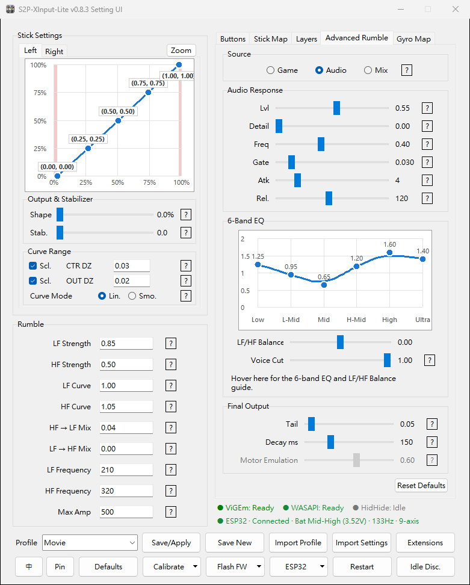

**Audio Response**（音訊反應）：

| 欄位 | 說明 | 調整方向 |
|---|---|---|
| **Lvl**（強度） | 音訊轉震動的整體敏感度。 | 整體太弱就提高；聲音一開始就過強就降低。 |
| **Gate**（噪閘） | 噪音門檻。 | 安靜處仍持續震動就提高；只有很大聲才有反應就降低。 |
| **Atk**（啟動） | 起振速度。 | 數值越小反應越快。 |
| **Rel.**（釋放） | 聲音結束後的釋放時間。 | 數值越高，震動尾端越長。 |

### 7.4 6-Band EQ（六頻段）

| 頻段 | 範圍 | 主要內容 |
|---|---:|---|
| Low | 20–120 Hz | 深沉撞擊與超低頻 |
| L-Mid | 120–300 Hz | 低頻厚度 |
| Mid | 300–700 Hz | 中低頻細節 |
| H-Mid | 700–2000 Hz | 中高頻細節 |
| High | 2000–4000 Hz | 摩擦與人聲邊緣 |
| Ultra | 4000–8000 Hz | 尖銳提示與超高頻細節 |

- 拖曳控制點可調整該頻段的增益，雙擊可還原預設。`1.00` 為中性增益。
- 游標移到圖下方的說明文字，可查看完整的頻段範圍與操作方式。
- 這些設定只影響 Audio 與 Mix，不影響 Game 模式。

**LF/HF Balance**（LF／HF 重心）只改變中間頻段的路由，不修改六個頻段本身的增益：`-1.00`
偏向 LF，`0.00` 平衡，`+1.00` 偏向 HF。建議先在 `-0.15～+0.15` 之間測試。

### 7.5 高頻噪音排查

若 Audio 或 Mix 模式出現持續的高頻聲：

1. 降低 **High** 與 **Ultra** 增益。
2. 將 **LF/HF Balance** 稍微往 LF 移動。
3. 提高 **Gate**，過濾安靜的背景聲。
4. 若所有聲音一開始就過強，降低 **Lvl**。
5. 若仍有異音，降低 **HF Strength** 或 **Max Amp**。

---

## 8. 手把測試

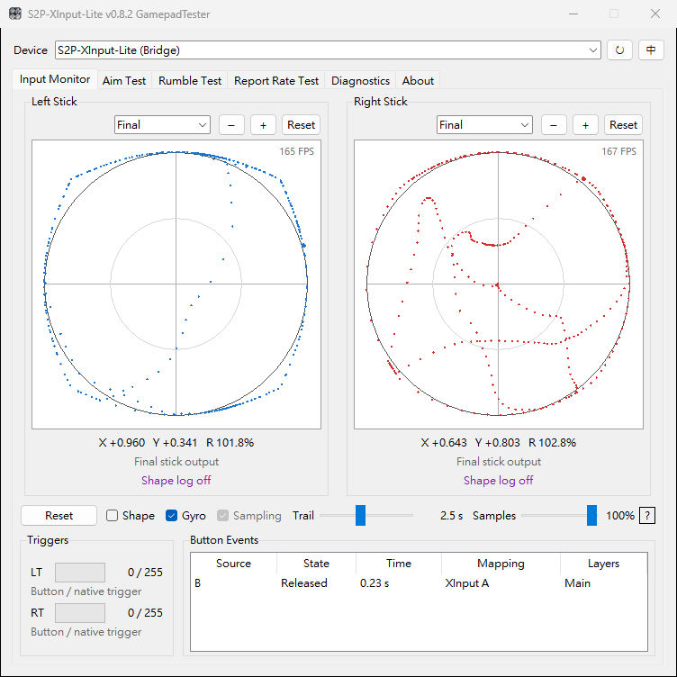

按主視窗底部的 **Extensions**（擴充工具），選取內建的 **Gamepad Test**（手把測試）按 **Open**（開啟）；也可從系統匣右鍵選單開啟，或直接執行 `GamepadTester.exe`。
測試程式和設定視窗分開執行，高更新率繪圖不會拖慢設定操作。再按一次按鈕會把既有的測試視窗帶到最上層。

> [!IMPORTANT]
> 手把測試主要針對由 S2P-XInput-Lite 連線並處理的 Switch 2 Pro Controller。其他 XInput、WinMM 或
> Raw HID 手把也能做基本的輸入、震動與回報率測試，但不會有 S2P 的共享遙測；實體／處理後來源、
> 有效映射、映射層、電量、感測器與 ESP32 診斷等資訊可能缺少，這是預期行為。

**快速測試步驟：**

1. 喚醒手把；若要測試 S2P 輸出，先啟動主程式並確認已連線。
2. 開啟手把測試，在頂端 **Device**（測試手把）選擇 **S2P-XInput-Lite (Bridge)**。找不到時按旁邊的 **↻** 重新掃描。
3. 在 **Input Monitor**（輸入監看）移動兩支搖桿、按下按鍵與扳機，確認圖上的圓點與事件表有變化。
4. 依需要切換 **Aim Test**（瞄準測試）、**Rumble Test**（震動測試）、**Report Rate Test**（回報率量測）
   或 **Diagnostics**（診斷模式）。

### 8.1 選擇測試來源

- **S2P-XInput-Lite (Bridge)**：測試主程式目前輸出的虛擬手把，可顯示套用前、套用後與合成結果。
- **其他手把**：Windows 偵測到的 XInput 或一般遊戲手把，只顯示該介面實際提供的資料。
- **Raw HID**：名稱含 `Raw HID` 的項目是 HID 介面，用於 [回報率量測](#87-report-rate-test回報率量測)。
  **S2P Mobile Gamepad (Raw HID)** 是 Android USB HID 獨立模式的 ESP32-S3，會顯示所有按鍵與十字鍵，也能用於瞄準測試。
- 同名裝置超過一支時，選單會加上介面類型與編號。切換裝置時會清除舊的量測，避免資料混在一起。

### 8.2 搖桿圖

上方左右兩張圖分別是左、右搖桿。十字線中心是零點，黑色外圈是 100% 基準，圓點是目前位置，
其後的點是最近的軌跡。圖下方顯示目前座標與半徑 **R**。

- 圖上方的來源選單：**Stick**（實體搖桿）、**Gyro**（陀螺儀）、**Final**（合成結果）；
  其他手把則有 **Input**（實際輸入）。S2P 來源才有實體與陀螺儀的分別。`-`、`+` 縮放，**Reset**（重設）恢復圖面。
- **Trail**（軌跡長度）設定軌跡保留秒數，**Samples**（採樣點）設定有多少比例的實際報告畫入軌跡。
- **Gyro**（陀螺儀圖例）顯示陀螺儀相關的參考線。
- 右上角的 FPS 是有變化的畫面更新次數，不是手把回報率；量測回報率請用 [回報率量測](#87-report-rate-test回報率量測)。

### 8.3 輸出形狀

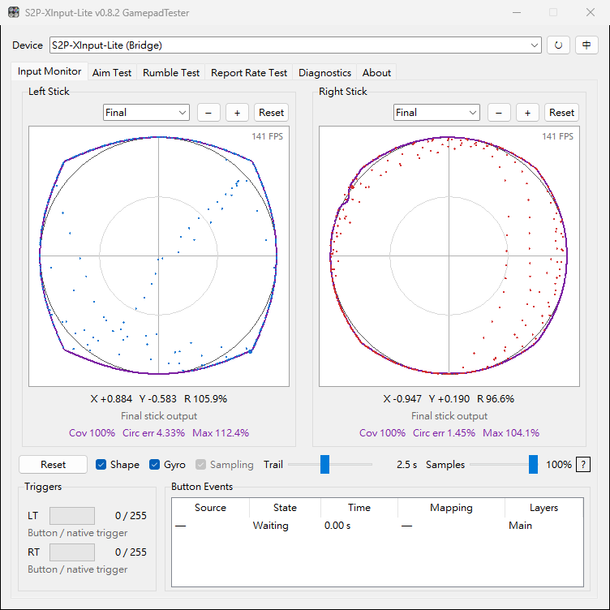

勾選 **Shape**（輸出形狀）後，沿搖桿外圈緩慢旋轉幾圈。紫色線會記錄每個方向實際到達的最大輸出，
圖下方顯示 **Cov**（覆蓋率）、**Circ err**（圓度誤差）與 **Max**（最大半徑）。

- 每個 5° 區段都取得真實樣本後，覆蓋率會達到 100%。
- 紫色線連續一秒沒有再擴張時，量測會鎖定並停止重畫，避免長時間開啟時持續消耗效能。
- 取消再勾選 **Shape**，或切換來源與設定，即可開始新的量測。按 **Reset** 會清除目前的量測。

### 8.4 按鍵與扳機

- **Triggers**（扳機）：分別顯示 LT、RT 的目前數值與輸入類型。
- **Button Events**（按鍵與映射事件）：列出 **Source**（來源按鍵）、**State**（按下／放開）、
  **Time**（持續時間）、**Mapping**（實際生效的映射）與 **Layers**（映射層）。

### 8.5 Aim Test（瞄準測試）

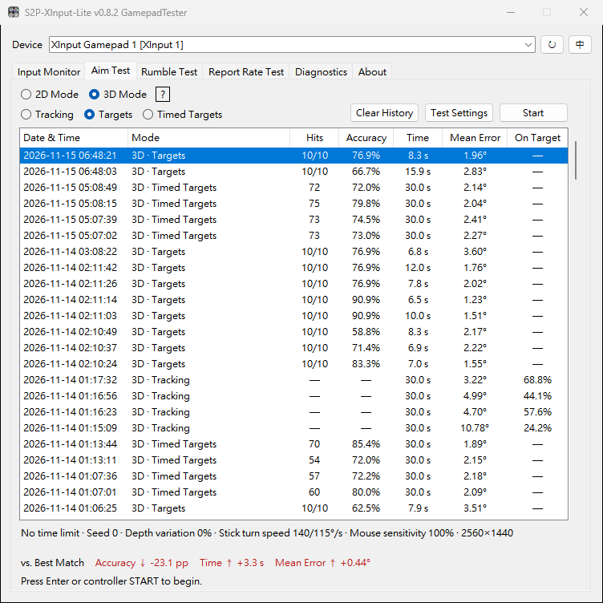

**Aim Test** 分頁的各區域：

- **左上**：選擇 **2D Mode** 或 **3D Mode**，以及 **Tracking**（跟槍）、**Targets**（點靶）或
  **Timed Targets**（限時點靶）。**?** 可查看操作與比對規則。
- **右上**：**Gyro Preview**（補償預覽）、**Calculator**（補償計算）、**Clear History**（清除紀錄）、
  **Test Settings**（測試設定）與 **Start**（開始）。
- **中間**：已儲存的回合紀錄。選取一筆可在下方查看和最佳成績的比較。
- **下方**：目前的測試條件，以及與相同靶設定最佳成績的差異。

#### 測試陀螺儀映射的右搖桿輸出

1. 透過 S2P-XInput-Lite 連接手把。在 **Gyro Map** 將 **Target** 設為 **Right Stick**，
   **Control Mode** 選 **Aim (Center)**，指定啟動按鍵並選擇 **Hold** 或 **Toggle**，再按 **Save/Apply**。
2. 開啟手把測試，在 **Device** 選取 **S2P-XInput-Lite (Bridge)**。瞄準測試讀取的是 Windows 收到的
   虛擬手把右搖桿輸出，目前方案的映射、死區與反應設定都會反映在操作上。
3. 選擇 **3D Mode → Tracking**，按 **Start**。啟用陀螺儀後放開實體右搖桿，只轉動手把來檢查反應。
   要測試射擊時改用 **Targets** 或 **Timed Targets**。

#### 選擇並開始測試

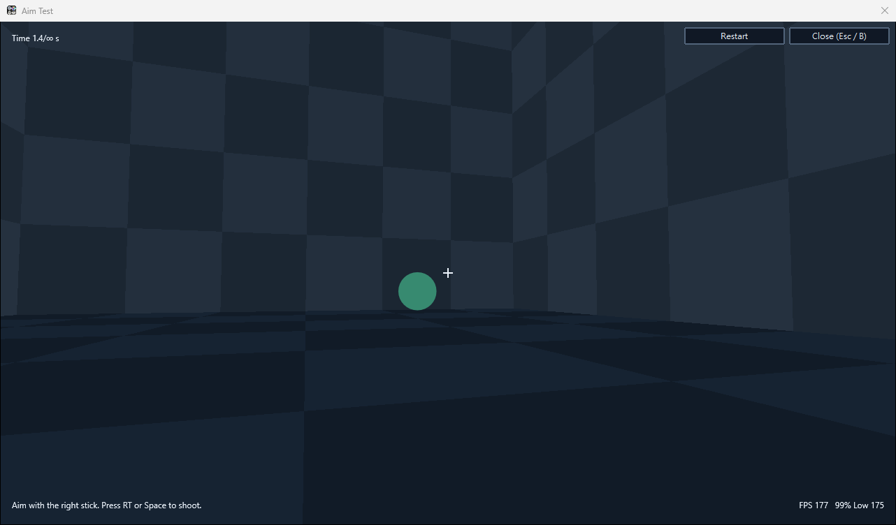

上圖為視窗模式的 **3D Mode → Targets**。左上角是計時，右上角是 **Restart**（重新開始）與
**Close**（關閉），左下角是操作提示，右下角是 **FPS** 與 **99% Low**。把中央的準心移到球靶上再射擊即可命中。

在 **2D Mode** 用滑鼠或右搖桿移動準心；在 **3D Mode** 用滑鼠或右搖桿轉動視角。偵測到手把時預設用
手把瞄準，按 RT 或空白鍵射擊；沒有手把時用滑鼠瞄準，按左鍵或空白鍵射擊。要在同一回合交替使用兩者，
請在 **Test Settings** 勾選 **Auto-switch between controller and mouse**（啟用手把與滑鼠自動銜接）。
準心或視角的移動速度與搖桿輸出成正比。預設為 **3D Mode → Targets**。

| 測試 | 2D 模式 | 3D 模式 |
|---|---|---|
| **Tracking**（跟槍） | 移動準心跟上移動的靶。 | 轉動視角追蹤移動的球靶。 |
| **Targets**（點靶） | 逐一點擊或射擊畫面上的靶。 | 逐一射擊空間中的球靶。 |
| **Timed Targets**（限時點靶） | 在倒數內盡量擊中補上的靶。 | 在倒數內盡量擊中補上的球靶。 |

跟槍依設定的秒數結束。點靶每次命中才換靶，達到指定命中數或時限便結束。限時點靶開場有兩顆靶，
各自保留到被擊中，短暫間隔後補上新靶，倒數歸零時結算總命中數。3D 靶重疊時，會擊中準心射線最先
碰到的球面。

按 **Start**、Enter 或手把 START，畫面倒數 3、2、1 後開始計分。倒數時若已按住 RT，須先放開再按
才會射擊。用右上角的 **Restart**、Enter 或 START 重跑目前的測試；用 **Close**、Esc 或手把 B 返回
手把測試。3D 回合可用滑鼠瞄準時，按右鍵可釋放游標操作視窗按鈕，再在測試區按右鍵恢復滑鼠瞄準。
全螢幕測試在切換到其他視窗時也會關閉，並還原原本的顯示模式。

#### 測試設定

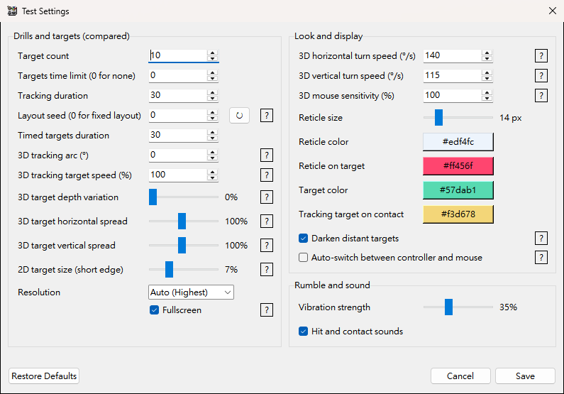

按 **Test Settings** 開啟上圖視窗。視窗分成三個區塊：

- 左側 **Drills and targets (compared)**（回合與靶，列入成績比對）：解析度、靶數、秒數、出靶種子與出靶範圍。
  只有這個區塊的設定會決定成績和哪些紀錄比較。
- 右上 **Look and display**（視角與顯示）：視角速度、滑鼠感度、準心與顏色。
- 右下 **Rumble and sound**（震動與音效）：命中回饋。

欄位旁的 **?** 有詳細說明。修改後按 **Save**（儲存）；按 **Restore Defaults**（恢復預設）再儲存可重設全部測試設定。

- **Fullscreen**（全螢幕）預設勾選。視窗模式的 **Auto (Highest)**（自動（最高））會讓測試視窗連同標題列
  填滿目前螢幕的工作區，保留 Windows 工作列；全螢幕的 **Auto (Highest)** 使用 Windows 在該螢幕驗證可用
  的最高解析度。兩種模式都可手動選擇尺寸。
- 點靶時限設為 `0` 時，打完指定數量才結束。
- 出靶種子設為 `0` 時，點靶使用內建靶序，跟槍使用內建路線，限時點靶也有固定可重播的出靶序列。
  按 **↻** 產生新種子，儲存後便能重跑同一配置。
- 所有模式都可調整準心的顏色與大小。2D 靶的直徑以畫面短邊的百分比設定。遠近差異與水平、垂直範圍
  控制 3D 點靶與限時點靶的出靶位置。
- **3D mouse sensitivity (%)**（3D 滑鼠感度）預設 100%，游標每移動一像素，視角轉動 0.18°。
- **3D horizontal／vertical turn speed (°/s)**（3D 水平／垂直視角速度）設定右搖桿滿值時的轉向速度，
  也適用於映射到右搖桿的陀螺儀。預設水平 140°/秒、垂直 115°/秒。
- **3D tracking arc (°)**（3D 跟槍環繞範圍）設為 0° 時使用原本路線；180° 會在左右各 90° 處折返；
  360° 會在正後方折返，經過正面後往另一側移動。按出靶種子旁的 **↻** 可隨機決定起跑方向，
  種子 0 固定往右起跑。
- **3D tracking target speed (%)**（3D 跟槍靶速）可調 10–600%，環繞路線在 100% 時為 90°/秒，600% 時為 540°/秒。
- **Darken distant targets**（加深遠近效果）預設勾選，最近的 3D 球靶最亮，較遠的逐漸變暗；關閉後球靶會顯示外框。
- 跟槍時準心落在靶上會讓靶變色並提供輕微震動；點靶與限時點靶則是準心變色。命中會播放音效、顯示短暫的
  碎片效果並震動，未命中會播放另一種短音。**Vibration strength**（震動強度）設為 `0` 可關閉震動，
  音效可用核取方塊關閉。

右下角的 **FPS** 依成功的 Direct2D 提交或 Tk 繪圖更新計算，**99% Low** 則把 P99 繪圖間隔換算為 FPS，
可看出平均 FPS 高時是否仍有較長的間隔。繪圖目標跟隨螢幕目前的更新率，實際呈現也受 Windows 與顯示卡影響。

#### 陀螺儀補償預覽與補償計算

調高遊戲內的視角速度後，映射到右搖桿的陀螺儀也會跟著變快。補償倍率可降低陀螺儀輸出，
讓微瞄手感維持原本的樣子，實體搖桿的輸出不受影響。

**Gyro Preview** 與 **Calculator** 只在測試來源為 **S2P-XInput-Lite (Bridge)** 且陀螺儀可用時顯示。
補償預覽需要 **3D Mode**。若目前方案已調整過補償倍率，開啟時會詢問是否先還原為 1.00。

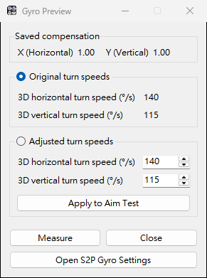

**用補償預覽量測：**

1. 按 **Gyro Preview**。測試畫面會以無邊框方式填滿螢幕，右上角顯示預覽面板。
2. **Saved compensation**（已儲存的補償倍率）顯示目前 S2P 設定的 X（水平）／Y（垂直）倍率。
3. **Original turn speeds**（原始視角速度）固定為預設的水平 140°/秒、垂直 115°/秒。
4. 在 **Adjusted turn speeds**（調整後視角速度）輸入新的水平與垂直速度，初始值取自目前的測試設定。
5. 選取原始或調整後的速度，可用右搖桿實際轉動視角比較兩種手感。
6. 按 **Measure**（量測）。預覽會以相同的搖桿輸出，依序轉動原始 X、Y 與調整後 X、Y，再顯示建議的
   X／Y 補償倍率。建議值在 `0.10–2.00` 內時，會直接寫入目前的 S2P 設定和方案，並嘗試套用到目前連線。
   面板會顯示是否已即時套用。
7. 要讓之後的瞄準測試回合也使用調整後的速度，按 **Apply to Aim Test**（套用至瞄準測試）。
   這只更新瞄準測試的 3D 視角速度，不會改變 S2P 設定。
8. 按 **Close** 或 Esc 結束預覽。**Open S2P Gyro Settings**（開啟 S2P 陀螺儀設定）會切換到主視窗的 Gyro Map。

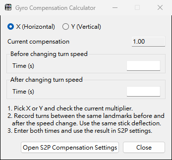

**用補償計算換算遊戲實測：**

1. 按 **Calculator**，選擇 **X (Horizontal)** 或 **Y (Vertical)**，並確認 **Current compensation**（目前補償倍率）。
2. 在遊戲中調整視角速度前，用固定的右搖桿推幅與瞄準狀態，從地標 A 轉到地標 B 並錄影。
3. 調整遊戲視角速度後，用相同推幅與狀態再錄一次。
4. 回看錄影，在 **Before changing turn speed**（調整視角速度前）與 **After changing turn speed**
   （調整視角速度後）填入兩次耗時（秒），即可得到建議倍率。例如原倍率為 1.00 時，舊設定 3 秒、
   新設定 2 秒會得到 0.67。
5. 按 **Open S2P Compensation Settings**（開啟 S2P 補償設定），或從主視窗 **Gyro Map** 開啟
   **Compensation Settings**，填入 X／Y 倍率並按 **OK**，再按 **Save/Apply**。

#### 判讀與比較成績

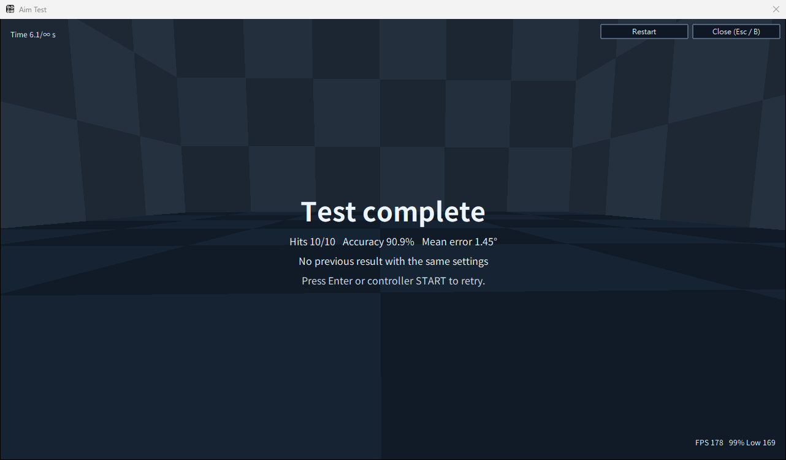

**Accuracy**（命中率）是命中數除以射擊次數。**Mean Error**（平均偏差）是準心到靶心的平均距離，
2D 用像素，3D 用角度。點靶取有靶時各次射擊的平均，包含未命中；限時點靶在補靶空檔射擊仍計入命中率。
跟槍的平均偏差按時間加權，**On Target**（跟靶率）是準心落在靶內的時間比例。3D 跟槍收到右搖桿輸入時，
結果也會顯示水平輸出峰值與最長連續滿桿時間（毫秒）；水平輸出離開滿值或反向就會中斷計時。

結束畫面的中央顯示成績，以及和相同靶設定下歷史最佳成績的差異。比對只看測試設定中
**Drills and targets (compared)**（回合與靶，列入成績比對）區塊的設定：模式、解析度、種子，以及適用的靶數、秒數、2D 靶心大小、
遠近差異與出靶範圍；3D 跟槍另外比對環繞範圍與靶速。手把視角速度、滑鼠感度、顏色、準心、震動與
音效不同的成績仍可互相比較。

- **Targets** 依序比較命中數、命中率、完成耗時與平均偏差，兩回合都打完所有靶才比較完成耗時。
- **Timed Targets** 依序比較命中數、命中率與平均偏差。
- **Tracking** 先比較跟靶率，再比較平均偏差。

箭頭表示數值上升或下降，綠色代表進步，紅色代表退步；命中率與跟靶率的差異以百分點顯示。
**Clear History**（清除紀錄）可移除已儲存的回合。

### 8.6 Rumble Test（震動測試）

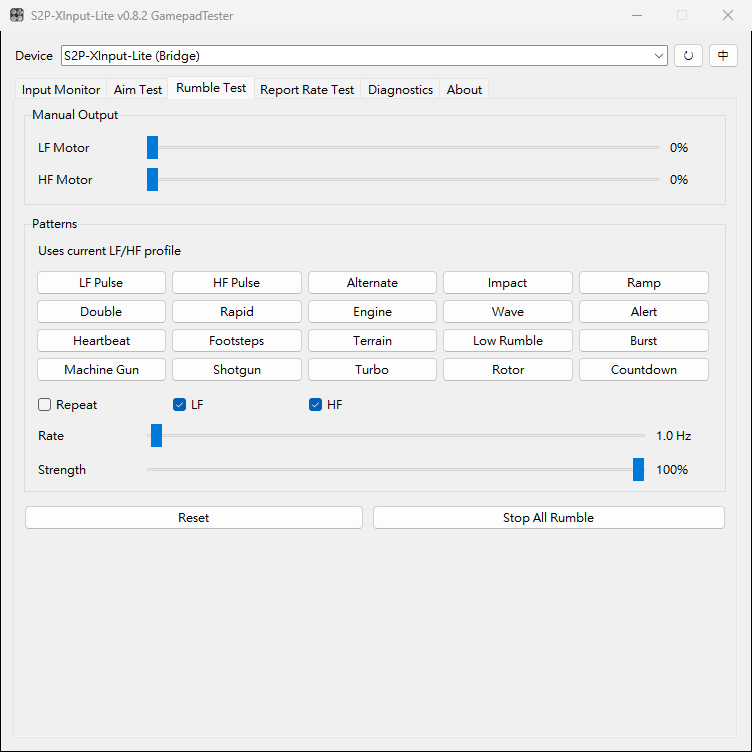

1. 在 **Device** 選擇 **S2P-XInput-Lite (Bridge)** 或支援震動的 XInput 裝置，開啟 **Rumble Test**。
2. **Manual Output**（手動震動輸出）：以低強度開始，分別拉動 **LF Motor** 與 **HF Motor**。
3. **Patterns**（震動模板）：按任一模板播放，例如 Impact、Engine、Machine Gun。
   **Repeat**（重複播放）連續播放，**LF／HF** 選擇頻段，**Rate**（播放頻率）與 **Strength**（模板強度）調整節奏與強度。
4. 結束時按 **Stop All Rumble**（停止所有震動）。**Reset**（重設）還原本頁設定。

Bridge 測試會套用目前方案的 LF／HF 設定；Source 為純 Audio 時，遊戲震動模板不會輸出。
若顯示 `No XInput rumble` 或控制項呈灰色，請確認虛擬手把已啟用，或改選支援震動的 XInput 裝置。
更換測試裝置、輸出連線變動或關閉測試時，程式會停止原裝置的震動。Android USB HID 獨立模式只提供輸入，
不會把遊戲震動傳回手把。

### 8.7 Report Rate Test（回報率量測）

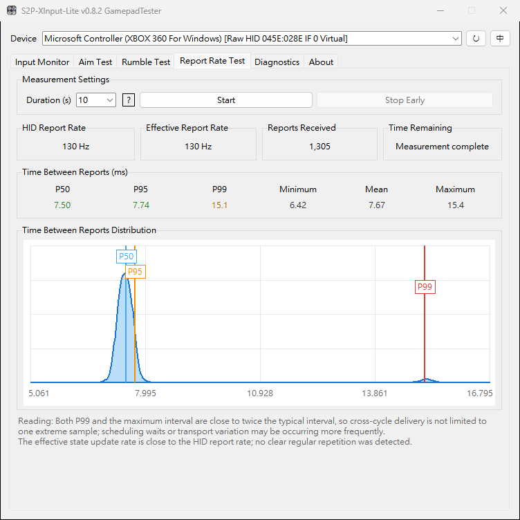

1. 在 **Device** 選擇名稱含 `Raw HID` 的介面，開啟 **Report Rate Test**。
2. 選擇 **Duration (s)**（量測秒數）並按 **Start**（開始量測）。
3. 量測期間持續大幅度繞圈移動一支搖桿，直到結束；需要時可按 **Stop Early**（提前停止）。
4. 比較 **HID Report Rate**（HID 回報率）與 **Effective Report Rate**（有效回報率），
   並查看 **Time Between Reports**（回報間隔）的 P50／P95／P99 與分布圖。圖下方會附上判讀說明。

上圖量測的是虛擬手把的 Raw HID 介面，數值代表該介面的回報，不能直接視為實體手把或 BLE 的原始回報率。
同一實體裝置可能有多個介面，若沒有有效資料，請改選移動手把時資料確實會變化的介面。

### 8.8 Diagnostics（診斷模式）

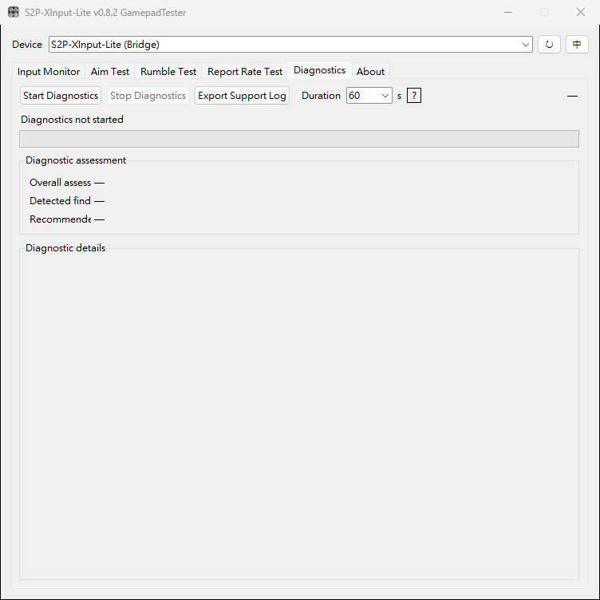

**Diagnostics** 可執行 30、60 或 120 秒的 ESP32 健康檢查：

1. 在 **Device** 選擇 S2P 裝置，選擇 **Duration**（診斷時間）。
2. 按 **Start Diagnostics**（開始診斷）。測試期間請保持手把喚醒，並操作搖桿、轉動手把、觸發震動。
3. 完成後，**Diagnostic assessment**（診斷評估）會摘要整體判定、發現項目與建議處理方式，
   **Diagnostic details**（診斷細節）列出連線、輸入、延遲、校正、感測器與震動的檢查結果。
4. 需要回報問題時，按 **Export Support Log**（匯出支援 Log）存成 UTF-8 文字檔。

橋接模式會暫時使用主程式目前的序列連線；獨立模式則直接開啟 ESP32 的診斷通道。完整的診斷命令
需要隨附的 S2P-FW 1.0.9。

### 8.9 About（關於）

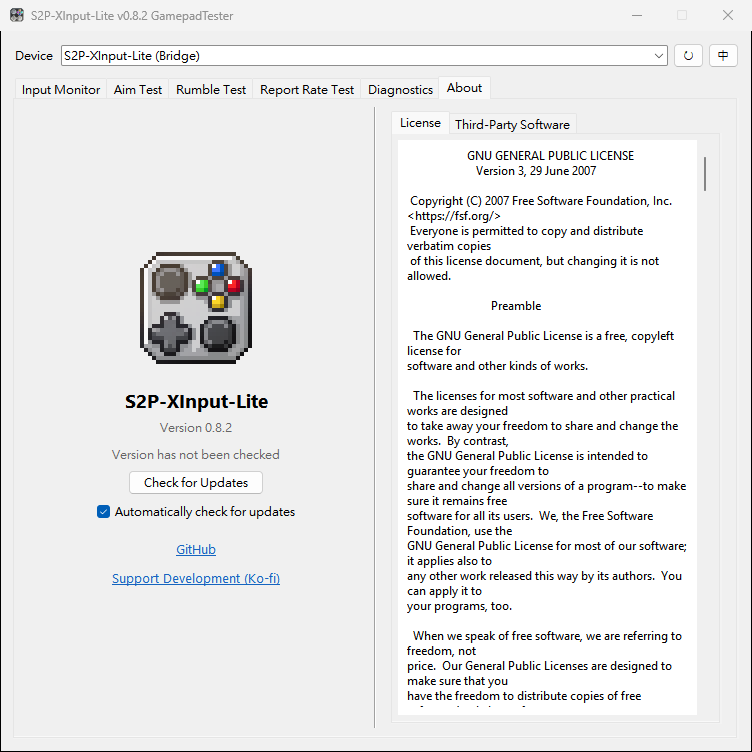

左側顯示版本、**Check for Updates**（檢查更新）、**Automatically check for updates**
（自動檢查更新），以及 GitHub 與 Ko-fi 連結。右側的 **License**（許可協議）與
**Third-Party Software**（第三方程式）頁籤顯示發佈包隨附的完整聲明。

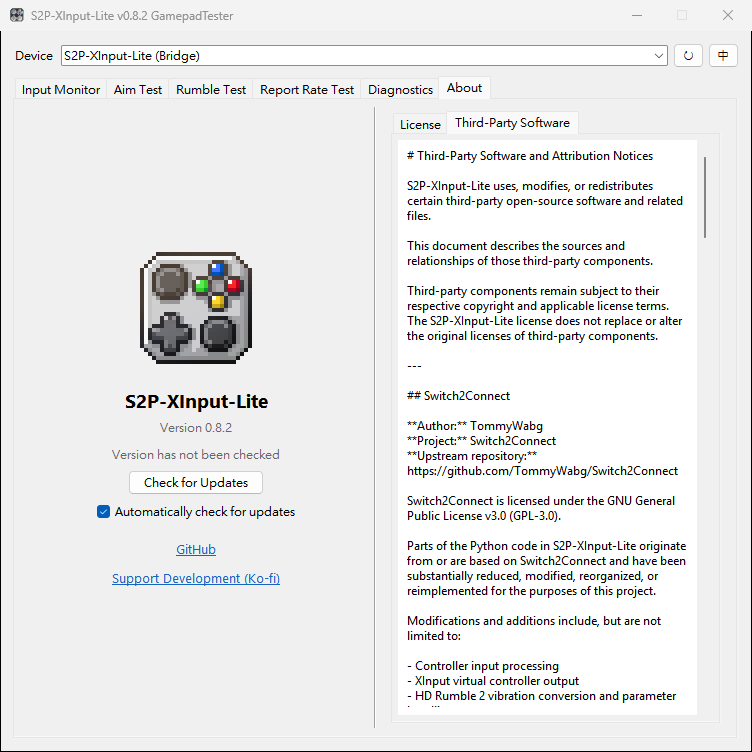

---

## 9. ESP32-S3

### 9.1 兩種運作方式

| 模式 | 需要保持 Windows 程式開啟 | USB 輸出 | 識別碼 |
|---|---|---|---|
| **ESP32 Bridge**（橋接） | 是 | CDC；桌面經 ViGEmBus 輸出 XInput | `303A:4001` |
| **Android USB HID 獨立模式** | 否 | CDC＋標準 HID，顯示為 `S2P Mobile Gamepad` | `303A:4005` |

兩種模式都保留 CDC 設定／診斷與救援通道。這些是 Espressif／TinyUSB 共用的預設 VID/PID，
不能只憑識別碼或產品名稱認定是 S2P；桌面程式會驗證韌體身分與能力。舊的 `CAFE:4020/4021/4022`
只用來辨識升級候選，無法啟用已移除的 PC XInput／Auto 模式。

舊版 NVS 的 `0=Bridge`、`2=HID` 維持原意；`1=XInput`、`3=Auto` 升級後改為 HID，桌面會提示
「獨立 PC XInput／Auto 已取消，已改為 Android USB HID；桌面 XInput 請切回 Bridge」。
未知值或讀取錯誤時以 Bridge 啟動。

手把的四顆玩家燈會累進顯示實測電量：低電量亮一顆、中低兩顆、中高三顆、高電量四顆。
獨立模式也會顯示，不需要開啟 Windows 程式。

### 9.2 刷入韌體

刷寫前請準備：

- 16 MB Flash 的 ESP32-S3 開發板。其他容量會在檢查時取消，不會寫入。
- 可傳輸資料的 USB 線，接在板子標示 **USB／OTG** 的接口（不是 **UART／COM**）。
- 找到板子上的 `BOOT` 與 `RESET`（有些板子標示為 `EN` 或 `RST`）按鍵。

**1. 確認版本**

按主視窗底部的 **Flash FW**（刷入相容韌體）。程式會先讀取目前的韌體版本，期間會顯示
「正在讀取 ESP32-S3 目前的韌體版本…」，約需數秒。

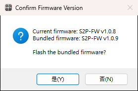

確認畫面會列出目前版本與隨附的 **S2P-FW 1.0.9**。按 **是** 繼續，按 **否** 取消；
若版本檢查曾暫停連接程式，取消後會自動恢復。版本相同時也能選擇重新刷入。

**2. 讓 ESP32-S3 進入刷機模式**

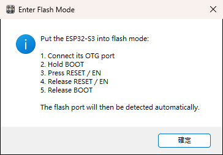

1. 先按說明視窗的 **確定**。
2. 按住 `BOOT` 不放。
3. 按一下 `RESET / EN` 再放開。
4. 最後放開 `BOOT`。

沒有 `RESET` 鍵的板子，通常是按住 `BOOT` 再插上 USB 線，接著放開 `BOOT`。

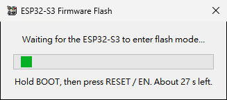

程式會顯示倒數，最多等待 30 秒。它會依 USB 身分辨識 ESP32-S3 的 ROM 刷機連接埠，
即使該 COM 已存在也能使用。逾時會顯示「未偵測到刷機連接埠」，請重新按一次 **Flash FW**。

**3. 檢查晶片與 Flash 容量**

偵測到連接埠後會先顯示連接埠名稱，按 **確定** 後開始檢查。

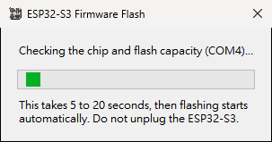

檢查約需 5 到 20 秒，只讀取資訊，不會寫入。不是 ESP32-S3 或不是 16 MB Flash 時會取消刷寫。

**4. 刷寫與重新連線**

1. 通過檢查後會自動開啟 esptool 視窗，刷寫進度顯示在該視窗。
2. 完成後會顯示「韌體刷寫完成」，ESP32 會切回橋接模式。
3. USB 重新列舉完成後，連接程式會自動啟動並重新搜尋手把。
4. 若數秒後橋接裝置仍未出現，按一下 `RESET / EN` 或重新插拔 ESP32-S3。

> [!CAUTION]
> 刷寫期間不要拔除 ESP32-S3，也不要關閉程式。刷寫失敗時會顯示 esptool 的結束代碼，
> 重新進入刷機模式後再刷一次即可。

刷入新韌體後，若使用獨立模式，請再依 [9.5](#95-寫入設定並啟用-android-usb-hid) 將方案寫入 ESP32。

### 9.3 手把與 ESP32-S3 配對

1. 將 ESP32-S3 接到電腦並啟動 S2P-XInput-Lite。
2. 需要建立新配對時，按住手把的 `SYNC`。
3. 程式偵測到 SYNC 配對連線後，會將 ESP32-S3 的配對資料寫入手把。
4. 確認狀態列的 ESP32 變為 `Connected`。

### 9.4 結束橋接連線

一般橋接請用通知區的「結束程式」退出，並等待所有 BLE 連線解除。主機工作階段建立後，CDC 連續消失
3 秒或主機心跳逾時 8 秒，ESP32 會自動釋放 BLE。Android USB HID 不需要桌面程式或 CDC/DTR，
保留原有的閒置斷線與按鍵喚醒功能。詳見[實機檢查表](../docs/bridge-host-shutdown.md)。

### 9.5 寫入設定並啟用 Android USB HID

一次只能執行一項 ESP32 寫入或模式切換。操作期間請保持連接，等完成提示後再關閉程式或開始下一項操作。

1. 選擇要寫入的方案，完成設定後按 **Save/Apply**。修改 `System Default` 後需先用 **Save New** 另存。
2. 確認 ESP32 已連線，並已刷入隨附的 S2P-FW 1.0.9。
3. 按 **ESP32 ▼**，選擇 **寫入並啟用 Android USB HID 獨立模式**。
4. 檢查相容性提示。方案包含 Windows 專用輸出時，取消修改或確認略過不支援的項目。
5. 等待寫入、長度／CRC 驗證、套用與受控重新啟動，期間保持 USB 供電。桌面程式會在重新啟動後核對
   裝置、USB 模式與方案。
6. 以資料線及必要的 OTG 轉接器連接支援 USB 主機功能的 Android 裝置。系統與遊戲必須支援 USB HID 手把。

ESP32 以 A/B 儲存槽保留上一份有效設定，新資料驗證成功才切換為有效槽。寫入或模式保存失敗時，
不要假設已經切換。

### 9.6 切回 Bridge 與救援

- **桌面選單**：將 ESP32 接回 Windows，選擇 **ESP32 ▼ → 切回 ESP32 橋接模式**，等待重新列舉與自動搜尋；
  仍未恢復時再重新插拔或按 **Restart**。
- **用手把切換**：長按 **HOME+X 3 秒再放開**，保存並切回 Bridge；長按 **HOME+A 3 秒再放開**，
  保存並切到 Android USB HID。組合鍵在套用映射與映射層之前讀取原始按鍵；Bridge 的 CDC 傳送卡住時
  仍可切到 HID。ESP32 成功保存新模式後才會重新啟動。
- **沒有手把**：兩種模式的 CDC 都接受 `mode bridge`，成功保存後以 `restart` 受控重啟。使用序列終端前，
  請先關閉占用該 COM 埠的桌面連線。
- **CDC 也無法使用**：進入晶片的 ROM Download Mode。通常是按住 **BOOT**，短按並放開 **RESET/EN**，
  再放開 **BOOT**；沒有 RESET 鍵的板子通常要按住 BOOT 重新接上 USB。各板的接線與時序可能不同，
  請依板商說明。確認 ROM 裝置後使用 [9.2](#flash-esp32-s3) 的刷寫流程；寫入前仍須通過晶片與
  16 MB Flash 檢查。

切回 Bridge 不會刪除最後保存的獨立設定。**Restart** 只重啟桌面連線。

### 9.7 獨立模式的支援範圍

**支援**：搖桿校正、曲線、中心／外圍死區、輸出形狀、防抖與平滑、按鍵與方向映射（含左右搖桿與
啟用映射層的 4WAY／8WAY 個別方向死區）、相容的映射層、線性扳機、陀螺儀轉搖桿（含圓形死區、
抑制突波與獨立的 X／Y 補償倍率）、閒置斷線與 BLE 重連。HID 提供按鍵、四軸、十字鍵與獨立類比扳機，
以及數位 L2／R2 相容輸出。

**不支援**：Windows 鍵盤／滑鼠輸出、Audio／Mix 音訊震動、依程序切換方案、陀螺儀滑鼠。HID 沒有震動
output report，不提供 Android 遊戲震動，也不提供 BLE HID。Windows 遊戲震動與音訊震動仍由 Bridge 處理。

Android 相容性依裝置、系統與遊戲而異，Apple 裝置不在支援範圍內。實機驗證狀態請見
[驗證與官方參考](../docs/usb-hid-standardization.md)。

---

## 10. 快速操作技巧

### 10.1 滑桿與數值

- 點擊滑桿右側的數值，可開啟參數輸入視窗，顯示設定範圍、步進與說明。
- 在參數名稱上按住並向右拖曳可增加數值，向左拖曳可減少；每次變化依照該參數自己的步進。
- 手把測試（含瞄準測試設定與補償視窗）的參數也能用同樣方式拖曳與右鍵還原。輸入監看、震動測試等即時數值
  不會儲存，所以它們的「還原上次儲存」會呈灰色。

### 10.2 右鍵還原

在支援的參數上按右鍵，可選擇：

- **Restore Saved**（還原上次儲存）：取消尚未儲存的修改。
- **Restore Default**（還原系統預設）：使用 `System Default` 的數值。

補償視窗的「還原上次儲存」會跟著最近一次儲存的值：

- **Gyro Compensation Settings**（陀螺儀補償設定）：方案中已儲存的倍率，包含 **Gyro Preview**（補償預覽）量測後存入的倍率。
- 補償預覽的 **Adjusted turn speeds**（調整後視角速度）：最近一次按 **Apply to Aim Test**（套用至瞄準測試）存入的速度；尚未套用時為瞄準測試設定中的速度。

### 10.3 曲線控制點

- 拖曳：直接修改控制點位置。
- 雙擊：還原該控制點預設。
- 右鍵：直接輸入 X、Y 座標。

### 10.4 說明提示

欄位旁的 **?** 會顯示該項目的說明。六頻段圖下方的說明文字也可以用游標停留，查看頻段範圍、
LF/HF Balance 的作用與控制點操作。

> [!WARNING]
> 按 **Restart** 前請先按 **Save/Apply**，否則畫面上未儲存的變更不會套用。

---

## 11. 疑難排解

### 儲存或操作提示

- **方案被外部修改**：選擇重新載入、以目前編輯覆蓋，或取消後保留目前編輯。
- **映射層已變更**：關閉該編輯視窗，重新開啟最新項目。
- **已儲存，但清單無法更新**：檔案已經儲存，稍後重新開啟方案選單即可。
- **另一項操作仍在進行**：連線、校正、刷寫與 ESP32 寫入會依序進行，等目前的操作完成再重試。

### ViGEm 不是 Ready

1. 重新安裝 ViGEmBus。
2. 重新啟動 Windows。
3. 再次執行 S2P-XInput-Lite。

### 遊戲收到兩組輸入

- USB 模式請安裝並設定 HidHide。
- 檢查 Steam Input 是否又做了一次輸入轉換。
- 確認遊戲沒有同時讀取實體手把與虛擬 XInput 手把。

### HidHide 顯示 Error

先關閉 HidHide Configuration Client，再回到 S2P-XInput-Lite 重試。若 HidHide 清單中已有其他裝置，
啟用全域隱藏也可能影響那些裝置。

### 找不到手把

- 確認 USB 線材可以傳輸資料，並重新插拔。
- Windows BLE：先從 Windows 移除舊配對，再啟動程式並按住手把的 `SYNC` 重新配對。
- ESP32：確認韌體版本與配對狀態，見 [9. ESP32-S3](#9-esp32-s3)。

### ESP32 一直顯示 Searching

- 確認 ESP32-S3 接的是正確的 USB 接口，並已刷入相容韌體。
- 重新插拔 ESP32-S3。
- 讓手把重新進入配對模式。

### 手把剛連線時搖桿有殘留數值

手把連線後輕撥兩支搖桿讓它回中即可歸零，見 [1.2](#12-安裝與第一次啟動) 的說明。

### 寫入 ESP32 時使用了舊設定

- 修改後先按 **Save/Apply**；程式提示尚未儲存時不要略過。
- 修改 `System Default` 後請用 **Save New** 建立個人方案。

### 切換獨立／橋接模式後裝置沒有出現

- 等待 ESP32 完成重新啟動與 USB 重新列舉，或拔除後重新插入。
- 回到橋接模式後會自動啟動連線；仍未恢復時按 **Restart**。
- HID 模式顯示為 `S2P Mobile Gamepad` 並保留 CDC COM；Bridge 只提供 CDC。

### 音訊震動沒有反應

- 確認 `WASAPI: Ready`，以及 Windows 預設輸出裝置正確。
- 將 **Source** 設為 **Audio** 或 **Mix**。
- 降低 **Gate** 或提高 **Lvl**。

### 安靜處仍持續震動

- 提高 **Gate**、降低 **Lvl**。
- 降低 **High** 與 **Ultra** 頻段。
- 確認麥克風監聽或系統提示音沒有送到預設輸出。

### 震動出現撞擊聲

- 降低 **Max Amp** 與 **LF/HF Strength**。
- 降低容易觸發異音的六頻段增益。
- 避免長時間使用接近 `1023` 的最大振幅。

### 陀螺儀漂移

- 將手把平放後重新執行 **Calibrate ▼** → **Sensor Calibration**。
- 遠離喇叭、磁鐵與大型金屬物。
- 必要時少量增加 **DZ**。

### 方案無法覆寫

`System Default` 是唯讀方案，請用 **Save New** 建立個人方案。

### 重啟後設定消失

- 確認修改後按過 **Save/Apply**。
- 確認程式資料夾可以寫入，且不是在壓縮檔內直接執行。

### 回復穩定設定

1. 先將可疑的參數按右鍵還原至上次儲存值。
2. 問題仍在時，切換到 `System Default` 比較。
3. 確定要全面重設時才按 **Defaults**。
4. 按 **Save/Apply**。
5. 按 **Restart**，重新測試輸入與震動。

> [!NOTE]
> **Defaults** 不會修改搖桿校正與已儲存的方案，但會停用映射層，並取消本程式的 HidHide 隱藏設定。

---

## 附錄：建議調整順序

| 項目 | 順序 |
|---|---|
| 搖桿 | 校正 → 中心死區 → 外圍死區 → 曲線 → 防抖 |
| 陀螺儀 | Sensor Calibration → Target → 啟動方式 → 感度 → X/Y 比例 → 死區 → 平滑 → 補償倍率 |
| 遊戲震動 | 先用 Game 模式與預設 Max Amp `500` 測試；有異音再降低 Max Amp 或 LF/HF Strength |
| 音訊震動 | Gate → Lvl → 六頻段 → LF/HF Balance → Tail／Decay |
| 方案管理 | 保留一個已驗證的穩定方案，實驗性設定用 **Save New** 另存 |
